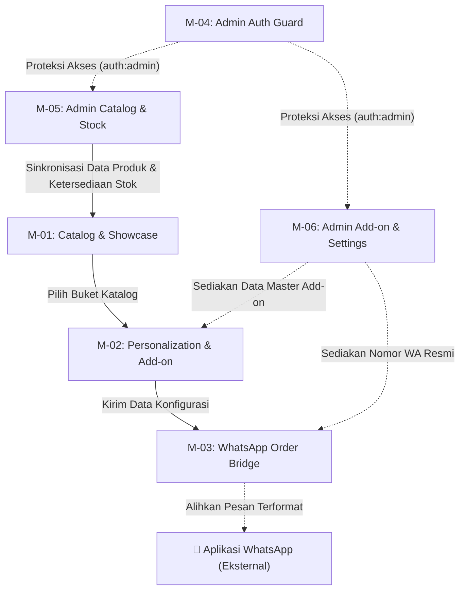

# PENETAPAN MODUL APLIKASI (APPLICATION MODULES SPECIFICATION)
## BLOOMÉ — Flowers & Stories
**Task ID:** ARC-004  
**Fase:** Phase 2 — System Analysis and Design (Sub-fase 5.3 System Architecture)  
**Penanggung Jawab:** Elsa Futri (Lead Software Architect & Backend Developer) & Jayanti Firdasari (Project Manager & System Analyst)  
**Tanggal Penyusunan:** 13 November 2026 (Revisi Final: 20 November 2026)  
**Status Task:** Completed Final (`[x]`)  
**Dependensi:** ARC-001 — Three-Layer Architecture, ARC-003 — Component Diagram  

---

## 1. Ringkasan Eksekutif & Karakteristik Modularitas

Penetapan Modul Aplikasi (Task ARC-004) bertujuan untuk membagi sistem monolitik **BLOOMÉ — Flowers & Stories** ke dalam modul-modul fungsional terpadu (*Modular Monolith*). Pendekatan ini memastikan bahwa meskipun aplikasi berjalan dalam satu basis kode Laravel, batas-batas logika (*logical boundaries*) setiap modul tetap terisolasi dengan rapi, memudahkan pemeliharaan, dan meminimalkan keterikatan antar-modul (*low coupling*).

Sesuai ketentuan arsitektur terkini:
- Seluruh modul transaksional web (checkout pesanan, verifikasi pembayaran online, pelacakan status pesanan) ditiadakan.
- Sistem difokuskan pada 6 modul fungsional inti yang mendukung katalog interaktif, personalisasi buket, pengalihan pemesanan ke WhatsApp, serta pengelolaan konten back-office oleh pemilik usaha.

---

## 2. Dekomposisi 6 Modul Aplikasi Utama

| No | Modul Aplikasi | Ranah (*Domain*) | Tanggung Jawab Utama | Aktor Pengguna |
|---|---|---|---|---|
| **M-01** | **Catalog & Showcase Module** | Public Domain | Mengelola penelusuran katalog buket, penapisan (*filtering*) kategori, dan pratinjau detail produk buket. | Customer (Guest) |
| **M-02** | **Interactive Personalization & Add-on Module** | Public Domain | Mengelola antarmuka konfigurasi buket (pilihan warna wrapping, pita satin, checklist add-on, teks kartu ucapan) dan kalkulator live estimasi biaya. | Customer (Guest) |
| **M-03** | **WhatsApp Order Bridge Module** | Public / Boundary | Mengekstrak data formulir, mengompilasi template pesan teks terstruktur, mengenkoding parameter URL, dan mengalihkan peramban ke aplikasi WhatsApp. | Customer (Guest) |
| **M-04** | **Admin Authentication & Guard Module** | Admin Domain | Mengamankan akses panel administrasi untuk satu akun admin pemilik usaha (Nabila Febriyani) via guard `auth:admin`, proteksi CSRF, dan rate limiting. | Admin (Owner) |
| **M-05** | **Admin Catalog & Stock Management Module** | Admin Domain | Operasi CRUD master kategori buket, CRUD produk katalog, unggah foto produk resmi (≤ 5MB) ke storage lokal, dan toggle ketersediaan stok (*is_available*). | Admin (Owner) |
| **M-06** | **Admin Add-on & Business Settings Module** | Admin Domain | Operasi CRUD master item add-on (nama item & tarif tambahan), serta pembaruan nomor kontak WhatsApp resmi butik dan informasi profil bisnis. | Admin (Owner) |

---

## 3. Matriks Interaksi & Komunikasi Antar-Modul

---

## 4. Rincian Batasan Fungsional Setiap Modul

### M-01: Catalog & Showcase Module
- Bertanggung jawab merender halaman beranda (`/`), etalase katalog (`/katalog`), dan detail buket (`/katalog/{slug}`).
- Menyediakan penapisan kategori yang instan tanpa membebani server (*efficient SQL indexing pada is_available dan category_id*).

### M-02: Interactive Personalization & Add-on Module
- Beroperasi secara reaktif pada sisi klien melalui antarmuka Blade dan skrip `personalization.js`.
- Memungkinkan penyesuaian warna kertas pembungkus (*wrapping*), warna pita satin, penambahan item pelengkap berbayar (boneka wisuda, cokelat, lampu LED), serta penulisan pesan kartu ucapan.
- Menghitung live estimasi total biaya: $\text{Total} = \text{Harga Dasar Buket} + \sum \text{Harga Add-on}$.

### M-03: WhatsApp Order Bridge Module
- Menjembatani sistem web dengan obrolan WhatsApp pemilik butik.
- Mengompilasi seluruh parameter konfigurasi buket ke dalam format teks pesan yang humanis dan rapi.
- Mengamankan parameter melalui fungsi `rawurlencode()` dan merakit URL universal `https://wa.me/{nomor}?text={encoded_message}`.

### M-04: Admin Authentication & Guard Module
- Menangani otentikasi satu akun admin melalui email dan kata sandi terenkripsi Bcrypt.
- Melindungi seluruh rute `/admin/*` menggunakan middleware `auth:admin`.
- Mencegah serangan brute force melalui pembatasan frekuensi request (*rate limiting*).

### M-05: Admin Catalog & Stock Management Module
- Menyediakan fasilitas bagi Nabila Febriyani untuk menambah buket baru lengkap dengan unggahan foto resmi ke `storage/app/public/products/`.
- Menyediakan sakelar cepat (*stock toggle*) untuk mengubah status ketersediaan bunga segar secara seketika (*real-time*).

### M-06: Admin Add-on & Business Settings Module
- Memfasilitasi pemeliharaan opsi add-on pelengkap beserta tarif harganya.
- Memungkinkan pembaruan nomor WhatsApp resmi butik Samarinda secara dinamis tanpa perlu mengubah baris kode program.

---

## 5. Kesimpulan
Task **ARC-004 (Application Modules Specification)** telah selesai direvisi penuh. Dekomposisi 6 modul aplikasi terbebas dari alur transaksi website dan terfokus pada katalog, personalisasi, jembatan WhatsApp, dan pemeliharaan konten back-office.
