# SPESIFIKASI ARSITEKTUR ROUTING (ROUTING ARCHITECTURE SPECIFICATION)
## BLOOMÉ — Flowers & Stories
**Task ID:** ARC-005  
**Fase:** Phase 2 — System Analysis and Design (Sub-fase 5.3 System Architecture)  
**Penanggung Jawab:** Elsa Futri (Lead Software Architect & Backend Developer) & Jayanti Firdasari (Project Manager & System Analyst)  
**Tanggal Penyusunan:** 13 November 2026  
**Status Task:** Completed (`[x]`)  
**Dependensi:** ARC-001 — Three-Layer Architecture, ARC-004 — Application Modules  

---

## 1. Ringkasan Eksekutif & Prinsip Desain Routing

Penetapan Arsitektur Routing (Task ARC-005) bertujuan untuk memetakan seluruh rute HTTP pada website **BLOOMÉ — Flowers & Stories** ke dalam pola yang aman, semantik, RESTful, dan terstruktur rapi di dalam `routes/web.php`.

### 1.1 Prinsip Perancangan Routing
1. **Pemisahan Tegas Antara Domain Publik dan Admin:**
   - Rute Publik (*Guest Domain*): Bebas diakses tanpa autentikasi, tanpa fitur registrasi akun pelanggan (*guest checkout*).
   - Rute Admin (*Protected Domain*): Berada di bawah prefix `/admin`, dilindungi middleware autentikasi kustom `auth:admin`, proteksi sesi aktif, dan perlindungan *rate limiting*.
2. **Kepatuhan Konvensi RESTful & Semantik:** Menggunakan kata kerja HTTP yang tepat (`GET`, `POST`, `PUT`/`PATCH`, `DELETE`) dengan penamaan rute (*named routes*) berkonsistensi tinggi (`catalog.*`, `custom.*`, `order.*`, `admin.*`).
3. **Validasi Parameter Rute (Route Model Binding / RegEx Constraints):** Rute publik yang menerima kode pesanan atau slug produk dibatasi dengan ekspresi reguler ketat (contoh: slug buket `[a-z0-9-]+` dan kode pesanan `BLM-[0-9]{6}-[0-9]{4}`).
4. **Proteksi CSRF Universal:** Seluruh rute bermetode `POST`, `PUT`, `PATCH`, dan `DELETE` secara otomatis melewati middleware `VerifyCsrfToken`.

---

## 2. Diagram Hirarki & Topologi Routing

```mermaid
graph TD
    Request["Incoming HTTP Request"] --> Router["Laravel Router (routes/web.php)"]
    
    subgraph PublicRoutes ["1. Rute Publik (Guest Domain)"]
        direction TB
        R_Home["GET / -> HomeController@index (home)"]
        R_Catalog["GET /katalog -> CatalogController@index (catalog.index)"]
        R_Product["GET /katalog/{slug} -> CatalogController@show (catalog.show)"]
        R_Order["GET & POST /pesan/{slug} -> OrderController (order.create/store)"]
        R_Custom["GET & POST /custom-bouquet -> CustomBouquetController (custom.create/store)"]
        R_Tracking["GET /lacak-pesanan & GET /lacak-pesanan/{order_code} -> TrackingController"]
        R_PayConfirm["GET & POST /pembayaran/{order_code} -> PaymentController"]
        R_Cancel["POST /pesanan/{order_code}/batal -> OrderController@requestCancel"]
        R_Static["GET /tentang-kami & GET /kontak -> StaticPageController"]
    end

    subgraph AdminRoutes ["2. Rute Terproteksi (/admin)"]
        direction TB
        R_Login["GET & POST /admin/login -> AdminAuthController (admin.login)"]
        R_Logout["POST /admin/logout -> AdminAuthController@logout (admin.logout)"]
        
        subgraph AdminProtected ["Middleware: auth:admin"]
            direction TB
            A_Dash["GET /admin/dashboard -> AdminDashboardController (admin.dashboard)"]
            A_Prod["CRUD /admin/produk -> AdminProductController (admin.products.*)"]
            A_Cat["CRUD /admin/kategori -> AdminCategoryController (admin.categories.*)"]
            A_Ord["GET & PATCH /admin/pesanan -> AdminOrderController (admin.orders.*)"]
            A_CustomReq["GET & POST /admin/custom-requests -> AdminCustomRequestController"]
            A_PayAudit["GET & PATCH /admin/pembayaran -> AdminPaymentController"]
            A_Status["POST /admin/pesanan/{id}/status -> AdminOrderStatusController"]
            A_CancelApprove["POST /admin/pesanan/{id}/batal -> AdminCancellationController"]
            A_Settings["GET & PUT /admin/pengaturan -> AdminSettingController"]
        end
    end

    Router --> PublicRoutes
    Router --> AdminRoutes
```

---

## 3. Matriks Lengkap Rute Sistem BLOOMÉ

### 3.1 Rute Publik (Tamu & Pelanggan)

| Metode | URI Endpoint | Nama Rute (*Named Route*) | Controller & Action | Middleware | Deskripsi Fungsional |
|---|---|---|---|---|---|
| `GET` | `/` | `home` | `HomeController@index` | `web` | Landing page etalase butik dan banner promosi. |
| `GET` | `/katalog` | `catalog.index` | `CatalogController@index` | `web` | Daftar seluruh produk buket dengan filter kategori. |
| `GET` | `/katalog/{slug}` | `catalog.show` | `CatalogController@show` | `web` | Halaman detail spesifikasi bunga, harga, dan ketersediaan. |
| `GET` | `/pesan/{slug}` | `order.create` | `OrderController@create` | `web` | Formulir pemesanan buket katalog (*guest checkout*). |
| `POST` | `/pesan/{slug}` | `order.store` | `OrderController@store` | `web` | Menyimpan pesanan katalog baru ke basis data. |
| `GET` | `/custom-bouquet` | `custom.create` | `CustomBouquetController@create` | `web` | Formulir permintaan personalisasi buket custom. |
| `POST` | `/custom-bouquet` | `custom.store` | `CustomBouquetController@store` | `web`, `throttle:6,1` | Menyimpan tiket custom dan unggah maks 3 foto (≤5MB). |
| `GET` | `/custom-bouquet/sukses/{code}` | `custom.success` | `CustomBouquetController@success` | `web` | Halaman konfirmasi pengajuan kustomisasi diterima. |
| `GET` | `/pesanan/{order_code}` | `order.summary` | `OrderController@summary` | `web` | Halaman ringkasan detail pesanan dan instruksi bayar. |
| `GET` | `/lacak-pesanan` | `tracking.index` | `TrackingController@index` | `web` | Formulir pencarian pesanan dengan kode pesanan unik. |
| `GET` | `/lacak-pesanan/{order_code}` | `tracking.show` | `TrackingController@show` | `web` | Visualisasi status terkini dari pesanan buket. |
| `GET` | `/pembayaran/{order_code}` | `payment.create` | `PaymentController@create` | `web` | Form konfirmasi pembayaran dan rekening bank butik. |
| `POST` | `/pembayaran/{order_code}` | `payment.store` | `PaymentController@store` | `web`, `throttle:5,1` | Unggah bukti transfer dan kirim konfirmasi. |
| `POST` | `/pesanan/{order_code}/batal` | `order.cancel` | `OrderController@cancel` | `web` | Permohonan pembatalan pesanan oleh pelanggan. |
| `GET` | `/tentang-kami` | `static.about` | `StaticPageController@about` | `web` | Profil butik BLOOMÉ Samarinda dan filosofi merek. |
| `GET` | `/kontak` | `static.contact` | `StaticPageController@contact` | `web` | Informasi alamat fisik, jam operasional, dan tautan WhatsApp. |

### 3.2 Rute Otentikasi Admin

| Metode | URI Endpoint | Nama Rute | Controller & Action | Middleware | Deskripsi Fungsional |
|---|---|---|---|---|---|
| `GET` | `/admin/login` | `admin.login` | `AdminAuthController@showLoginForm` | `web`, `guest:admin` | Menampilkan formulir login admin (Nabila). |
| `POST` | `/admin/login` | `admin.login.submit` | `AdminAuthController@login` | `web`, `guest:admin`, `throttle:5,1` | Memvalidasi kredensial login admin dengan Bcrypt. |
| `POST` | `/admin/logout` | `admin.logout` | `AdminAuthController@logout` | `web`, `auth:admin` | Mengakhiri sesi admin dan meregenerasi CSRF token. |

### 3.3 Rute Dashboard & Manajemen Admin (Prefix: `/admin`, Middleware: `auth:admin`)

| Metode | URI Endpoint | Nama Rute | Controller & Action | Deskripsi Fungsional |
|---|---|---|---|---|
| `GET` | `/admin/dashboard` | `admin.dashboard` | `AdminDashboardController@index` | Ringkasan metrik pesanan baru, tiket custom, dan omzet harian. |
| `GET` | `/admin/produk` | `admin.products.index` | `AdminProductController@index` | Tabel manajemen master produk buket. |
| `GET` | `/admin/produk/tambah` | `admin.products.create` | `AdminProductController@create` | Formulir penambahan produk buket baru. |
| `POST` | `/admin/produk` | `admin.products.store` | `AdminProductController@store` | Menyimpan produk baru beserta gambar produk. |
| `GET` | `/admin/produk/{id}/edit` | `admin.products.edit` | `AdminProductController@edit` | Formulir perubahan data produk buket. |
| `PUT` | `/admin/produk/{id}` | `admin.products.update` | `AdminProductController@update` | Memperbarui informasi produk buket. |
| `PATCH` | `/admin/produk/{id}/toggle` | `admin.products.toggle` | `AdminProductController@toggleStatus` | Mengubah status stok produk (*Tersedia / Habis*). |
| `DELETE` | `/admin/produk/{id}` | `admin.products.destroy` | `AdminProductController@destroy` | Menghapus produk (dibatasi jika ada riwayat pesanan). |
| `GET` | `/admin/kategori` | `admin.categories.index` | `AdminCategoryController@index` | Manajemen kategori buket (Bunga, Uang, Snack, Balon). |
| `POST` | `/admin/kategori` | `admin.categories.store` | `AdminCategoryController@store` | Menambahkan kategori buket baru. |
| `PUT` | `/admin/kategori/{id}` | `admin.categories.update` | `AdminCategoryController@update` | Mengubah nama atau slug kategori buket. |
| `DELETE` | `/admin/kategori/{id}` | `admin.categories.destroy` | `AdminCategoryController@destroy` | Menghapus kategori jika tidak memiliki produk terkait. |
| `GET` | `/admin/pesanan` | `admin.orders.index` | `AdminOrderController@index` | Daftar master pesanan masuk dengan filter status harian. |
| `GET` | `/admin/pesanan/{id}` | `admin.orders.show` | `AdminOrderController@show` | Rincian lengkap pesanan, kartu ucapan, dan log status. |
| `POST` | `/admin/pesanan/{id}/status` | `admin.orders.update_status` | `AdminOrderStatusController@update` | Transisi status fisik pesanan (FSM: Diproses -> Siap -> Selesai). |
| `GET` | `/admin/custom-requests` | `admin.custom.index` | `AdminCustomRequestController@index` | Antrean pengajuan pesanan buket kustom yang perlu ditinjau. |
| `GET` | `/admin/custom-requests/{id}` | `admin.custom.show` | `AdminCustomRequestController@show` | Detail preferensi pelanggan dan galeri foto referensi. |
| `POST` | `/admin/custom-requests/{id}/pricing` | `admin.custom.set_price` | `AdminCustomRequestController@setPrice` | Menetapkan estimasi harga final buket kustom (BR-007). |
| `GET` | `/admin/pembayaran` | `admin.payments.index` | `AdminPaymentController@index` | Daftar bukti transfer bank/e-wallet menunggu verifikasi. |
| `PATCH` | `/admin/pembayaran/{id}/verifikasi` | `admin.payments.verify` | `AdminPaymentController@verify` | Menyetujui bukti transfer dana manual (Status -> Diproses). |
| `PATCH` | `/admin/pembayaran/{id}/tolak` | `admin.payments.reject` | `AdminPaymentController@reject` | Menolak bukti transfer dan meminta unggah ulang bukti. |
| `GET` | `/admin/pembatalan` | `admin.cancellations.index` | `AdminCancellationController@index` | Pengajuan pembatalan yang memerlukan persetujuan admin. |
| `PATCH` | `/admin/pembatalan/{id}/proses` | `admin.cancellations.process` | `AdminCancellationController@process` | Eksekusi persetujuan atau penolakan pembatalan pesanan. |
| `GET` | `/admin/pengaturan` | `admin.settings.index` | `AdminSettingController@index` | Pengaturan profil admin, nomor rekening, dan kontak WhatsApp. |
| `PUT` | `/admin/pengaturan` | `admin.settings.update` | `AdminSettingController@update` | Memperbarui profil toko dan konfigurasi operasional. |

---

## 4. Kesimpulan & Rekomendasi
Task **ARC-005 (Menentukan Routing Architecture)** telah selesai. Seluruh 35 endpoint aplikasi telah dipetakan dengan rapi, lengkap dengan metode HTTP, nama rute semantik, middleware keamanan, dan controller pengendali.

