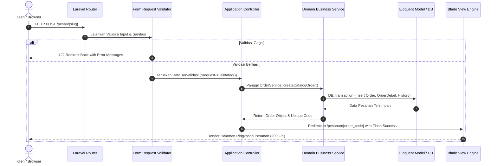

# SPESIFIKASI TANGGUNG JAWAB CONTROLLER (CONTROLLER RESPONSIBILITIES SPECIFICATION)
## BLOOMÉ — Flowers & Stories
**Task ID:** ARC-006  
**Fase:** Phase 2 — System Analysis and Design (Sub-fase 5.3 System Architecture)  
**Penanggung Jawab:** Elsa Futri (Lead Software Architect & Backend Developer) & Jayanti Firdasari (Project Manager & System Analyst)  
**Tanggal Penyusunan:** 13 November 2026  
**Status Task:** Completed (`[x]`)  
**Dependensi:** ARC-001 — Three-Layer Architecture, ARC-005 — Routing Architecture  

---

## 1. Ringkasan Eksekutif & Prinsip Desain Controller

Penetapan Tanggung Jawab Controller (Task ARC-006) merumuskan secara tegas batas kerja seluruh berkas Controller di dalam namespace `App\Http\Controllers` pada proyek **BLOOMÉ — Flowers & Stories**.

### 1.1 Prinsip Desain: *Skinny Controller, Fat Service*
1. **Pemisahan Logika Bisnis:** Controller tidak boleh mengeksekusi kalkulasi matematis rumit, manipulasi berkas biner secara langsung, atau logika transisi state yang bercabang. Tugas tersebut didelegasikan kepada kelas Service di `App\Services`.
2. **Validasi Melalui Form Requests:** Controller tidak boleh menulis aturan `$request->validate([...])` yang panjang di dalam method. Semua validasi input dibungkus dalam kelas Form Request khusus (`App\Http\Requests`).
3. **Penanganan Respon Seragam:** Controller bertindak sebagai orkestrator yang menerima HTTP Request, memanggil Service/Model, dan mengembalikan HTTP Response berupa Blade View atau HTTP Redirect beserta *Flash Session Message*.
4. **Pencegahan Kebocoran Kueri Database:** Controller tidak boleh menjalankan kueri SQL mentah (*raw queries*) atau logika Eloquent yang bertumpuk (*query chaining* lebih dari 2 tingkat). Operasi kueri kompleks wajib dibungkus dalam Eloquent Query Scopes.

---

## 2. Diagram Interaksi Controller dalam Arsitektur Tiga Lapis

---

## 3. Spesifikasi Rinci Controller Publik (*Public Domain*)

### 3.1 `HomeController` (`App\Http\Controllers\HomeController`)
- **Tanggung Jawab:** Menyajikan landing page butik bunga BLOOMÉ.
- **Method `index()`:**
  - Mengambil 6 produk unggulan (*featured bouquets*) yang berstatus aktif (`is_available = true`).
  - Mengambil daftar kategori utama untuk navigasi cepat.
  - Mengembalikan view `customer.home`.

### 3.2 `CatalogController` (`App\Http\Controllers\CatalogController`)
- **Tanggung Jawab:** Mengelola etalase katalog produk untuk pengunjung.
- **Method `index(Request $request)`:**
  - Menangani filter berdasarkan kategori (`category_id` / `slug`).
  - Menangani pengurutan harga (*termurah*, *termahal*, *terbaru*).
  - Melakukan paginasi 9 produk per halaman.
  - Mengembalikan view `customer.catalog.index`.
- **Method `show(string $slug)`:**
  - Mengambil rincian produk berdasarkan slug unik beserta kategori relasinya.
  - Menampilkan rekomendasi 3 produk terkait dari kategori yang sama.
  - Mengembalikan view `customer.catalog.show`.

### 3.3 `OrderController` (`App\Http\Controllers\OrderController`)
- **Tanggung Jawab:** Mengorkestrasi pemesanan produk katalog siap pesan (*guest checkout*).
- **Method `create(string $slug)`:**
  - Memastikan produk yang dipilih masih tersedia (`is_available = true`).
  - Menyiapkan formulir pemesanan dengan tanggal kebutuhan minimal $H+1$.
  - Mengembalikan view `customer.order.create`.
- **Method `store(StoreCatalogOrderRequest $request, string $slug)`:**
  - Menerima data tervalidasi: nama pemesan, no. WhatsApp, alamat pengiriman, tanggal kebutuhan, ucapan kartu bunga.
  - Memanggil `OrderCreationService` untuk generate kode `BLM-YYYYMM-XXXX` dan eksekusi transaksi basis data (`orders`, `order_details`, `order_status_histories`).
  - Mengarahkan ke rute `order.summary` dengan pesan sukses.
- **Method `summary(string $order_code)`:**
  - Mengambil rincian pesanan dan rekening butik.
  - Mengembalikan view `customer.order.summary`.
- **Method `cancel(CancelOrderRequest $request, string $order_code)`:**
  - Memverifikasi status pesanan (hanya status `ST-01 Menunggu Pembayaran` yang dapat dibatalkan mandiri - BR-017).
  - Mengupdate status menjadi `ST-08 Dibatalkan`.
  - Mengembalikan redirect dengan flash message.

### 3.4 `CustomBouquetController` (`App\Http\Controllers\CustomBouquetController`)
- **Tanggung Jawab:** Menangani alur pengajuan buket bunga personalisasi custom.
- **Method `create()`:**
  - Menampilkan formulir spesifikasi custom: budget estimasi, preferensi warna, jenis wrapping, tema acara, pesan kartu.
  - Mengembalikan view `customer.custom.create`.
- **Method `store(StoreCustomOrderRequest $request)`:**
  - Menerima data spesifikasi dan berkas unggahan foto referensi (maks 3 file, masing-masing ≤ 5MB).
  - Mendelegasikan penyimpanan berkas ke `FileUploadService`.
  - Membuat entitas `orders` (status awal `ST-04 Menunggu Konfirmasi Harga Custom`) dan `custom_requests`.
  - Mengarahkan ke rute `custom.success` dengan menampilkan kode tiket.
- **Method `success(string $order_code)`:**
  - Mengembalikan view `customer.custom.success`.

### 3.5 `PaymentController` (`App\Http\Controllers\PaymentController`)
- **Tanggung Jawab:** Mengelola konfirmasi pembayaran manual oleh pelanggan.
- **Method `create(string $order_code)`:**
  - Menampilkan rincian nominal tagihan dan daftar rekening resmi toko (BCA, Mandiri, Dana).
  - Mengembalikan view `customer.payment.create`.
- **Method `store(StorePaymentProofRequest $request, string $order_code)`:**
  - Memvalidasi unggahan berkas bukti transfer (JPG/PNG, ≤ 5MB).
  - Menyimpan bukti transfer via `FileUploadService`.
  - Mencatat entitas `payments` dan memperbarui status pesanan menjadi `ST-02 Menunggu Verifikasi Pembayaran`.
  - Mengarahkan kembali ke halaman pelacakan dengan pesan konfirmasi.

### 3.6 `TrackingController` (`App\Http\Controllers\TrackingController`)
- **Tanggung Jawab:** Melayani pencarian dan visualisasi status pesanan pelanggan.
- **Method `index()`:** Menampilkan antarmuka pencarian kode pesanan (`customer.tracking.index`).
- **Method `show(string $order_code)`:**
  - Mengambil pesanan beserta relasi rincian, kustomisasi, pembayaran, dan riwayat status kronologis.
  - Mengembalikan view `customer.tracking.show`.

---

## 4. Spesifikasi Rinci Controller Admin (*Admin Domain*)

### 4.1 `AdminAuthController` (`App\Http\Controllers\Admin\AdminAuthController`)
- **Tanggung Jawab:** Otentikasi sesi tunggal untuk Nabila Febriyani.
- **Method `showLoginForm()`:** Menampilkan formulir login admin (`admin.auth.login`).
- **Method `login(AdminLoginRequest $request)`:**
  - Memvalidasi kombinasi email dan password menggunakan `Auth::guard('admin')->attempt(...)`.
  - Menerapkan *rate limiting* (maks 5 percobaan gagal per menit).
  - Meregenerasi ID sesi pengguna untuk mencegah *Session Fixation*.
  - Mengarahkan ke `admin.dashboard`.
- **Method `logout(Request $request)`:**
  - Melakukan `Auth::guard('admin')->logout()`.
  - Menginvalidasi sesi dan meregenerasi CSRF token.
  - Mengarahkan kembali ke halaman login.

### 4.2 `AdminDashboardController` (`App\Http\Controllers\Admin\AdminDashboardController`)
- **Tanggung Jawab:** Menyajikan ringkasan analitik dan metrik operasional toko harian.
- **Method `index()`:**
  - Mengumpulkan metrik: Total Pesanan Masuk Hari Ini, Pesanan Menunggu Verifikasi Pembayaran (`ST-02`), Permintaan Custom Butuh Penentuan Harga (`ST-04`), dan Total Omzet Terverifikasi Bulan Berjalan.
  - Mengambil 5 pesanan terbaru yang membutuhkan tindakan segera.
  - Mengembalikan view `admin.dashboard.index`.

### 4.3 `AdminProductController` & `AdminCategoryController`
- **Tanggung Jawab:** Manajemen katalog master produk dan kategori buket.
- **Operasi:** Standar CRUD (Create, Read, Update, Delete) serta aksi `toggleStatus()` untuk menyalakan/mematikan ketersediaan stok buket secara instan.
- **Pengamanan Penghapusan:** Kategori atau produk yang telah terikat riwayat pesanan dilarang dihapus secara permanen (*referential constraint enforcement*).

### 4.4 `AdminOrderController` & `AdminOrderStatusController`
- **Tanggung Jawab:** Pemantauan daftar pesanan dan eksekusi perubahan status fisik buket.
- **Method `index(Request $request)`:** Menyajikan tabel pesanan terfilter (berdasarkan status, tanggal kebutuhan, atau kata kunci nama pemesan).
- **Method `show(int $id)`:** Menampilkan rincian lengkap pesanan, ucapan kartu, kontak WhatsApp pelanggan, dan histori log.
- **Method `updateStatus(UpdateOrderStatusRequest $request, int $id)`:**
  - Memanggil `OrderStatusStateMachineService` untuk memvalidasi bahwa transisi status mematuhi alur resmi (misal: ST-05 -> ST-06 -> ST-07).
  - Mencatat nama admin dan catatan transisi ke tabel `order_status_histories`.

### 4.5 `AdminCustomRequestController`
- **Tanggung Jawab:** Evaluasi tiket custom dan penentuan harga penawaran.
- **Method `index()`:** Menampilkan antrean tiket buket custom yang masuk.
- **Method `show(int $id)`:** Menampilkan detail preferensi bahan, warna, tema, dan foto referensi.
- **Method `setPrice(SetCustomPriceRequest $request, int $id)`:**
  - Memasukkan estimasi harga final yang disetujui florist (BR-007).
  - Memperbarui total harga di tabel `orders` dan mengubah status pesanan menjadi `ST-01 Menunggu Pembayaran`.
  - Menghasilkan tautan pesan WhatsApp otomatis (*universal link*) untuk memberi tahu pelanggan mengenai nominal harga final.

### 4.6 `AdminPaymentController`
- **Tanggung Jawab:** Audit mutasi rekening bank dan verifikasi transfer manual.
- **Method `index()`:** Menampilkan antrean bukti bayar yang menunggu audit.
- **Method `verify(int $id)`:**
  - Menandai pembayaran sebagai `verified`.
  - Mengubah status pesanan menjadi `ST-05 Diproses` (florist mulai merangkai bunga).
- **Method `reject(RejectPaymentRequest $request, int $id)`:**
  - Menandai pembayaran sebagai `rejected` dengan alasan penolakan (misal: nominal tidak cocok, mutasi tidak ditemukan).
  - Mengubah status pesanan menjadi `ST-03 Pembayaran Ditolak`.

---

## 5. Kesimpulan & Rekomendasi
Task **ARC-006 (Menentukan Controller Responsibilities)** telah selesai. Seluruh 11 controller aplikasi telah dirinci tugasnya, parameter masukannya, Form Request terkait, serta keterikatan layanannya.

