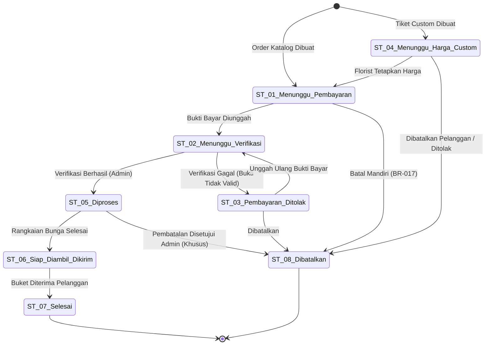

# SPESIFIKASI TANGGUNG JAWAB SERVICE (SERVICE RESPONSIBILITIES SPECIFICATION)
## BLOOMÉ — Flowers & Stories
**Task ID:** ARC-007  
**Fase:** Phase 2 — System Analysis and Design (Sub-fase 5.3 System Architecture)  
**Penanggung Jawab:** Elsa Futri (Lead Software Architect & Backend Developer) & Jayanti Firdasari (Project Manager & System Analyst)  
**Tanggal Penyusunan:** 13 November 2026  
**Status Task:** Completed (`[x]`)  
**Dependensi:** ARC-001 — Three-Layer Architecture, ARC-006 — Controller Responsibilities  

---

## 1. Ringkasan Eksekutif & Prinsip Lapisan Layanan (*Domain Service Layer*)

Penetapan Tanggung Jawab Service (Task ARC-007) merumuskan spesifikasi logika bisnis murni (*pure business logic*) yang diisolasi di dalam direktori `app/Services/`. 

Sebagai perwujudan prinsip *Separation of Concerns*, Application Service bertanggung jawab untuk:
1. **Enkapsulasi Aturan Bisnis Inti (*Core Business Invariants*):** Memastikan seluruh aturan bisnis (BR-001 hingga BR-025) ditegakkan secara konsisten tanpa duplikasi di berbagai controller.
2. **Pengelolaan Transaksi ACID Database:** Membungkus operasi manipulasi multi-tabel di dalam blok transaksi terisolasi (`DB::transaction`).
3. **Penyedia Layanan Mandiri (*Stateless & Dependency Injection Friendly*):** Seluruh kelas service bersifat mandiri, dapat diuji secara terisolasi melalui unit test (*mockable*), dan diinjeksikan secara otomatis melalui Service Container Laravel.

---

## 2. Diagram Finite State Machine (FSM) Siklus Status Pesanan

Logika transisi status dikontrol secara terpusat oleh `OrderStatusStateMachineService`:



---

## 3. Spesifikasi Rinci 5 Layanan Bisnis Utama

### 3.1 `OrderCodeGeneratorService` (`App\Services\OrderCodeGeneratorService`)
- **Tujuan:** Menghasilkan kode identifikasi unik pesanan berformat `BLM-YYYYMM-XXXX`.
- **Spesifikasi Format:**
  - `BLM`: Prefix singkatan resmi produk BLOOMÉ.
  - `YYYYMM`: 4 digit tahun dan 2 digit bulan kalender pembuatan pesanan (contoh: `202611`).
  - `XXXX`: 4 digit nomor urut sekuensial yang di-reset setiap pergantian bulan kalender (contoh: `0001`, `0002`).
- **Pencegahan Kondisi Balapan (*Race Condition Prevention*):**
  - Menggunakan kueri penguncian transaksi basis data:
    ```php
    $latestOrder = Order::where('order_code', 'LIKE', "BLM-{$yearMonth}-%")
        ->lockForUpdate()
        ->latest('id')
        ->first();
    ```
  - Menghitung urutan berikutnya secara atomik dalam satu blok transaksi database InnoDB.

### 3.2 `OrderStatusStateMachineService` (`App\Services\OrderStatusStateMachineService`)
- **Tujuan:** Memvalidasi dan mengeksekusi transisi status pesanan dari 8 status resmi (ST-01 hingga ST-08).
- **Aturan Transisi Legal (Legal Transitions Matrix):**
  ```php
  private const LEGAL_TRANSITIONS = [
      'ST-01' => ['ST-02', 'ST-08'],
      'ST-02' => ['ST-05', 'ST-03'],
      'ST-03' => ['ST-02', 'ST-08'],
      'ST-04' => ['ST-01', 'ST-08'],
      'ST-05' => ['ST-06', 'ST-08'],
      'ST-06' => ['ST-07'],
      'ST-07' => [], // Final state
      'ST-08' => []  // Final state
  ];
  ```
- **Tanggung Jawab Eksekusi:**
  1. Memeriksa apakah status saat ini dapat berpindah ke status target. Melempar `InvalidStatusTransitionException` jika transisi tidak sah.
  2. Memperbarui kolom `current_status` pada tabel `orders`.
  3. Menyisipkan rekaman audit kronologis pada tabel `order_status_histories` (mencatat aktor pembaru: `System`, `Customer`, atau `Admin: Nabila`, beserta catatan alasan perubahan).

### 3.3 `CustomPriceService` (`App\Services\CustomPriceService`)
- **Tujuan:** Mengelola kalkulasi harga dan penetapan penawaran buket custom oleh admin florist.
- **Tanggung Jawab:**
  1. Menerima nominal harga usulan admin untuk permintaan custom tertentu.
  2. Memvalidasi bahwa nominal tidak boleh negatif dan harus berupa angka bulat rupiah (minimal Rp10.000).
  3. Memperbarui atribut `agreed_price` pada entitas `custom_requests` dan `total_amount` pada entitas `orders`.
  4. Memicu transisi status dari `ST-04 Menunggu Konfirmasi Harga Custom` ke `ST-01 Menunggu Pembayaran`.
  5. Menghasilkan draf teks WhatsApp konfirmasi harga untuk dikirimkan admin kepada pemesan.

### 3.4 `FileUploadSanitizerService` (`App\Services\FileUploadSanitizerService`)
- **Tujuan:** Mengelola validasi keamanan, sanitasi nama, dan penyimpanan berkas unggahan gambar (foto referensi custom dan bukti transfer bank).
- **Tanggung Jawab:**
  1. **Validasi Ukuran & Tipe Berkas:** Memastikan ukuran berkas ≤ 5MB (5.120 KB) dan MIME type hanya `image/jpeg` atau `image/png`.
  2. **Sanitasi Nama Berkas:** Mengabaikan nama asli berkas yang diberikan pengguna untuk mencegah *Path Traversal*. Nama berkas di-generate ulang menggunakan format acak aman:
     ```php
     $filename = Str::uuid() . '.' . $file->getClientOriginalExtension();
     ```
  3. **Isolasi Penyimpanan:** Menyimpan berkas ke subdirektori terpisah di dalam disk `public` (`custom_references/` atau `payment_proofs/`).
  4. **Pembersihan Berkas Batal (*Housekeeping*):** Menyediakan method pembersihan berkas jika transaksi pembuatan pesanan mengalami *rollback*.

### 3.5 `WhatsAppLinkGeneratorService` (`App\Services\WhatsAppLinkGeneratorService`)
- **Tujuan:** Menghasilkan URL universal link WhatsApp (`https://wa.me/...`) langsung dari antarmuka web tanpa integrasi bot pihak ketiga atau biaya langganan API berbayar.
- **Tanggung Jawab:**
  1. Menghasilkan tautan konfirmasi pesanan katalog ke nomor resmi BLOOMÉ Samarinda (`+628xxxxxxxxxx`).
  2. Menghasilkan tautan notifikasi dari admin ke pelanggan saat harga buket kustom selesai ditetapkan.
  3. Menghasilkan tautan notifikasi saat pesanan telah selesai dirangkai dan siap diambil di butik Loa Janan Ilir.
  4. Melakukan encoding teks pesan secara aman menggunakan `urlencode()`.

---

## 4. Kesimpulan & Rekomendasi
Task **ARC-007 (Menentukan Service Responsibilities)** telah selesai. Lima modul layanan bisnis utama telah dirancang dengan batasan tanggung jawab yang kokoh, menjamin integritas transaksi dan kepatuhan penuh terhadap seluruh aturan bisnis sistem BLOOMÉ.

