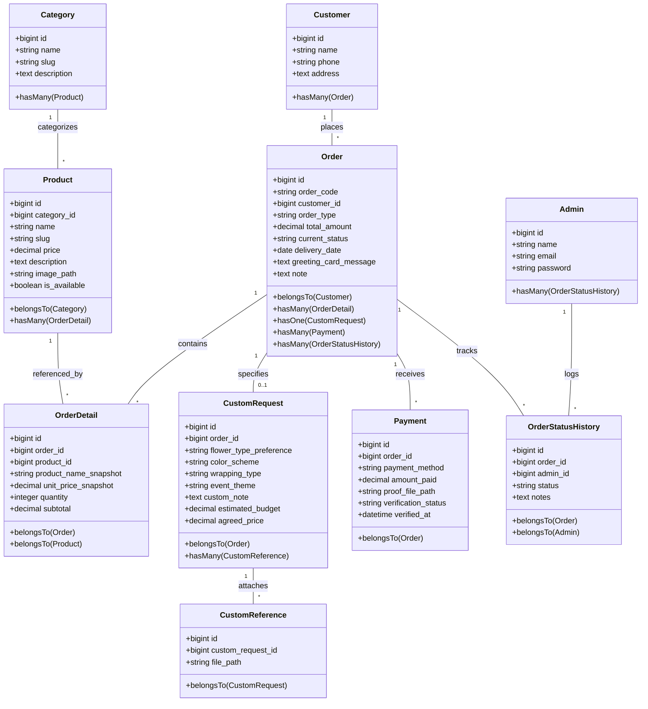

# SPESIFIKASI RELASI ELOQUENT MODEL (MODEL RELATIONSHIPS SPECIFICATION)
## BLOOMÉ — Flowers & Stories
**Task ID:** ARC-008  
**Fase:** Phase 2 — System Analysis and Design (Sub-fase 5.3 System Architecture)  
**Penanggung Jawab:** Elsa Futri (Lead Software Architect & Backend Developer) & Jayanti Firdasari (Project Manager & System Analyst)  
**Tanggal Penyusunan:** 13 November 2026  
**Status Task:** Completed (`[x]`)  
**Dependensi:** ARC-001 — Three-Layer Architecture, ARC-004 — Application Modules, DOC-017 — Database Design  

---

## 1. Ringkasan Eksekutif & Prinsip Desain Data Layer

Penetapan Relasi Model Eloquent (Task ARC-008) bertujuan untuk mendefinisikan pemetaan objek-relasional (*Object-Relational Mapping*) dari 10 tabel basis data MySQL ke dalam kelas Model Laravel di namespace `App\Models`.

### 1.1 Prinsip Perancangan Model
1. **Integritas Relasional Ganda (*Dual Integrity Enforcement*):** Seluruh relasi entitas didefinisikan secara tegas baik pada level basis data (MySQL *Foreign Keys*) maupun pada level aplikasi melalui metode relasi Eloquent (`belongsTo`, `hasMany`, `hasOne`).
2. **Immutability Perlindungan Snapshot Historis (BR-020):** Model `OrderDetail` menyimpan snapshot permanen nama produk dan harga pada saat transaksi, sehingga jika model `Product` mengalami perubahan harga atau dihapus, riwayat transaksi tetap utuh.
3. **Audit Trail Otomatis:** Setiap perubahan status pesanan dicatat ke entitas `OrderStatusHistory` tanpa menimpa (*overwrite*) rekaman riwayat sebelumnya.
4. **Keamanan Mass Assignment:** Seluruh model mengunci atribut mass assignment menggunakan properti `$fillable` eksplisit untuk mencegah kerentanan modifikasi parameter yang tidak sah (*Mass Assignment Vulnerability*).

---

## 2. Diagram Relasi Entitas Model Eloquent



---

## 3. Spesifikasi Definisi Model Eloquent

### 3.1 `Category` (`App\Models\Category`)
```php
namespace App\Models;

use Illuminate\Database\Eloquent\Model;
use Illuminate\Database\Eloquent\Relations\HasMany;

class Category extends Model
{
    protected $fillable = ['name', 'slug', 'description'];

    public function products(): HasMany
    {
        return $this->hasMany(Product::class);
    }
}
```

### 3.2 `Product` (`App\Models\Product`)
```php
namespace App\Models;

use Illuminate\Database\Eloquent\Model;
use Illuminate\Database\Eloquent\Relations\BelongsTo;
use Illuminate\Database\Eloquent\Relations\HasMany;

class Product extends Model
{
    protected $fillable = [
        'category_id', 'name', 'slug', 'price', 
        'description', 'image_path', 'is_available'
    ];

    protected $casts = [
        'price' => 'decimal:2',
        'is_available' => 'boolean',
    ];

    public function category(): BelongsTo
    {
        return $this->belongsTo(Category::class);
    }

    public function orderDetails(): HasMany
    {
        return $this->hasMany(OrderDetail::class);
    }

    // Scopes
    public function scopeAvailable($query)
    {
        return $query->where('is_available', true);
    }
}
```

### 3.3 `Customer` (`App\Models\Customer`)
```php
namespace App\Models;

use Illuminate\Database\Eloquent\Model;
use Illuminate\Database\Eloquent\Relations\HasMany;

class Customer extends Model
{
    protected $fillable = ['name', 'phone', 'address'];

    public function orders(): HasMany
    {
        return $this->hasMany(Order::class);
    }
}
```

### 3.4 `Order` (`App\Models\Order`)
```php
namespace App\Models;

use Illuminate\Database\Eloquent\Model;
use Illuminate\Database\Eloquent\Relations\BelongsTo;
use Illuminate\Database\Eloquent\Relations\HasMany;
use Illuminate\Database\Eloquent\Relations\HasOne;

class Order extends Model
{
    protected $fillable = [
        'order_code', 'customer_id', 'order_type', 
        'total_amount', 'current_status', 'delivery_date', 
        'greeting_card_message', 'note'
    ];

    protected $casts = [
        'total_amount' => 'decimal:2',
        'delivery_date' => 'date',
    ];

    public function customer(): BelongsTo
    {
        return $this->belongsTo(Customer::class);
    }

    public function orderDetails(): HasMany
    {
        return $this->hasMany(OrderDetail::class);
    }

    public function customRequest(): HasOne
    {
        return $this->hasOne(CustomRequest::class);
    }

    public function payments(): HasMany
    {
        return $this->hasMany(Payment::class);
    }

    public function statusHistories(): HasMany
    {
        return $this->hasMany(OrderStatusHistory::class)->orderBy('created_at', 'asc');
    }

    // Scopes
    public function scopeActive($query)
    {
        return $query->whereNotIn('current_status', ['ST-07', 'ST-08']);
    }
}
```

### 3.5 `OrderDetail` (`App\Models\OrderDetail`)
```php
namespace App\Models;

use Illuminate\Database\Eloquent\Model;
use Illuminate\Database\Eloquent\Relations\BelongsTo;

class OrderDetail extends Model
{
    protected $fillable = [
        'order_id', 'product_id', 'product_name_snapshot', 
        'unit_price_snapshot', 'quantity', 'subtotal'
    ];

    protected $casts = [
        'unit_price_snapshot' => 'decimal:2',
        'subtotal' => 'decimal:2',
        'quantity' => 'integer',
    ];

    public function order(): BelongsTo
    {
        return $this->belongsTo(Order::class);
    }

    public function product(): BelongsTo
    {
        return $this->belongsTo(Product::class);
    }
}
```

### 3.6 `CustomRequest` & `CustomReference`
```php
namespace App\Models;

use Illuminate\Database\Eloquent\Model;
use Illuminate\Database\Eloquent\Relations\BelongsTo;
use Illuminate\Database\Eloquent\Relations\HasMany;

class CustomRequest extends Model
{
    protected $fillable = [
        'order_id', 'flower_type_preference', 'color_scheme', 
        'wrapping_type', 'event_theme', 'custom_note', 
        'estimated_budget', 'agreed_price'
    ];

    protected $casts = [
        'estimated_budget' => 'decimal:2',
        'agreed_price' => 'decimal:2',
    ];

    public function order(): BelongsTo
    {
        return $this->belongsTo(Order::class);
    }

    public function references(): HasMany
    {
        return $this->hasMany(CustomReference::class);
    }
}

class CustomReference extends Model
{
    protected $fillable = ['custom_request_id', 'file_path'];

    public function customRequest(): BelongsTo
    {
        return $this->belongsTo(CustomRequest::class);
    }
}
```

### 3.7 `Payment` & `OrderStatusHistory`
```php
namespace App\Models;

use Illuminate\Database\Eloquent\Model;
use Illuminate\Database\Eloquent\Relations\BelongsTo;

class Payment extends Model
{
    protected $fillable = [
        'order_id', 'payment_method', 'amount_paid', 
        'proof_file_path', 'verification_status', 'verified_at'
    ];

    protected $casts = [
        'amount_paid' => 'decimal:2',
        'verified_at' => 'datetime',
    ];

    public function order(): BelongsTo
    {
        return $this->belongsTo(Order::class);
    }
}

class OrderStatusHistory extends Model
{
    protected $fillable = ['order_id', 'admin_id', 'status', 'notes'];

    public function order(): BelongsTo
    {
        return $this->belongsTo(Order::class);
    }

    public function admin(): BelongsTo
    {
        return $this->belongsTo(Admin::class);
    }
}
```

---

## 4. Kesimpulan & Rekomendasi
Task **ARC-008 (Menentukan Model Relationships)** telah selesai. Seluruh 10 model Eloquent telah didefinisikan dengan pemetaan relasi lengkap, proteksi mass assignment, casting tipe data presisi, dan query scopes yang optimal.

