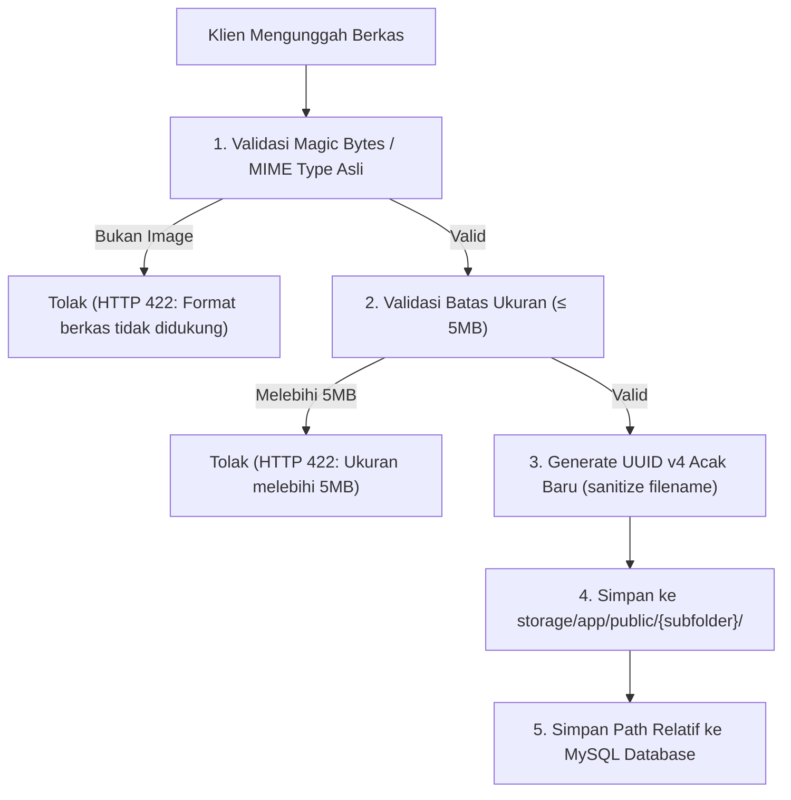

# SPESIFIKASI ARSITEKTUR FILE STORAGE (FILE STORAGE ARCHITECTURE SPECIFICATION)
## BLOOMÉ — Flowers & Stories
**Task ID:** ARC-009  
**Fase:** Phase 2 — System Analysis and Design (Sub-fase 5.3 System Architecture)  
**Penanggung Jawab:** Elsa Futri (Lead Software Architect & Backend Developer) & Jayanti Firdasari (Project Manager & System Analyst)  
**Tanggal Penyusunan:** 13 November 2026  
**Status Task:** Completed (`[x]`)  
**Dependensi:** ARC-001 — Three-Layer Architecture, ARC-007 — Service Responsibilities  

---

## 1. Ringkasan Eksekutif & Prinsip Desain Penyimpanan Berkas

Penetapan Arsitektur File Storage (Task ARC-009) merumuskan tata kelola penyimpanan berkas statis (*static file management*) pada website **BLOOMÉ — Flowers & Stories**.

Sistem BLOOMÉ mengelola tiga kategori berkas biner:
1. **Foto Master Produk Buket:** Diunggah oleh Admin Florist untuk etalase katalog.
2. **Foto Referensi Buket Custom:** Diunggah oleh Pelanggan saat mengajukan pesanan kustom (maks 3 berkas, masing-masing ≤ 5MB).
3. **Bukti Transfer Pembayaran:** Diunggah oleh Pelanggan sebagai bukti transaksi transfer bank/e-wallet manual (≤ 5MB).

### 1.1 Prinsip Desain Penyimpanan
- **Isolasi Berkas Lokal (*Local Disk Sandbox*):** Menggunakan driver penyimpanan lokal Laravel `public` disk yang berbasis di `storage/app/public/` dan dipetakan ke direktori publik via symbolic link `public/storage`.
- **Mencegah Eksekusi Skrip (*Zero Script Execution*):** Berkas yang disimpan dalam folder unggahan tidak boleh memiliki izin eksekusi skrip PHP atau CGI.
- **Nama Acak Bebas Kolisi (*UUID Obfuscation*):** Nama asli berkas dari pengguna dihapus dan digantikan oleh identifier unik UUID v4 untuk mencegah serangan *Path Traversal* dan penimpaan berkas (*file overwriting*).

---

## 2. Struktur Hirarki Direktori File Storage

```
storage/app/public/
├── products/                   # Berkas foto etalase produk katalog (Diunggah Admin)
│   ├── a1b2c3d4-prod-001.jpg
│   └── e5f6a7b8-prod-002.png
│
├── custom_references/          # Foto referensi preferensi bunga custom (Diunggah Pelanggan)
│   ├── 8f9a2b1c-custom-ref-001.jpg
│   └── 3d4e5f6a-custom-ref-002.png
│
└── payment_proofs/             # Berkas bukti transfer manual (Diunggah Pelanggan)
    ├── c1d2e3f4-pay-proof-001.jpg
    └── 7b8a9c0d-pay-proof-002.png
```

---

## 3. Matriks Kebijakan & Validasi Berkas

| Kategori Berkas | Direktori Simpan | Ukuran Maksimal | MIME Types Diizinkan | Ekstensi Diizinkan | Pelaku Unggah |
|---|---|---|---|---|---|
| **Foto Produk** | `storage/app/public/products/` | 3 MB (3.072 KB) | `image/jpeg`, `image/png`, `image/webp` | `.jpg`, `.jpeg`, `.png`, `.webp` | Admin |
| **Referensi Custom** | `storage/app/public/custom_references/` | 5 MB (5.120 KB) | `image/jpeg`, `image/png` | `.jpg`, `.jpeg`, `.png` | Customer (Tamu) |
| **Bukti Transfer** | `storage/app/public/payment_proofs/` | 5 MB (5.120 KB) | `image/jpeg`, `image/png` | `.jpg`, `.jpeg`, `.png` | Customer (Tamu) |

---

## 4. Mekanisme Keamanan Unggahan (*Upload Security Hardening*)



### 4.1 Proteksi Web Server (Mencegah Eksekusi PHP di Folder Storage)
Pada web server Apache, berkas `.htaccess` di dalam direktori `public/storage` dikonfigurasi untuk mematikan eksekusi skrip:
```apache
<FilesMatch "(?i)\.(php|phtml|phar|pl|py|cgi|asp|js|sh)$">
    Order Deny,Allow
    Deny from all
</FilesMatch>
Options -ExecCGI
```

Untuk web server Nginx:
```nginx
location ^~ /storage/ {
    location ~ \.(php|phar|phtml)$ {
        deny all;
    }
}
```

---

## 5. Strategi Pembersihan Berkas Menggantung (*Orphan File Cleanup*)

1. **Rollback Otomatis Saat Transaksi Gagal:**
   Jika penyimpanan entitas database di dalam `DB::transaction` gagal, berkas fisik yang telah tersimpan di disk wajib dihapus seketika via `Storage::disk('public')->delete($filePath)`.
2. **Pembersihan Berkas Pembatalan:**
   Pesanan yang dibatalkan pada status awal dapat dibersihkan melalui command artisan terjadwal (*Scheduled Task*) atau tombol pembersihan manual di dashboard admin.

---

## 6. Kesimpulan & Rekomendasi
Task **ARC-009 (Menentukan File Storage Architecture)** telah selesai. Seluruh arsitektur penyimpanan berkas lokal, penamaan UUID, mitigasi keamanan eksekusi skrip berbahaya, dan kebijakan pembersihan berkas telah dirumuskan secara komprehensif.

