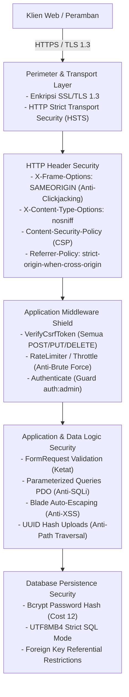

# SPESIFIKASI ARSITEKTUR KEAMANAN (SECURITY ARCHITECTURE SPECIFICATION)
## BLOOMÉ — Flowers & Stories
**Task ID:** ARC-010  
**Fase:** Phase 2 — System Analysis and Design (Sub-fase 5.3 System Architecture)  
**Penanggung Jawab:** Elsa Futri (Lead Software Architect & Backend Developer) & Jayanti Firdasari (Project Manager & System Analyst)  
**Tanggal Penyusunan:** 13 November 2026  
**Status Task:** Completed (`[x]`)  
**Dependensi:** ARC-001 — Three-Layer Architecture, ARC-005 — Routing Architecture, ARC-009 — File Storage Architecture  

---

## 1. Ringkasan Eksekutif & Prinsip Pertahanan Berlapis (*Defense-in-Depth*)

Penetapan Arsitektur Keamanan Sistem (Task ARC-010) menetapkan standar perlindungan menyeluruh terhadap integritas, kerahasiaan, dan ketersediaan data pada website **BLOOMÉ — Flowers & Stories**.

Sebagai platform e-commerce buket artisan yang melayani pelanggan umum (tamu) dan operasional internal pemilik usaha (Nabila Febriyani), arsitektur keamanan dirancang dengan prinsip **Defense-in-Depth** (pertahanan berlapis) pada setiap lapisan komputasi: antarmuka pengguna, pipa lalu lintas HTTP, logika aplikasi Laravel, hingga persistensi basis data MySQL.

---

## 2. Diagram Matriks Pertahanan Berlapis (*Security Layering*)



---

## 3. Spesifikasi Rinci 7 Pilar Keamanan Sistem

### 3.1 Otentikasi & Manajemen Sesi Admin
- **Guard Khusus:** Menggunakan guard kustom `admin` yang terpisah dari default user guard Laravel.
- **Enkripsi Kata Sandi:** Wajib menggunakan algoritma hashing **Bcrypt** dengan work factor (*cost*) minimal 12 (`Hash::make($password)`). Kata sandi teks polos (*plaintext*) tidak pernah dicatat atau disimpan.
- **Pencegahan Session Fixation:** Sesi di-regenerasi secara wajib setiap kali admin berhasil login (`$request->session()->regenerate()`) dan di-flush total saat logout.
- **Konfigurasi Cookie Sesi Aman:**
  - `SESSION_SECURE_COOKIE=true` (Hanya dikirim melalui HTTPS).
  - `SESSION_HTTP_ONLY=true` (Mencegah pencurian cookie via JavaScript Document Object Model).
  - `SESSION_SAME_SITE=lax` (Mencegah serangan lintas situs).

### 3.2 Proteksi Terhadap Serangan CSRF (*Cross-Site Request Forgery*)
- Setiap formulir publik dan panel admin wajib menyertakan direktif Blade `@csrf` yang menghasilkan token terenkripsi acak:
  ```html
  <form action="/pembayaran/BLM-202611-0001" method="POST">
      @csrf
      <!-- Form Input -->
  </form>
  ```
- Permintaan AJAX wajib menyertakan header `X-CSRF-TOKEN` yang diambil dari meta tag halaman.
- Rute yang tidak memiliki token CSRF yang cocok secara otomatis ditolak dengan kode respon `419 Page Expired`.

### 3.3 Mitigasi Serangan Injeksi SQL (*SQL Injection Prevention*)
- **Parameter Binding PDO Universal:** Meniadakan konkatenasi string SQL mentah (`DB::raw("... WHERE id = " . $id)` dilarang keras).
- Seluruh manipulasi data menggunakan Eloquent ORM atau Query Builder terparameterisasi:
  ```php
  // Pendekatan Baku Terproteksi
  Order::where('order_code', $orderCode)->firstOrFail();
  ```

### 3.4 Sanitasi & Pencegahan XSS (*Cross-Site Scripting*)
- **Blade Auto-Escaping:** Seluruh data dinamis yang dirender ke antarmuka Blade wajib menggunakan kurung kurawal ganda `{{ $variable }}` yang mengeksekusi `htmlspecialchars()` bawaan PHP dengan entitas UTF-8.
- Sintaks `{!! $variable !!}` dilarang keras digunakan pada data masukan pengguna (seperti ucapan kartu, catatan kustom, nama pemesan).
- Validasi ketat pada tautan WhatsApp untuk memastikan skema hanya berawalan `https://wa.me/`.

### 3.5 Pembatasan Laju Akses (*Rate Limiting & Anti-Brute Force*)
Menerapkan throttle bawaan Laravel untuk mencegah penyerangan DoS berskala kecil dan *credential stuffing*:
1. **Endpoint Login Admin (`/admin/login`):** Maksimal 5 percobaan per menit. Jika melebihi, kunci akses selama 60 detik (HTTP 429 Too Many Requests).
2. **Endpoint Pemesanan Custom (`/custom-bouquet`):** Maksimal 6 permintaan per menit per IP untuk mencegah *spamming* unggahan berkas ke disk server.
3. **Endpoint Konfirmasi Bayar (`/pembayaran/{code}`):** Maksimal 5 permintaan per menit per IP.

### 3.6 Pengamanan Berkas Unggahan (*File Upload Hardening*)
- **Validasi Magic Bytes:** Tidak hanya memeriksa ekstensi berkas, tetapi memeriksa header biner file asli menggunakan `finfo_file` (ekstensi gambar palsu seperti `malware.php.jpg` ditolak).
- **Penggantian Nama Berkas:** Nama berkas diganti dengan UUID acak (`Str::uuid()`).
- **Izin Berkas Minimal:** Direktori penyimpanan berkas memiliki izin `0755` untuk folder dan `0644` untuk berkas, serta menonaktifkan eksekusi skrip web server.

### 3.7 Manajemen Konfigurasi Rahasia & Lingkungan (*Environment Secrets*)
- Kredensial basis data, kunci aplikasi (`APP_KEY`), dan konfigurasi rahasia hanya disimpan di dalam berkas `.env` lokal yang masuk ke dalam `.gitignore`.
- Mode debugging (`APP_DEBUG=false`) wajib dimatikan pada server produksi untuk mencegah kebocoran jejak kesalahan (*stack trace*) dan kredensial sistem kepada publik.

---

## 4. Kesimpulan & Rekomendasi
Task **ARC-010 (Menentukan Security Architecture)** telah selesai. Sistem arsitektur keamanan telah dirumuskan secara holistik mencakup otentikasi, enkripsi sesi, proteksi CSRF, anti-SQLi, anti-XSS, rate limiting, dan proteksi berkas biner.

Dengan selesainya ARC-010, seluruh **Sub-fase 5.3 System Architecture (ARC-001 hingga ARC-010) resmi LENGKAP 100%**.

