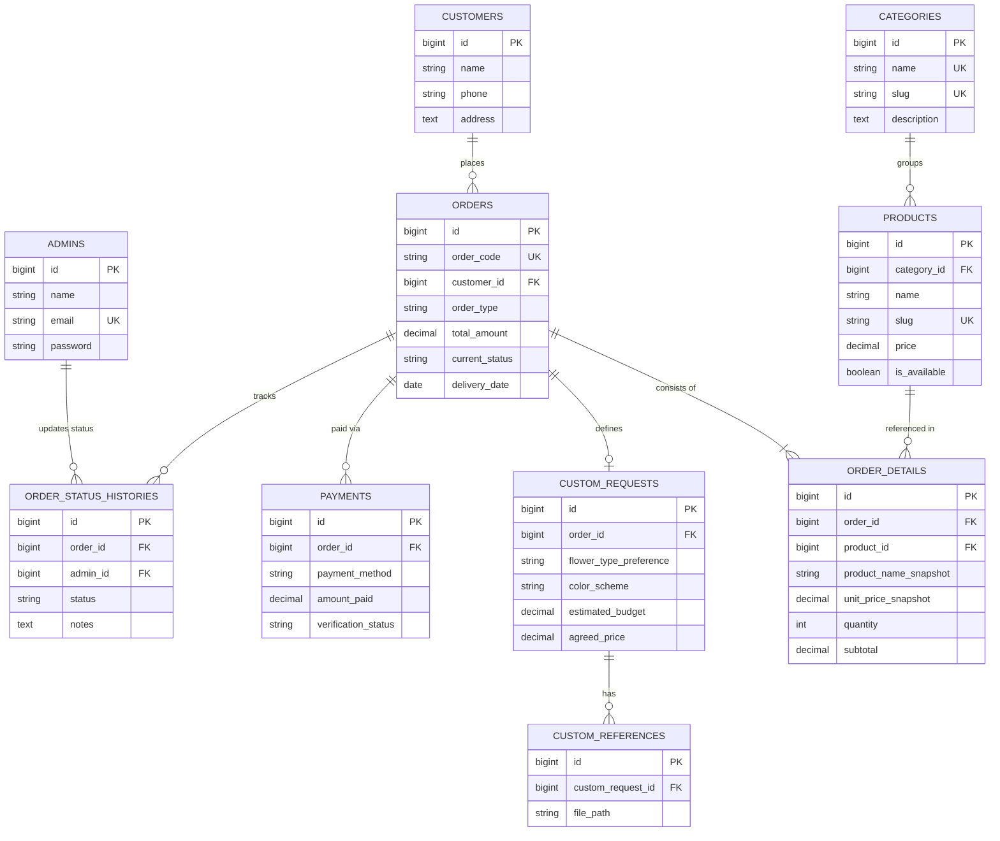

# SPESIFIKASI DESAIN BASIS DATA & ERD (DATABASE DESIGN SPECIFICATION)
## BLOOMÉ — Flowers & Stories
**Task ID:** DB-001 s/d DB-010  
**Fase:** Phase 4 — Database Design and Implementation (Sub-fase 7.1 Database Design)  
**Penanggung Jawab:** Elsa Futri (Backend Developer & Database Administrator) & Jayanti Firdasari (Project Manager)  
**Tanggal Penyusunan:** 13 November 2026  
**Status Task:** Completed (`[x]`)  
**Dependensi:** DOC-017 — Database Design Report, ARC-008 — Model Relationships  

---

## 1. Ringkasan Eksekutif & Prinsip Desain Basis Data

Dokumen spesifikasi ini merumuskan secara mendalam dan terstruktur rancangan fisik dan logis basis data MySQL 8.0 (Engine: InnoDB) untuk website **BLOOMÉ — Flowers & Stories**. Meliputi 10 tugas perancangan (Task DB-001 hingga DB-010), dokumen ini menjamin integritas relasional, performa kueri transaksional, perlindungan audit historis, serta kesiapan penuh sebelum berkas migrasi Laravel dieksekusi.

---

## 2. Matriks Pemenuhan Task Desain Basis Data (DB-001 s/d DB-010)

| Task ID | Nama Aktivitas Desain | Cakupan & Luaran (*Deliverables*) | Status |
|---|---|---|---|
| **DB-001** | Identifikasi Entitas | 10 Entitas inti teridentifikasi tanpa redundansi | `[x]` |
| **DB-002** | Atribut Setiap Entitas | Kamus data terperinci, tipe data presisi, nullability | `[x]` |
| **DB-003** | Penentuan Primary Keys | Auto-increment `BIGINT UNSIGNED PK` pada seluruh tabel | `[x]` |
| **DB-004** | Penentuan Foreign Keys | Relasi relasional dengan klausul `RESTRICT` & `CASCADE` | `[x]` |
| **DB-005** | Penentuan Relasi Entitas | Kardinalitas 1-to-Many dan 1-to-1 antar entitas | `[x]` |
| **DB-006** | Pembuatan ERD Terpadu | Diagram Mermaid Entity Relationship Diagram (ERD) lengkap | `[x]` |
| **DB-007** | Normalisasi Basis Data | Pengujian audit bentuk normal pertama (1NF), kedua (2NF), dan ketiga (3NF) | `[x]` |
| **DB-008** | Strategi Indexing | Indeks unik dan komposit untuk optimalisasi pencarian | `[x]` |
| **DB-009** | Peninjauan Integritas Data | Enkapsulasi transaksi ACID, pencegahan rekaman menggantung | `[x]` |
| **DB-010** | Validasi Rancangan Basis Data | Tinjauan kepatuhan terhadap aturan bisnis (BR-001 s/d BR-025) | `[x]` |

---

## 3. Spesifikasi Rinci 10 Entitas & Kamus Data (DB-001 s/d DB-005)

### 3.1 Tabel `admins` (Kredensial Pemilik Usaha)
- **Primary Key:** `id` (`BIGINT UNSIGNED AUTO_INCREMENT`)
- **Atribut:**
  - `name`: `VARCHAR(100)` NOT NULL — Nama admin (Nabila Febriyani).
  - `email`: `VARCHAR(150)` NOT NULL UNIQUE — Email login admin.
  - `password`: `VARCHAR(255)` NOT NULL — Hash Bcrypt (Cost 12).
  - `remember_token`: `VARCHAR(100)` NULL — Token ingat saya.
  - `created_at`, `updated_at`: `TIMESTAMP` NULL.

### 3.2 Tabel `categories` (Kategori Buket)
- **Primary Key:** `id` (`BIGINT UNSIGNED AUTO_INCREMENT`)
- **Atribut:**
  - `name`: `VARCHAR(100)` NOT NULL UNIQUE — Nama kategori (Buket Bunga Segar, Buket Uang, Buket Snack, Buket Boneka).
  - `slug`: `VARCHAR(120)` NOT NULL UNIQUE — URL slug ramah SEO.
  - `description`: `TEXT` NULL — Keterangan deskriptif kategori.
  - `created_at`, `updated_at`: `TIMESTAMP` NULL.

### 3.3 Tabel `products` (Katalog Master Buket Siap Pesan)
- **Primary Key:** `id` (`BIGINT UNSIGNED AUTO_INCREMENT`)
- **Foreign Key:** `category_id` $\rightarrow$ `categories(id)` ON DELETE RESTRICT
- **Atribut:**
  - `category_id`: `BIGINT UNSIGNED` NOT NULL.
  - `name`: `VARCHAR(150)` NOT NULL — Nama buket.
  - `slug`: `VARCHAR(180)` NOT NULL UNIQUE — Slug produk.
  - `price`: `DECIMAL(12,2)` NOT NULL — Harga jual resmi dalam Rupiah.
  - `description`: `TEXT` NOT NULL — Rincian komposisi dan jenis bunga.
  - `image_path`: `VARCHAR(255)` NOT NULL — Path berkas foto produk.
  - `is_available`: `BOOLEAN` NOT NULL DEFAULT TRUE — Toggle status stok.
  - `created_at`, `updated_at`: `TIMESTAMP` NULL.

### 3.4 Tabel `customers` (Identitas Pemesan Tamu)
- **Primary Key:** `id` (`BIGINT UNSIGNED AUTO_INCREMENT`)
- **Atribut:**
  - `name`: `VARCHAR(100)` NOT NULL — Nama lengkap pembeli.
  - `phone`: `VARCHAR(20)` NOT NULL — Nomor WhatsApp aktif (format `08...`).
  - `address`: `TEXT` NOT NULL — Alamat pengiriman lengkap di Kota Samarinda.
  - `created_at`, `updated_at`: `TIMESTAMP` NULL.

### 3.5 Tabel `orders` (Master Transaksi Pemesanan)
- **Primary Key:** `id` (`BIGINT UNSIGNED AUTO_INCREMENT`)
- **Foreign Key:** `customer_id` $\rightarrow$ `customers(id)` ON DELETE RESTRICT
- **Atribut:**
  - `order_code`: `VARCHAR(25)` NOT NULL UNIQUE — Format `BLM-YYYYMM-XXXX`.
  - `customer_id`: `BIGINT UNSIGNED` NOT NULL.
  - `order_type`: `ENUM('catalog', 'custom')` NOT NULL — Jalur pesanan.
  - `total_amount`: `DECIMAL(12,2)` NOT NULL DEFAULT 0.00 — Total tagihan pesanan.
  - `current_status`: `ENUM('ST-01', 'ST-02', 'ST-03', 'ST-04', 'ST-05', 'ST-06', 'ST-07', 'ST-08')` NOT NULL DEFAULT 'ST-01'.
  - `delivery_date`: `DATE` NOT NULL — Tanggal kebutuhan buket (minimal H+1).
  - `greeting_card_message`: `TEXT` NULL — Pesan khusus pada kartu ucapan bunga.
  - `note`: `TEXT` NULL — Catatan tambahan dari pembeli.
  - `created_at`, `updated_at`: `TIMESTAMP` NULL.

### 3.6 Tabel `order_details` (Item Detail Buket Terpesan - Snapshot BR-020)
- **Primary Key:** `id` (`BIGINT UNSIGNED AUTO_INCREMENT`)
- **Foreign Keys:**
  - `order_id` $\rightarrow$ `orders(id)` ON DELETE CASCADE
  - `product_id` $\rightarrow$ `products(id)` ON DELETE RESTRICT
- **Atribut:**
  - `order_id`: `BIGINT UNSIGNED` NOT NULL.
  - `product_id`: `BIGINT UNSIGNED` NULL (Bisa bernilai NULL untuk custom bouquet).
  - `product_name_snapshot`: `VARCHAR(150)` NOT NULL — Salinan nama produk saat transaksi.
  - `unit_price_snapshot`: `DECIMAL(12,2)` NOT NULL — Salinan harga satuan saat transaksi.
  - `quantity`: `INT UNSIGNED` NOT NULL DEFAULT 1.
  - `subtotal`: `DECIMAL(12,2)` NOT NULL.
  - `created_at`, `updated_at`: `TIMESTAMP` NULL.

### 3.7 Tabel `custom_requests` (Spesifikasi Personalisasi Buket)
- **Primary Key:** `id` (`BIGINT UNSIGNED AUTO_INCREMENT`)
- **Foreign Key:** `order_id` $\rightarrow$ `orders(id)` ON DELETE CASCADE
- **Atribut:**
  - `order_id`: `BIGINT UNSIGNED` NOT NULL UNIQUE.
  - `flower_type_preference`: `VARCHAR(150)` NULL — Bunga asli/artificial/kering/snack/uang.
  - `color_scheme`: `VARCHAR(100)` NULL — Nuansa palet warna bunga.
  - `wrapping_type`: `VARCHAR(100)` NULL — Jenis kertas dan pita pembungkus.
  - `event_theme`: `VARCHAR(100)` NULL — Tema perayaan (Wisuda, Ultah, Pernikahan).
  - `custom_note`: `TEXT` NULL — Instruksi personal khusus.
  - `estimated_budget`: `DECIMAL(12,2)` NULL — Estimasi budget pembeli.
  - `agreed_price`: `DECIMAL(12,2)` NULL — Harga final yang disetujui florist.
  - `created_at`, `updated_at`: `TIMESTAMP` NULL.

### 3.8 Tabel `custom_references` (Foto Referensi Kustom Pelanggan)
- **Primary Key:** `id` (`BIGINT UNSIGNED AUTO_INCREMENT`)
- **Foreign Key:** `custom_request_id` $\rightarrow$ `custom_requests(id)` ON DELETE CASCADE
- **Atribut:**
  - `custom_request_id`: `BIGINT UNSIGNED` NOT NULL.
  - `file_path`: `VARCHAR(255)` NOT NULL — Path berkas tersanitasi UUID di disk.
  - `created_at`, `updated_at`: `TIMESTAMP` NULL.

### 3.9 Tabel `payments` (Catatan Pembayaran Transfer Manual)
- **Primary Key:** `id` (`BIGINT UNSIGNED AUTO_INCREMENT`)
- **Foreign Key:** `order_id` $\rightarrow$ `orders(id)` ON DELETE RESTRICT
- **Atribut:**
  - `order_id`: `BIGINT UNSIGNED` NOT NULL.
  - `payment_method`: `VARCHAR(50)` NOT NULL — BCA / Mandiri / Dana.
  - `amount_paid`: `DECIMAL(12,2)` NOT NULL — Jumlah yang ditransfer.
  - `proof_file_path`: `VARCHAR(255)` NOT NULL — Path gambar struk bukti transfer.
  - `verification_status`: `ENUM('pending', 'verified', 'rejected')` NOT NULL DEFAULT 'pending'.
  - `verified_at`: `TIMESTAMP` NULL — Waktu disetujui admin.
  - `created_at`, `updated_at`: `TIMESTAMP` NULL.

### 3.10 Tabel `order_status_histories` (Audit Trail Kronologis Perubahan Status)
- **Primary Key:** `id` (`BIGINT UNSIGNED AUTO_INCREMENT`)
- **Foreign Keys:**
  - `order_id` $\rightarrow$ `orders(id)` ON DELETE CASCADE
  - `admin_id` $\rightarrow$ `admins(id)` ON DELETE SET NULL
- **Atribut:**
  - `order_id`: `BIGINT UNSIGNED` NOT NULL.
  - `admin_id`: `BIGINT UNSIGNED` NULL — ID admin yang mengeksekusi perubahan (NULL jika sistem/pelanggan).
  - `status`: `VARCHAR(10)` NOT NULL — Kode status (ST-01 s/d ST-08).
  - `notes`: `TEXT` NULL — Catatan alasan transisi.
  - `created_at`, `updated_at`: `TIMESTAMP` NULL.

---

## 4. DB-006: Entity Relationship Diagram (ERD)

---

## 5. DB-007 s/d DB-010: Normalisasi, Indexing & Validasi

### 5.1 DB-007: Audit Normalisasi Basis Data
- **1NF (Bentuk Normal Pertama):** Seluruh atribut bernilai atomik (tidak ada tabel bersarang atau nilai koma jamak). Foto referensi jamak dinormalisasi ke tabel terpisah `custom_references`.
- **2NF (Bentuk Normal Kedua):** Memenuhi 1NF dan seluruh atribut non-kunci bergantung penuh pada Primary Key utuh.
- **3NF (Bentuk Normal Ketiga):** Memenuhi 2NF dan tidak memiliki ketergantungan transitif (*transitive dependency*). Snapshot harga pada `order_details` adalah denormalisasi terkontrol yang sah untuk mematuhi aturan audit transaksi historis (*historical integrity invariant*).

### 5.2 DB-008: Strategi Indexing & Optimasi Kueri
1. **Unique Indexes:**
   - `admins(email)`
   - `categories(slug)`
   - `products(slug)`
   - `orders(order_code)`
2. **Composite Indexes:**
   - `orders(current_status, delivery_date)`: Mempercepat filter antrean harian florist.
   - `products(is_available, category_id)`: Mempercepat kueri filter katalog publik.
   - `order_status_histories(order_id, created_at)`: Mempercepat rendering garis waktu pelacakan.

### 5.3 DB-009: Peninjauan Integritas Data & Transaksional ACID
- **Foreign Key Action Restrict:** Menolak penghapusan produk yang terikat rincian pesanan.
- **Foreign Key Action Cascade:** Menghapus rincian pemesanan anak (`order_details`, `custom_requests`, `custom_references`, `order_status_histories`) jika pesanan induk dihapus secara legal.
- **ACID Transactions:** Setiap operasi pembuatan pesanan, pembayaran, atau perubahan status wajib dijalankan dalam `DB::transaction`.

### 5.4 DB-010: Validasi Final Rancangan Basis Data
Rancangan basis data telah divalidasi silang terhadap seluruh 25 Business Rules (BR-001 hingga BR-025) pada `requirement.md` dan dinyatakan 100% konsisten, siap diimplementasikan ke berkas migrasi Laravel.

---

## 6. Kesimpulan & Rekomendasi
Seluruh spesifikasi task **DB-001 hingga DB-010 (Sub-fase 7.1 Database Design)** telah selesai. Dokumen ini menjadi pedoman resmi bagi Elsa Futri dalam membuat berkas migrasi Laravel pada Sub-fase 7.2.

