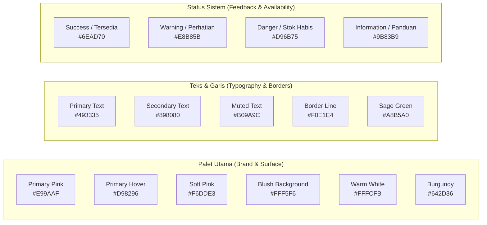
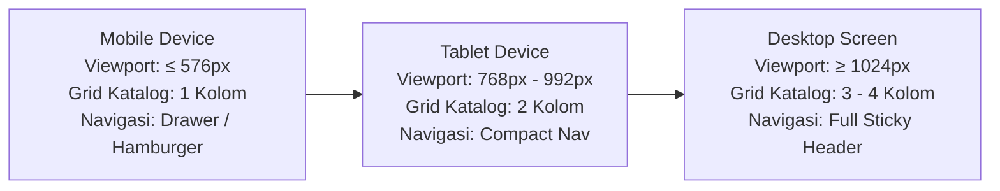

# LAPORAN PENYUSUNAN DESIGN SYSTEM & KOMPONEN UI (DESIGN SYSTEM REPORT)
## BLOOMÉ — Flowers & Stories
**Task ID:** DOC-018  
**Fase:** Phase 1 — Project Initiation and Documentation (Sub-fase 4.4 Technical Documentation)  
**Penanggung Jawab:** Riya Monika (UI/UX Designer & Frontend Developer)  
**Tanggal Penyusunan:** 13 November 2026 (Diperbarui: 20 November 2026)  
**Status Task:** Completed (`[x]`)  
**Dokumen Hasil:** [design-system.md](../../design-system.md) (Versi 1.1 — Penyelarasan Paradigma WhatsApp Hand-off & Zero-Checkout)

---

## 1. Ringkasan Eksekutif

Penyusunan dan audit dokumen master `design-system.md` (Task DOC-018) telah selesai diselaraskan dengan arsitektur dan kebutuhan sistem terbaru. Dokumen ini menjadi pedoman resmi tata kelola estetika visual, konsistensi token warna, hierarki tipografi, grid layout responsif, serta pustaka komponen UI untuk seluruh antarmuka publik dan administratif website **BLOOMÉ — Flowers & Stories**.

Rancangan ini secara konsisten mempertahankan identitas visual **Elegant Floral Boutique** (lembut, feminin, modern, minimalis, dan premium) yang memancarkan atmosfer butik bunga artisan di Samarinda. 

Sesuai dengan arahan sistem terkini, seluruh komponen antarmuka yang berkaitan dengan *e-commerce checkout*, manajemen pembayaran web, serta *order lifecycle badges* (ST-01 hingga ST-08) telah **dieliminasi dari ruang lingkup website**. Fokus antarmuka kini dialokasikan penuh untuk mengoptimalkan pengalaman penelusuran katalog interaktif, konfigurator personalisasi buket & add-on, kalkulator estimasi harga *real-time*, tombol pemesanan WhatsApp terstruktur (*WhatsApp Hand-off*), serta panel backoffice administratif tunggal.

---

## 2. Identitas Visual Resmi & Token Desain (Design Tokens)

### 2.1 Palet Warna Baku (15 Locked Color Tokens)
Seluruh komponen Blade dan utilitas CSS wajib merujuk pada 15 token warna baku yang telah ditetapkan:

| Token Name | Hex Code | Peran Penggunaan dalam Antarmuka | Kontras WCAG |
|---|---|---|:---:|
| **`color-primary`** | `#E99AAF` | Aksen utama merek, tombol Call-to-Action utama, tautan aktif. | Lolos |
| **`color-primary-hover`**| `#D98296` | Warna hover/active pada tombol interaktif utama. | Lolos |
| **`color-primary-soft`** | `#F6DDE3` | Latar belakang container sorotan, badge kategori lembut. | Lolos |
| **`color-bg-body`** | `#FFF5F6` | Latar belakang kanvas utama seluruh halaman website (Blush White). | Lolos (Dasar) |
| **`color-bg-surface`** | `#FFFCFB` | Latar putih hangat untuk kartu produk, container formulir, modal. | Lolos (Dasar) |
| **`color-burgundy`** | `#642D36` | Judul utama (Heading H1/H2), logo merek, navigasi admin aktif. | AAA (Tinggi) |
| **`color-text-main`** | `#493335` | Teks utama untuk paragraf, label formulir, rincian estimasi harga. | AAA (Tinggi) |
| **`color-text-sub`** | `#898080` | Teks sekunder, subjudul kartu, metadata tanggal katalog, deskripsi. | AA |
| **`color-text-muted`** | `#B09A9C` | Placeholder form input, teks nonaktif (*disabled*), breadcrumbs. | Standar Form |
| **`color-botanical`** | `#A8B5A0` | Aksen dedaunan botani (*sage green*), penanda kategori bunga segar. | AA |
| **`color-border`** | `#F0E1E4` | Garis tepi tipis (*border*) kartu, pemisah baris tabel, input form. | Garis Halus |
| **`color-success`** | `#6EAD70` | Badge status "Tersedia", notifikasi sukses simpan admin. | AA |
| **`color-warning`** | `#E8B85B` | Notifikasi konfirmasi hapus, peringatan ketersediaan stok terbatas. | AA |
| **`color-danger`** | `#D96B75` | Badge status "Stok Habis", pesan error validasi input. | AA |
| **`color-info`** | `#9B83B9` | Kotak panduan personalisasi, informasi instruksi pemesanan WhatsApp. | AA |

### 2.2 Hierarki Tipografi (Typography Scale)
Sistem tipografi memadukan keanggunan editorial dan kejelasan pembacaan digital:
- **Heading Font:** `Playfair Display` (Serif) — Memberikan aura butik eksklusif dan sentuhan artisan.
- **Body & Interface Font:** `Poppins` (Sans-serif) — Menjamin keterbacaan tinggi pada katalog dan layar mobile.

| Tingkat Tipografi | Font Family | Ukuran / Line Height | Weight | Penggunaan Utama |
|---|---|---|:---:|---|
| **Display H1** | Playfair Display | 36px / 44px (Mobile: 28px/36px) | 700 (Bold) | Hero banner beranda, judul katalog utama |
| **Heading H2** | Playfair Display | 28px / 36px (Mobile: 24px/32px) | 600 (SemiBold) | Judul bagian halaman, header modal ringkasan |
| **Heading H3** | Poppins | 22px / 28px (Mobile: 18px/24px) | 600 (SemiBold) | Nama produk di halaman detail, judul kartu admin |
| **Heading H4** | Poppins | 18px / 24px | 600 (SemiBold) | Nama buket pada kartu grid katalog |
| **Body Large** | Poppins | 16px / 24px | 500 (Medium) | Estimasi harga total (IDR), teks tombol CTA |
| **Body Regular**| Poppins | 14px / 22px | 400 (Regular) | Deskripsi produk, label formulir, teks paragraf |
| **Caption/Small**| Poppins | 12px / 16px | 400 (Reg) / 500 (Med) | Badge kategori, badge ketersediaan, hint form |

### 2.3 Sistem Jarak, Elevasi, dan Radius
- **Border Radius:**
  - Kartu Produk & Container Form: `16px`
  - Tombol & Pill Kontrol: `12px`
  - Input Formulir: `10px`
  - Badge Kategori / Kapsul Status: `9999px` (Full rounded)
- **Elevasi & Soft Shadow:**
  - Elevation 1 (Kartu Default): `box-shadow: 0 4px 20px rgba(73, 51, 53, 0.05);`
  - Elevation 2 (Kartu Hover / Sticky Bar): `box-shadow: 0 8px 30px rgba(73, 51, 53, 0.08);`
  - Elevation 3 (Modal Ringkasan Estimasi): `box-shadow: 0 12px 40px rgba(73, 51, 53, 0.12);`

---

## 3. Pustaka Komponen Antarmuka (UI Components Library)

### 3.1 Komponen Publik (Customer Domain)
1. **Kartu Produk Katalog (Product Card):**
   - Rasio gambar buket `1:1` atau `4:5` (*object-fit: cover*) dengan efek zoom halus `scale(1.03)` saat hover.
   - Badge kategori di pojok kiri atas foto buket.
   - Badge ketersediaan stok di pojok kanan atas: *"Tersedia"* (`#6EAD70`) atau *"Stok Habis"* (`#D96B75`).
   - Informasi harga dasar berformat mata uang Rupiah (`Rp xxx.xxx`).
   - Tombol aksi: *"Personalisasi & Pesan"* atau *"Lihat Detail"*.
2. **Formulir Personalisasi & Add-on:**
   - **Wrapping Color Swatch:** Pilihan visual warna kertas wrapping (Pink pastel, Cream, Hitam elegan, Sage green, dll) dengan penanda seleksi aktif bergaris ganda.
   - **Ribbon Selector:** Dropdown / radio kapsul pilihan jenis dan warna pita satin.
   - **Greeting Card Textarea:** Area teks kartu ucapan menyerupai kartu pos butik dengan penghitung karakter *real-time* (maksimal 200 karakter).
   - **Add-on Checkbox & Counter Card:** Kartu mini pilihan add-on (Boneka Wisuda, Cokelat Ferrero, Lampu LED Fairy, Balon Foil) dengan foto miniatur, nominal harga tambahan (+Rp xx.xxx), dan tombol kuantitas (+/-).
3. **Panel Estimasi Harga & Ringkasan (Live Price Estimator):**
   - Bar mengambang (*sticky bar*) di sisi bawah layar mobile atau kartu samping pada desktop.
   - Menampilkan akumulasi harga dasar produk + akumulasi add-on secara instan via `personalization.js`.
   - Menampilkan catatan penegasan: *"Estimasi harga produk & add-on belum termasuk ongkir delivery ke lokasi Samarinda [Perlu Konfirmasi Owner]."*
4. **Tombol Call-to-Action WhatsApp Hand-off:**
   - Tombol berukuran mencolok dengan ikon resmi WhatsApp: *"Pesan via WhatsApp"* (Latar `#E99AAF` atau aksen WhatsApp `#25D366` berpadu Blush theme).
   - Dilengkapi *subtext* informatif: *"Pesan otomatis dirangkum dan diteruskan ke chat WhatsApp resmi BLOOMÉ."*
5. **Customer Navigation (Navbar & Footer):**
   - **Navbar Mengambang (Sticky Floating Header):** Efek kaca (*glassmorphism*) `backdrop-filter: blur(10px); background: rgba(255, 252, 251, 0.95);`, memuat logo Burgundy BLOOMÉ, menu navigasi (Beranda, Katalog, Tentang Kami, Kontak), serta CTA cepat *"Konsultasi WhatsApp"*.
   - **Footer:** Nuansa Burgundy hangat (`#642D36`) dengan informasi jam buka butik Samarinda, alamat offline, tautan WhatsApp CS, dan hak cipta resmi.

### 3.2 Komponen Administratif (Admin Backoffice Domain)
1. **Formulir Login Admin:**
   - Desain terpusat yang aman, input email dan password dengan proteksi *toggle show/hide*, tombol login Primary Pink dengan *rate-limit feedback*.
2. **Layout Sidebar Admin:**
   - Sidebar navigasi tetap (*fixed*) bernuansa Soft Pink (`#F6DDE3`), ikon menu aktif dengan highlight Burgundy (`#642D36`), header profil admin (Nabila Febriyani), serta tombol logout aman.
3. **Kartu Metrik Katalog (Dashboard Widgets):**
   - Kartu statistik berdesain ringkas: Total Buket Aktif, Total Kategori, Buket Tersedia, dan Buket Habis Stok.
4. **Tabel Data Master & Toggle Status Stok:**
   - Tabel pengelolaan produk dan add-on yang bersih dengan zebra striping lembut (`#FFF5F6`).
   - Komponen sakelar (*switch toggle*) instan untuk mengubah ketersediaan produk (Tersedia / Stok Habis) tanpa perlu memuat ulang seluruh halaman.
5. **Dropzone Upload Foto Produk Admin:**
   - Area unggah drag-and-drop khusus admin dengan garis putus-putus (`border: 2px dashed #E99AAF; background: #FFF5F6;`), validasi format gambar (JPG/PNG/WebP, maksimal 2MB), serta pratinjau thumbnail instan.

---

## 4. Penanganan Kondisi Antarmuka Multi-State (UI States)

| Kondisi (State) | Pola Visual dan Interaksi yang Diterapkan |
|---|---|
| **Empty State** | Menampilkan ilustrasi vas bunga kosong bergaris lembut dengan teks ramah: *"Belum ada buket pada kategori ini. Silakan jelajahi kategori bunga lainnya atau konsultasikan kebutuhan buket custom via WhatsApp!"* |
| **Loading State** | <ul><li>Animasi shimmer skeleton bernuansa blush pink pada kartu katalog saat memuat data.</li><li>Indikator spinner dan teks *"Menyiapkan pesan WhatsApp..."* pada tombol CTA saat URL wa.me dikompilasi untuk mencegah klik ganda.</li></ul> |
| **Error State** | Banner alert merah lembut (`#FCE8E9` bergaris `#D96B75`) di atas formulir admin atau pesan peringatan inline jika input personalisasi melebihi batas karakter. |
| **Disabled State** | Tombol *"Pesan via WhatsApp"* berubah menjadi warna abu-abu lembut (`#F0E1E4`, teks `#B09A9C`) dengan status kursor `not-allowed` jika buket ditandai stok habis oleh admin. |
| **Modal Ringkasan** | Modal konfirmasi elegan yang merangkum rincian buket, pilihan personalisasi, add-on terpilih, dan total estimasi sebelum pengguna dialihkan secara sadar ke aplikasi WhatsApp. |

---

## 5. Responsivitas dan Aksesibilitas (Responsive & Accessibility)

### 5.1 Breakpoints Responsif

- **Mobile (≤ 576px):** 
  - Padding sisi 16px.
  - Kartu buket tampil lebar 100% (1 kolom) agar keindahan visual buket terlihat detail.
  - Target sentuh (*touch target*) seluruh tombol dan kontrol personalisasi minimal 44px × 44px (ramah jempol).
  - Floating bottom bar untuk estimasi harga dan tombol WhatsApp.
- **Tablet (768px – 992px):** 
  - Padding sisi 24px, grid katalog 2 kolom seimbang.
- **Desktop (≥ 1024px):** 
  - Container konten terpusat (*max-width: 1200px*), grid katalog 3 hingga 4 kolom, layout detail produk 2 kolom berdampingan (*sticky image preview* di kiri, *options configurator* di kanan).

### 5.2 Aksesibilitas (WCAG 2.1 Compliance)
1. **Rasio Kontras Teks:** Seluruh teks tubuh menggunakan `#493335` (Primary Text) di atas latar `#FFF5F6` / `#FFFCFB` menghasilkan rasio kontras > 7:1 (Lolos standar WCAG AAA).
2. **Fokus Interaktif:** Semua elemen interaktif memiliki status fokus visual yang kentara (`box-shadow: 0 0 0 3px rgba(233, 154, 175, 0.35)`).
3. **Keterbacaan:** Ukuran teks minimum pada perangkat bergerak adalah 12px untuk caption dan 14px untuk teks tubuh.

---

## 6. Kesimpulan & Status Verifikasi

### 6.1 Status Task DOC-018
Task **DOC-018 (Menyusun & Menyelaraskan design-system.md)** dinyatakan **SELESAI 100%**:
- Seluruh spesifikasi desain sistem telah konsisten dengan identitas merek BLOOMÉ (*Elegant Floral Boutique*).
- Komponen *e-commerce checkout* dan *status badges ST-01 s/d ST-08* telah resmi dibersihkan dari spesifikasi antarmuka website.
- Komponen konfigurator personalisasi, estimasi harga live, dan tombol delegasi WhatsApp telah dibakukan secara menyeluruh.

### 6.2 Hal yang Memerlukan Konfirmasi Owner `[Perlu Konfirmasi Owner]`:
1. **Integrasi Komponen Ongkir pada UI Ringkasan:** Desain UI saat ini hanya mencantumkan catatan disclaimer estimasi harga produk + add-on (belum termasuk ongkir delivery). Jika owner menetapkan tarif flat atau integrasi kurir lokal Samarinda, komponen baris ongkir dapat ditambahkan pada modal ringkasan.
