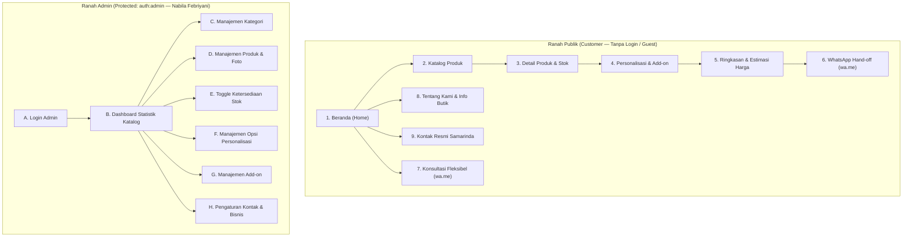
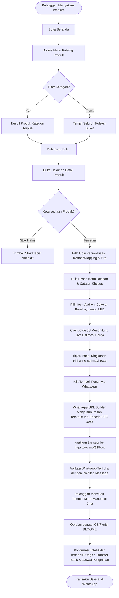
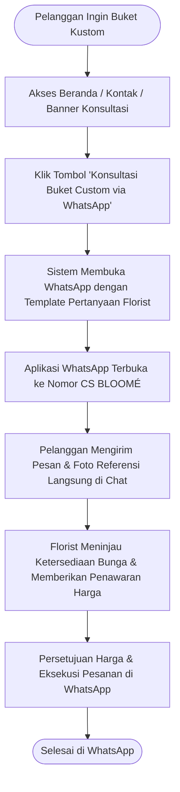
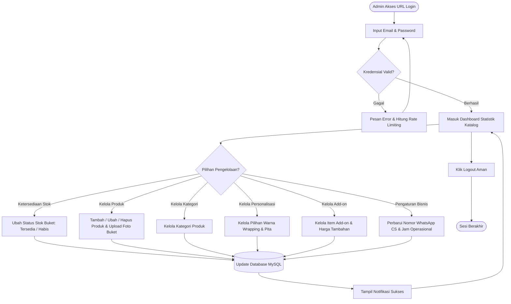

# LAPORAN PENYUSUNAN USER FLOW & ARSITEKTUR NAVIGASI (USER FLOW REPORT)
## BLOOMÉ — Flowers & Stories
**Task ID:** DOC-019  
**Fase:** Phase 1 — Project Initiation and Documentation (Sub-fase 4.4 Technical Documentation)  
**Penanggung Jawab:** Riya Monika (UI/UX Designer) & Jayanti Firdasari (System Analyst)  
**Tanggal Penyusunan:** 13 November 2026 (Diperbarui: 20 November 2026)  
**Status Task:** Completed (`[x]`)  
**Dokumen Hasil:** [user-flow.md](file:///c:/Users/jayan/Documents/buketbunga/buketbunga/user-flow.md) (Versi 1.1 — Penyelarasan Paradigma WhatsApp Hand-off & Zero-Checkout)  

---

## 1. Ringkasan Eksekutif

Penyusunan dan audit dokumen master `user-flow.md` (Task DOC-019) telah selesai diselaraskan dengan kebutuhan sistem terbaru. Dokumen ini menjadi pedoman resmi arsitektur navigasi, peta situs (*sitemap*), serta alur interaksi pengguna (*user flow pathways*) untuk seluruh modul publik dan administratif website **BLOOMÉ — Flowers & Stories**.

Berdasarkan keputusan bisnis terbaru, seluruh alur pemesanan *e-commerce checkout*, penyimpanan transaksi di database, instruksi/verifikasi pembayaran transfer bank di website, siklus status pesanan (ST-01 s/d ST-08), serta pengajuan pembatalan melalui website telah **dihapus sepenuhnya dari sistem**.

Sebagai gantinya, arsitektur interaksi pengguna dialihkan ke paradigma **Katalog Interaktif, Personalisasi Buket, dan WhatsApp Hand-off / Zero-Checkout**. Pelanggan menelusuri katalog, memilih opsi personalisasi dan add-on, meninjau estimasi harga *real-time*, dan meneruskan rincian pesanan secara manual ke WhatsApp resmi BLOOMÉ. Seluruh transaksi moneter, konfirmasi pembayaran, dan koordinasi pengiriman delivery berlangsung langsung di dalam obrolan WhatsApp.

---

## 2. Peta Situs & Arsitektur Informasi (Sitemap & Information Architecture)

Struktur pohon halaman website BLOOMÉ memisahkan domain publik tanpa autentikasi dengan domain administratif tunggal terproteksi:

---

## 3. Rincian Alur Interaksi Pengguna (User Interaction Flows)

### 3.1 User Flow 1: Eksplorasi Katalog, Personalisasi, dan Pemesanan via WhatsApp
Alur utama pelanggan mulai dari penelusuran katalog hingga penyusunan draf pemesanan ke WhatsApp:

#### Karakteristik Utama Alur 1:
1. **Tanpa Akun Pengguna:** Pelanggan tidak perlu melakukan registrasi atau login untuk merancang buket dan memesan.
2. **Kalkulasi Transparan:** Estimasi harga buket dan add-on langsung terlihat di sisi klien secara interaktif sebelum pengguna beralih ke WhatsApp.
3. **Penyusunan Pesan Otomatis:** Sistem merangkai teks pemesanan terstruktur (nama produk, warna wrapping, kartu ucapan, daftar add-on, catatan, dan estimasi subtotal).
4. **Pemberitahuan Sadar (Explicit Consent):** Website menampilkan notifikasi bahwa pesanan belum resmi tercatat sebelum pelanggan menekan tombol kirim di WhatsApp.

---

### 3.2 User Flow 2: Konsultasi Personalisasi Fleksibel via WhatsApp
Alur bagi pelanggan yang menginginkan buket kustom di luar opsi standar katalog:

#### Karakteristik Utama Alur 2:
- Menghilangkan formulir custom rumit dan fitur dropzone upload foto di website publik. Pelanggan mengirimkan foto referensi buket langsung melalui chat WhatsApp, memberikan kenyamanan percakapan natural dan fleksibilitas konsultasi artisan.

---

### 3.3 User Flow 3: Alur Kerja Harian Administrator
Alur kerja pemilik butik / administrator tunggal (Nabila Febriyani):

---

## 4. Batas Sistem yang Jelas (System Demarcation: Website vs. WhatsApp)

| Aspek Alur / Proses | Ranah Website BLOOMÉ | Ranah Ekosistem WhatsApp |
|---|---|---|
| **Katalog & Portofolio** | Menampilkan katalog produk, foto resolusi tinggi, filter kategori, dan status stok. | Tidak tersedia (hanya menerima tautan produk jika dibagikan). |
| **Personalisasi & Add-on**| Konfigurator interaktif (wrapping, pita, pesan kartu ucapan, pilihan add-on). | Ruang klarifikasi jika ada permintaan khusus tambahan. |
| **Estimasi Biaya** | Menghitung live subtotal produk + add-on di browser klien. | Mengonfirmasi total akhir resmi (termasuk ongkos kirim delivery). |
| **Penyusunan Pesan** | Merangkai draf pesan rapi dan menyematkan parameter URL `wa.me`. | Pelanggan membaca dan menekan tombol kirim manual. |
| **Transaksi & Checkout** | **TIDAK ADA.** Tidak ada form checkout atau penyimpanan order di web. | Seluruh transaksi, invoice transfer, dan instruksi rekening di WA. |
| **Pembayaran & Verifikasi**| **TIDAK ADA.** Tidak ada payment gateway atau upload bukti transfer. | Pelanggan mengirimkan bukti transfer via chat; diverifikasi langsung oleh owner. |
| **Pelacakan Pesanan** | **TIDAK ADA.** Website tidak melacak siklus pesanan. | Pelanggan mendapat update foto progres rangkaian buket langsung dari florist di WA. |
| **Koordinasi Delivery** | Menampilkan informasi area layanan kota Samarinda. | Mengatur alamat lengkap pengantaran dan konfirmasi waktu tiba kurir delivery. |

---

## 5. Protokol Penanganan Kasus Batas (Edge Cases Handling)

1. **Kasus Produk Habis Stok (`is_available = false`):**
   - Tombol *"Pesan via WhatsApp"* otomatis dinonaktifkan (`disabled`) dan digantikan teks *"Stok Habis"*.
   - Pelanggan diberikan tombol alternatif: *"Tanyakan Ketersediaan via WhatsApp"* yang mengarah ke chat CS dengan pesan otomatis menanyakan jadwal *restock*.
2. **Karakter Khusus pada Pesan Kartu Ucapan:**
   - Masukan kartu ucapan disaring dan di-*encode* menggunakan format RFC 3986 (`encodeURIComponent`) sehingga karakter baris baru (*enter*), tanda baca, dan emoji dapat terkirim sempurna ke WhatsApp tanpa tautan rusak.
3. **Kendala Aplikasi WhatsApp pada Perangkat Desktop:**
   - Jika pengguna mengakses via browser desktop dan aplikasi WhatsApp Desktop tidak terpasang, tautan diarahkan ke `https://web.whatsapp.com/send?phone=...` dengan pesan instruktif.
   - Halaman kontak selalu mencantumkan nomor WhatsApp resmi dalam bentuk teks agar pelanggan dapat menyimpan kontak secara manual.
4. **Sesi Admin Kedaluwarsa (*Session Timeout*):**
   - Jika sesi login admin kedaluwarsa saat sedang menginput data, sistem mengamankan aksi dan mengarahkan kembali ke halaman login dengan pesan notifikasi ramah tanpa menyebabkan server crash.

---

## 6. Kesimpulan & Status Verifikasi

### 6.1 Status Task DOC-019
Task **DOC-019 (Menyusun & Menyelaraskan user-flow.md)** dinyatakan **SELESAI 100%**:
- Seluruh alur pengguna telah merefleksikan model *Interactive Catalog & WhatsApp Hand-off*.
- Seluruh jejak alur *e-commerce checkout*, verifikasi pembayaran manual di website, siklus pesanan web, dan pembatalan web telah dibersihkan secara komprehensif.
- Arsitektur navigasi publik dan kontrol administratif tunggal terpetakan secara logis dan siap diimplementasikan ke dalam rute dan tampilan Blade.

### 6.2 Hal yang Memerlukan Konfirmasi Owner `[Perlu Konfirmasi Owner]`:
1. **Pola Konsultasi Buket Custom:** Format pesan template default untuk tombol "Konsultasi Buket Custom via WhatsApp" perlu disepakati dengan Nabila Febriyani agar sesuai dengan gaya komunikasi butik BLOOMÉ.
2. **Penentuan Kebijakan Delivery Samarinda:** Apakah rincian kecamatan / estimasi ongkir diinformasikan secara ringkas di website (misal: "Pengiriman khusus area Samarinda"), atau dikonfirmasi seutuhnya di chat WhatsApp.
