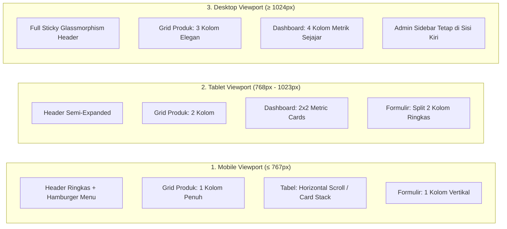

# PANDUAN DESAIN RESPONSIF & ALUR PROTOTIPE (RESPONSIVE & PROTOTYPE SPECIFICATION)
## BLOOMÉ — Flowers & Stories
**Task ID:** UX-040 (Cakupan Sub-fase 6.4 Responsive Design & 6.5 Prototype)  
**Fase:** Phase 3 — UI/UX Design  
**Penanggung Jawab:** Riya Monika (UI/UX Designer & Frontend Developer) & Jayanti Firdasari (Project Manager)  
**Tanggal Penyusunan:** 13 November 2026  
**Status Task:** Completed (`[x]`)  
**Dependensi:** UX-014 s/d UX-039 — Wireframes Pelanggan & Admin  

---

## 1. Ringkasan Eksekutif & Prinsip Desain Responsif

Panduan Desain Responsif dan Alur Prototipe ini merumuskan adaptasi antarmuka pada 3 breakpoint perangkat utama (*Mobile, Tablet, Desktop*) serta memetakan 6 skenario perjalanan prototipe interaktif untuk website **BLOOMÉ — Flowers & Stories**.

Sebagai butik bunga artisan di Kota Samarinda, mayoritas pelanggan (>70%) mengakses katalog melalui gawai pintar seluler (smartphone) saat merayakan momen wisuda, ulang tahun, atau hari jadi. Oleh karena itu, prinsip **Mobile-First Responsive Design** diterapkan secara konsisten.

---

## 2. Matriks Breakpoint Tata Letak 3 Perangkat



### 2.1 Spesifikasi Breakpoint CSS Media Queries
```css
/* Mobile First Base Styles (Smartphone: 360px - 767px) */
:root {
  --container-max-width: 100%;
  --grid-columns: 1;
}

/* Tablet Breakpoint (iPad / Android Tablet: 768px - 1023px) */
@media (min-width: 768px) {
  :root {
    --container-max-width: 720px;
    --grid-columns: 2;
  }
}

/* Desktop Breakpoint (Laptop / PC: ≥ 1024px) */
@media (min-width: 1024px) {
  :root {
    --container-max-width: 1140px;
    --grid-columns: 3;
  }
}

/* Wide Screen Breakpoint (FHD Monitor: ≥ 1280px) */
@media (min-width: 1280px) {
  :root {
    --container-max-width: 1200px;
  }
}
```

---

## 3. Spesifikasi 6 Skenario Prototipe Interaktif

### 3.1 Prototipe 1: Pemesanan Buket Katalog (*Catalog Ordering Journey*)
1. Pengunjung membuka halaman beranda (`/`) $\rightarrow$ Mengklik tombol *"Jelajahi Katalog"*.
2. Memfilter kategori *"Buket Bunga Segar"* $\rightarrow$ Mengklik kartu buket *"Pastel Dream"*.
3. Pada halaman detail (`/katalog/pastel-dream`), pengunjung memeriksa ketersediaan (*Ready Stock*) $\rightarrow$ Mengklik *"Pesan Sekarang"*.
4. Mengisi identitas tamu, alamat pengiriman di Samarinda, memilih tanggal kebutuhan (H+2), dan mengetik pesan kartu ucapan.
5. Meninjau ringkasan tagihan $\rightarrow$ Mengklik *"Konfirmasi Pesanan"*.
6. Sistem menerbitkan kode pesanan unik `BLM-202611-0001` dan menyajikan halaman ringkasan serta rekening butik.

### 3.2 Prototipe 2: Pengajuan Buket Custom (*Custom Ordering Journey*)
1. Pengunjung mengklik menu *"Custom Order"* di navigasi atas.
2. Memilih estimasi anggaran Rp 250.000, nuansa warna *Blush Pink & Burgundy*, bahan *Fresh Flowers*, kertas wrapping *Korean Matte*.
3. Mengunggah 2 foto referensi bunga inspirasi (JPG, masing-masing 2MB) ke dalam dropzone.
4. Mengetik ucapan kartu dan catatan tema wisuda.
5. Menekan tombol *"Kirim Permintaan Custom"*.
6. Sistem menerbitkan tiket `BLM-202611-0002` berstatus `ST-04 Menunggu Konfirmasi Harga Custom` dan menampilkan instruksi menunggu penawaran florist.

### 3.3 Prototipe 3: Penentuan Harga Buket Custom oleh Admin (*Admin Custom Pricing*)
1. Florist (Nabila) login ke panel admin (`/admin/login`).
2. Masuk ke menu *"Permintaan Custom"* $\rightarrow$ Mengklik tiket `BLM-202611-0002`.
3. Memeriksa foto referensi dan spesifikasi bunga $\rightarrow$ Memasukkan estimasi harga final: `Rp 275.000`.
4. Mengklik *"Tetapkan Harga & Kirim Penawaran"*.
5. Status pesanan berubah menjadi `ST-01 Menunggu Pembayaran` dan modal WhatsApp pop-up siap mengirim tautan pembayaran ke pemesan.

### 3.4 Prototipe 4: Verifikasi Bukti Pembayaran Manual (*Payment Verification*)
1. Pelanggan membuka rute pelacakan atau transfer $\rightarrow$ Mengunggah struk transfer bank BCA sebesar Rp 275.000.
2. Status pesanan otomatis berganti ke `ST-02 Menunggu Verifikasi Pembayaran`.
3. Di panel admin, Florist membuka menu *"Verifikasi Pembayaran"*.
4. Mengklik thumbnail bukti transfer untuk zoom struk $\rightarrow$ Memeriksa mutasi rekening m-banking.
5. Mengklik tombol hijau *[Verifikasi Pembayaran]*.
6. Status transaksi beralih ke `ST-05 Diproses` (Florist mulai menyiapkan tangkai bunga).

### 3.5 Prototipe 5: Manajemen Status Fisik Pesanan (*Order Lifecycle Progress*)
1. Florist membuka detail pesanan `BLM-202611-0002`.
2. Setelah rangkaian buket selesai dirangkai, florist mengklik tombol *[Tandai Siap Diambil/Dikirim]*.
3. Status beralih ke `ST-06 Siap Diambil / Dikirim`.
4. Saat buket diserahkan ke kurir atau diambil langsung di butik Loa Janan Ilir, florist mengklik *[Selesaikan Pesanan]*.
5. Status final tercatat sebagai `ST-07 Selesai`.

### 3.6 Prototipe 6: Pengelolaan Pembatalan (*Cancellation Handling*)
1. Pelanggan yang belum membayar pada status `ST-01` dapat mengklik tombol *"Batalkan Pesanan"* secara mandiri (BR-017). Status langsung beralih ke `ST-08 Dibatalkan`.
2. Jika pesanan sudah berstatus `ST-02` atau `ST-05`, pengajuan pembatalan masuk ke antrean admin (`/admin/pembatalan`) untuk dievaluasi oleh florist.

---

## 4. Kesimpulan & Rekomendasi
Seluruh spesifikasi responsivitas multi-perangkat (Sub-fase 6.4) dan 6 alur perjalanan prototipe (Sub-fase 6.5) telah didefinisikan secara komprehensif.

Dengan selesainya dokumen ini, seluruh **Fase 3 UI/UX Design (UX-001 hingga UX-040) resmi SELESAI 100%**.

