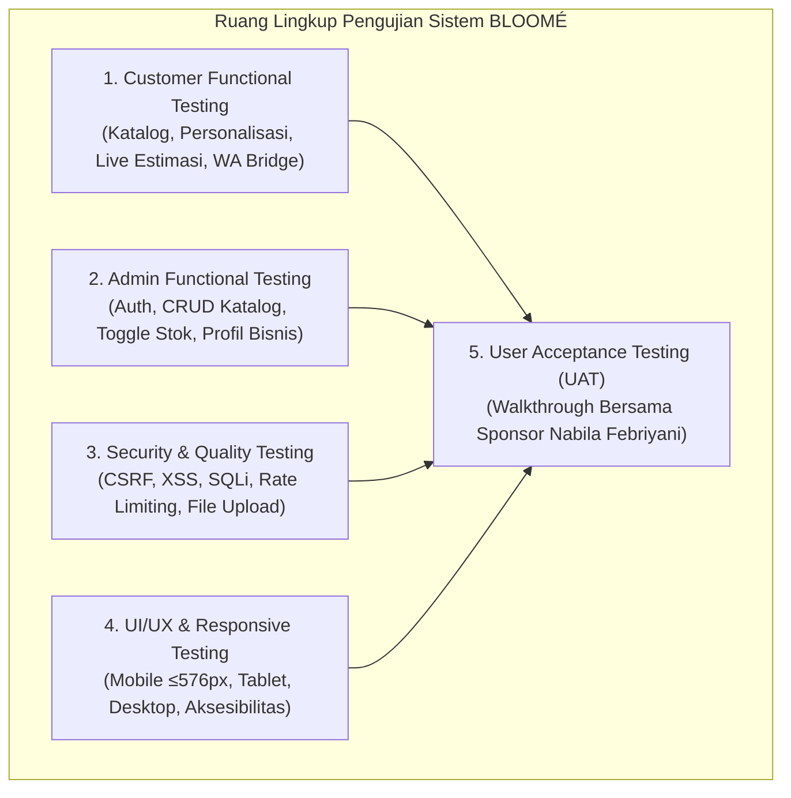

# LAPORAN PENYUSUNAN RENCANA PENGUJIAN PERANGKAT LUNAK (TESTING PLAN REPORT)
## BLOOMÉ — Flowers & Stories
**Task ID:** DOC-021  
**Fase:** Phase 1 — Project Initiation and Documentation (Sub-fase 4.4 Technical Documentation)  
**Penanggung Jawab:** Jayanti Firdasari (Lead QA & PM) didukung Elsa Futri & Riya Monika  
**Tanggal Penyusunan:** 13 November 2026 (Diperbarui: 20 November 2026)  
**Status Task:** Completed (`[x]`)  
**Dokumen Hasil:** [testing-plan.md](../../testing-plan.md) (Versi 1.1 — Penyelarasan Paradigma WhatsApp Hand-off & Zero-Checkout)

---

## 1. Ringkasan Eksekutif

Penyusunan dan audit dokumen master `testing-plan.md` (Task DOC-021) telah selesai diselaraskan dengan kebutuhan sistem, arsitektur, dan model proses bisnis terbaru. Dokumen ini menjadi pedoman resmi penjaminan mutu (*Quality Assurance*), metodologi pengujian fungsional dan keamanan, matriks kasus uji (*test cases*), serta protokol *User Acceptance Testing* (UAT) untuk sistem informasi **BLOOMÉ — Flowers & Stories**.

Sejalan dengan ketetapan sistem terkini, seluruh pengujian yang terkait dengan *checkout website*, integrasi *payment gateway*, penyimpanan transaksi resmi di database web, verifikasi mutasi rekening, mesin 8 status pesanan (*ST-01 s/d ST-08*), serta pelacakan pengiriman di website telah **dihapus seutuhnya dari cakupan pengujian sistem**.

Strategi pengujian difokuskan secara presisi untuk menjamin keandalan fungsi:
1. **Katalog Interaktif Publik:** Penelusuran produk, pemfilteran kategori, visualisasi foto buket, dan indikator ketersediaan stok.
2. **Konfigurator Personalisasi & Add-on:** Fleksibilitas pemilihan warna kertas wrapping, jenis pita, ucapan kartu pos, dan item tambahan.
3. **Kalkulasi Live & WhatsApp URL Builder:** Ketepatan estimasi subtotal di browser dan keakuratan formulasi pesan terenkripsi URL (RFC 3986) saat delegasi pemesanan dialihkan ke WhatsApp.
4. **Keamanan Backoffice Admin Tunggal:** Autentikasi ketat, pembatasan laju percobaan login (*rate limiting*), proteksi CSRF/XSS/SQLi, validasi unggahan foto produk, serta manajemen ketersediaan stok produk secara instan.

---

## 2. Ruang Lingkup Pengujian (Testing Scope)

### 2.1 Item yang Diuji (In-Scope)
- **Domain Pelanggan (Customer):**
  - Akses beranda, navigasi profil butik, dan tautan informasi kontak Samarinda.
  - Penelusuran katalog buket dan filter berbasis kategori produk.
  - Tampilan detail buket, spesifikasi rangkaian, dan indikator status stok (*Tersedia* / *Stok Habis*).
  - Penonaktifan aksi pemesanan untuk buket yang berstatus stok habis.
  - Interaksi pemilihan opsi personalisasi (warna wrapping, jenis pita).
  - Input kartu ucapan khusus dengan validasi batas panjang karakter.
  - Pemilihan item add-on dan akumulasi kuantitas.
  - Kalkulasi *real-time* estimasi total harga di sisi klien (`personalization.js`).
  - Penyusunan pesan pemesanan WhatsApp terstruktur berformat URL encoded (RFC 3986) mencakup karakter spasi, enter (`%0A`), emoji, dan simbol mata uang.
  - Eksekusi tombol "Pesan via WhatsApp" untuk mengalihkan peramban ke `https://wa.me/` dengan parameter draf pesan yang benar.
  - Tombol konsultasi buket custom langsung ke chat WhatsApp florist.
  - Responsivitas layout pada layar mobile (≤ 576px), tablet (768px – 992px), dan desktop (≥ 1024px).
  - Standar aksesibilitas kontras warna dan kenyamanan target sentuh minimal 44px × 44px.

- **Domain Administrator (Admin Backoffice):**
  - Autentikasi admin tunggal (`admin@bloome.com`) dengan verifikasi kata sandi aman (Bcrypt).
  - Penegakan mekanisme *Rate Limiting* (maksimal 5 percobaan gagal per menit).
  - Dashboard ringkasan metrik inventaris katalog buket.
  - CRUD Kategori Produk dan pencegahan penghapusan kategori berelasi aktif.
  - CRUD Produk Buket (nama, deskripsi, harga IDR, kategori).
  - Validasi upload foto buket (MIME-type: JPG, PNG, WebP; batas ukuran maksimal 2MB).
  - Fitur sakelar (*switch toggle*) ketersediaan stok produk (*In Stock* / *Out of Stock*).
  - Pengelolaan opsi personalisasi dan daftar item add-on beserta tarif tambahannya.
  - Pembaruan pengaturan nomor kontak WhatsApp CS dan jam operasional butik.

- **Keamanan Siber & Mutu Nonfungsional:**
  - Pencegahan akses rute ilegal tanpa sesi autentikasi (`auth:admin`).
  - Proteksi terhadap *Cross-Site Request Forgery* (CSRF) via token `@csrf`.
  - Proteksi terhadap *SQL Injection* pada seluruh query basis data (Eloquent ORM & Parameter Binding).
  - Proteksi terhadap *Cross-Site Scripting* (XSS) pada input form dan rendering Blade.
  - Sanitasi berkas unggahan foto (penamaan unik UUID, larangan berkas script yang dapat dieksekusi).
  - Waktu muat halaman (*load time*) rata-rata ≤ 2 detik pada jaringan standar.

### 2.2 Fitur yang Dilarang Diuji Sebagai Fitur Website (Out-of-Scope)
Sesuai arsitektur *Zero-Checkout*, sistem **TIDAK** mencakup dan **TIDAK BOLEH** diuji untuk:
1. Formulir pengisian data pengiriman/checkout pesanan di website.
2. Integrasi *payment gateway* otomatis atau API perbankan.
3. Penyimpanan record transaksi resmi atau penerbitan nomor invoice pesanan di database website.
4. Fitur upload struk/bukti transfer pembayaran oleh pelanggan ke server website.
5. Verifikasi mutasi rekening perbankan di dalam dashboard admin.
6. Mesin status pesanan atau transisi 8 status pengerjaan (*ST-01 s/d ST-08*).
7. Pelacakan posisi kurir atau status pengantaran di website.
8. Fitur registrasi akun atau riwayat pesanan pelanggan.
9. Otomasi bot WhatsApp Business API (pengiriman pesan murni dilakukan secara sadar dan manual oleh pelanggan melalui aplikasi WhatsApp).

---

## 3. Matriks Kasus Uji & Ketertelusuran Kebutuhan (Master Test Matrix & Traceability)

Seluruh skenario pengujian dirancang dengan ketertelusuran penuh terhadap Kebutuhan Fungsional (FR-001 s/d FR-017), Use Case (UC-01 s/d UC-14), dan PRD.

> **Catatan Status Pelaksanaan:**  
> Seluruh test case saat ini berstatus **Planned (Not Run)** karena proses pengerjaan baru menyelesaikan fase perancangan sistem dan dokumen arsitektur (Waterfall Phase 1-3). Pengujian akan dieksekusi secara nyata pada Phase 6 (Testing & QA) setelah implementasi kode (Phase 7-8).

### 3.1 Kasus Uji Domain Pelanggan (Customer Domain)
| Test ID | Skenario Pengujian | Ref Kebutuhan | Use Case | Langkah Pengujian | Hasil yang Diharapkan | Status Pelaksanaan |
|---|---|:---:|:---:|---|---|:---:|
| **TC-CUST-01** | Navigasi Beranda & Profil Butik | FR-001 | UC-01 | Buka URL utama website (`/`). | Halaman beranda tampil dengan hero banner, profil butik Samarinda, dan tautan katalog aktif. | Planned (Not Run) |
| **TC-CUST-02** | Penelusuran Katalog & Filter Kategori | FR-002, FR-004 | UC-02 | Buka menu Katalog, klik tombol filter kategori (misal: "Buket Wisuda"). | Grid produk hanya menampilkan buket yang berelasi dengan kategori terpilih tanpa memuat ulang halaman secara lambat. | Planned (Not Run) |
| **TC-CUST-03** | Tampilan Detail Buket & Informasi Stok | FR-003 | UC-03 | Klik salah satu kartu buket aktif di katalog. | Halaman detail memuat foto resolusi tinggi, deskripsi, harga dasar, dan badge ketersediaan (*Tersedia*). | Planned (Not Run) |
| **TC-CUST-04** | Blokir Pemesanan Buket Stok Habis | FR-003 | UC-03 | Buka halaman detail buket dengan `is_available = 0`. | Tombol *"Pesan via WhatsApp"* dalam kondisi nonaktif (*disabled*), teks tombol berubah *"Stok Habis"*. | Planned (Not Run) |
| **TC-CUST-05** | Konfigurasi Personalisasi Wrapping & Pita | FR-005 | UC-04 | Pilih variasi warna kertas wrapping (Pink Pastel) dan jenis pita (Satin Burgundy). | Seleksi visual aktif ditandai garis sorot ganda; nilai pilihan tersimpan pada state JS sementara. | Planned (Not Run) |
| **TC-CUST-06** | Pemilihan Item Add-on Tambahan | FR-005 | UC-04 | Centang add-on "Boneka Wisuda" (+Rp35.000) dan tambah kuantitas "Cokelat" jadi 2 (+Rp50.000). | Daftar add-on terpilih dan subtotal tambahan langsung terakumulasi secara instan. | Planned (Not Run) |
| **TC-CUST-07** | Input Pesan Kartu Ucapan & Validasi | FR-005 | UC-04 | Ketik pesan ucapan pada textarea kartu pos (150 karakter). | Penghitung karakter menampilkan sisa kuota karakter; input tidak meluap dari batas maksimal (200 karakter). | Planned (Not Run) |
| **TC-CUST-08** | Kalkulasi Live Estimasi Total Harga | FR-006 | UC-05 | Ubah kombinasi produk dasar dan add-on. | Panel estimasi harga langsung memperbarui total penjumlahan (Harga Dasar + Total Add-on) secara *real-time*. | Planned (Not Run) |
| **TC-CUST-09** | Tinjau Modal Ringkasan Pilihan | FR-006 | UC-05 | Klik tombol *"Lihat Ringkasan Pilihan"*. | Muncul modal elegan merangkum nama buket, wrapping, ucapan kartu, rincian add-on, dan estimasi harga total. | Planned (Not Run) |
| **TC-CUST-10** | WhatsApp URL Builder & Encoding RFC 3986 | FR-007 | UC-06 | Klik *"Pesan via WhatsApp"* pada buket yang dikonfigurasi. | URL yang dihasilkan menggunakan format `https://wa.me/628xxx?text=...` dengan parameter teks terenkripsi sempurna (spasi, newline `%0A`, emoji). | Planned (Not Run) |
| **TC-CUST-11** | Pengalihan Pemesanan ke WhatsApp | FR-007 | UC-06 | Klik tombol *"Pesan via WhatsApp"* di peramban seluler / desktop. | Aplikasi WhatsApp atau WhatsApp Web terbuka dengan draf pesan siap kirim; pelanggan mengirim pesan secara manual. | Planned (Not Run) |
| **TC-CUST-12** | Konsultasi Buket Custom via WhatsApp | FR-008 | UC-07 | Klik tombol *"Konsultasi Buket Custom via WhatsApp"*. | WhatsApp terbuka mengarah ke CS BLOOMÉ dengan draf pesan pembuka konsultasi buket custom. | Planned (Not Run) |
| **TC-CUST-13** | Responsivitas Tampilan Seluler (≤ 576px) | NFR-001 | UC-01 s/d UC-07 | Buka website menggunakan viewport ponsel (360px × 800px). | Layout beralih ke 1 kolom, floating bar estimasi harga muncul di bawah, navigasi drawer berfungsi mulus. | Planned (Not Run) |
| **TC-CUST-14** | Aksesibilitas & Kontras Warna | NFR-002 | UC-01 s/d UC-07 | Periksa kontras teks tubuh `#493335` di atas kanvas `#FFF5F6`. | Rasio kontras melebihi 7:1 (Lolos standar WCAG AAA); seluruh elemen interaktif memiliki outline fokus yang jelas. | Planned (Not Run) |

---

### 3.2 Kasus Uji Domain Administrator (Admin Domain)
| Test ID | Skenario Pengujian | Ref Kebutuhan | Use Case | Langkah Pengujian | Hasil yang Diharapkan | Status Pelaksanaan |
|---|---|:---:|:---:|---|---|:---:|
| **TC-ADM-01** | Login Admin Kredensial Valid | FR-009 | UC-08 | Masukkan email `admin@bloome.com` dan kata sandi benar di `/admin/login`. | Autentikasi berhasil, sesi dibuat, admin dialihkan ke `/admin/dashboard`. | Planned (Not Run) |
| **TC-ADM-02** | Login Gagal & Penegakan Rate Limiting | FR-009, FR-017 | UC-08 | Masukkan kata sandi salah sebanyak 5 kali berturut-turut. | Percobaan ke-6 diblokir oleh sistem dengan pesan *"Terlalu banyak percobaan. Silakan coba lagi dalam 60 detik."* | Planned (Not Run) |
| **TC-ADM-03** | Akses Dashboard & Ringkasan Metrik | FR-010 | UC-09 | Akses dashboard setelah login berhasil. | Menampilkan widget metrik: Total Produk Aktif, Total Kategori, Produk Tersedia, dan Produk Habis Stok. | Planned (Not Run) |
| **TC-ADM-04** | CRUD Kategori Produk | FR-011 | UC-10 | Tambah kategori baru "Buket Boneka", ubah nama, lalu verifikasi di daftar. | Kategori baru tersimpan di database dan muncul pada dropdown kategori produk. | Planned (Not Run) |
| **TC-ADM-05** | Pencegahan Hapus Kategori Berelasi | FR-011 | UC-10 | Coba hapus kategori yang masih memiliki relasi produk aktif di dalamnya. | Penghapusan ditolak sistem dengan pesan alert *"Kategori tidak dapat dihapus karena masih memiliki produk terkait."* | Planned (Not Run) |
| **TC-ADM-06** | Tambah & Edit Produk Buket | FR-012 | UC-11 | Masukkan nama buket, harga, pilih kategori, isi deskripsi, klik simpan. | Produk tersimpan di MySQL dan langsung dapat dilihat di katalog publik. | Planned (Not Run) |
| **TC-ADM-07** | Unggah Foto Buket & Validasi Ukuran/Format | FR-012 | UC-11 | Unggah berkas gambar buket format WebP (1.2MB). Coba unggah berkas `.pdf` atau gambar berukuran > 2MB. | Berkas WebP berhasil diunggah; berkas ilegal dan ukuran melebihi 2MB ditolak dengan pesan validasi. | Planned (Not Run) |
| **TC-ADM-08** | Sakelar Toggle Ketersediaan Stok | FR-013 | UC-11 | Klik sakelar toggle stok buket dari "Tersedia" menjadi "Habis". | Status `is_available` di database berganti instan; di katalog publik produk langsung bertanda "Stok Habis". | Planned (Not Run) |
| **TC-ADM-09** | CRUD Opsi Personalisasi & Add-on | FR-014, FR-015 | UC-12 | Tambah item add-on "Lampu LED" seharga Rp15.000, ubah harga, atau nonaktifkan add-on. | Konfigurasi add-on tersimpan dan langsung tercermin pada halaman konfigurator publik. | Planned (Not Run) |
| **TC-ADM-10** | Pengaturan Informasi Kontak Bisnis | FR-016 | UC-13 | Perbarui nomor WhatsApp resmi CS dan jam operasional butik Samarinda. | Nomor baru langsung digunakan oleh komponen *WhatsApp URL Builder* di seluruh website. | Planned (Not Run) |

---

### 3.3 Kasus Uji Keamanan & Mutu Nonfungsional (Security & Quality Tests)
| Test ID | Skenario Kerentanan / Mutu | Ref Kebutuhan | Vektor Pengujian | Hasil yang Diharapkan | Status Pelaksanaan |
|---|---|:---:|---|---|:---:|
| **TC-SEC-01** | Pencegahan Akses Ilegal Panel Admin | FR-017 | Buka URL `/admin/dashboard` tanpa login sesi di mode penyamaran (*incognito*). | Akses ditolak oleh middleware auth; pengguna langsung dialihkan ke `/admin/login`. | Planned (Not Run) |
| **TC-SEC-02** | Proteksi Serangan CSRF | FR-017 | Kirim request POST ke rute admin tanpa menyertakan token `@csrf`. | Server melempar respons HTTP 419 (*Page Expired*); aksi dibatalkan. | Planned (Not Run) |
| **TC-SEC-03** | Proteksi Serangan SQL Injection | FR-017 | Input payload string `' OR '1'='1` pada field input pencarian atau nama kategori. | Input diperlakukan sebagai string murni oleh PDO parameter binding; tidak ada kebocoran data basis data. | Planned (Not Run) |
| **TC-SEC-04** | Proteksi Serangan XSS pada Form Ucapan | FR-017 | Input payload `` pada teks kartu ucapan atau catatan buket. | Tag script otomatis di-escape oleh mesin templating Blade `{{ }}` menjadi karakter entitas HTML aman. | Planned (Not Run) |
| **TC-SEC-05** | Pencegahan Eksekusi Berkas Script PHP | FR-012, FR-017 | Coba unggah file script `backdoor.php` yang dimanipulasi berekstensi `.png`. | Sistem memeriksa MIME-type riil; berkas ditolak dan disimpan di luar direktori eksekusi publik. | Planned (Not Run) |
| **TC-SEC-06** | Uji Kecepatan Performa Halaman Katalog | NFR-003 | Buka halaman katalog berisikan 20 produk buket dengan Chrome DevTools Network audit. | Waktu muat penuh (*Full Load Time*) tercapai dalam tempo ≤ 2.0 detik pada koneksi internet reguler. | Planned (Not Run) |

---

## 4. Kriteria Kelulusan Pengujian (*Exit Criteria & Quality Gates*)

Pengujian sistem BLOOMÉ dinyatakan selesai dan memenuhi syarat serah terima (*handover*) apabila:
1. **100% Kasus Uji P0 (Must Have) Berstatus Lulus (Pass).**
2. **0 Temuan Cacat Kritis (*Critical*) dan Mayor (*Major*) yang Masih Terbuka.**
3. **Validasi URL WhatsApp Builder 100% Sempurna** pada peramban seluler (Chrome Mobile, Safari iOS) dan desktop tanpa ada pemutusan karakter draf pesan.
4. **Audit Keamanan Siber Lolos Penuh:** Tidak ada celah *bypass auth*, SQLi, XSS, maupun eksekusi file terlarang.
5. **Berita Acara User Acceptance Testing (UAT) Ditandatangani** oleh Sponsor Nabila Febriyani.

---

## 5. Protokol Pelaksanaan UAT Bersama Sponsor

Sesi UAT dijadwalkan bertempat di butik BLOOMÉ Samarinda dengan alur skenario terpandu:
1. **Skenario Pelanggan:** Sponsor mengakses website BLOOMÉ dari smartphone, memilih buket bunga wisuda di katalog, memilih kertas wrapping pink, menambahkan boneka dan kartu ucapan, meninjau panel ringkasan estimasi harga, dan mengklik tombol pemesanan WhatsApp.
2. **Verifikasi WhatsApp Hand-off:** Memverifikasi bahwa aplikasi WhatsApp terbuka dengan pesan terformat rapi yang memuat seluruh rincian kustomisasi secara presisi.
3. **Skenario Administrator:** Sponsor login ke panel admin dari laptop, memperbarui status stok salah satu buket menjadi "Habis", mengunggah foto buket baru, dan memastikan perubahan langsung terlihat di katalog publik.
4. **Penandatanganan Dokumen Serah Terima:** Sponsor menandatangani berita acara serah terima UAT setelah seluruh alur diverifikasi secara nyata.

---

## 6. Kesimpulan & Status Verifikasi

### 6.1 Status Task DOC-021
Task **DOC-021 (Menyusun & Menyelaraskan testing-plan.md)** dinyatakan **SELESAI 100%**:
- Seluruh strategi penjaminan mutu, matriks kasus uji, dan protokol UAT telah mencerminkan model *Interactive Catalog & WhatsApp Hand-off*.
- Seluruh kasus uji transaksi lama (*checkout*, verifikasi bank, transisi status ST-01 s/d ST-08, pembatalan web) telah dibersihkan secara komprehensif.
- Matriks ketertelusuran menghubungkan 30 skenario kasus uji dengan kebutuhan fungsional (FR-001 s/d FR-017) dan use case (UC-01 s/d UC-14).
- Status pengujian diberi label secara jujur dan transparan sebagai **Planned (Not Run)**.

### 6.2 Hal yang Memerlukan Konfirmasi Owner `[Perlu Konfirmasi Owner]`:
1. **Verifikasi Uji Integrasi Ongkos Kirim Delivery Samarinda:** Apakah pengujian WhatsApp URL Builder cukup mencakup draf subtotal produk + add-on, atau perlu memuat format teks tambahan penegasan *"Ongkir delivery akan dihitung berdasarkan alamat di Samarinda"*.
2. **Jadwal Pelaksanaan Sesi UAT Lapangan:** Memastikan ketersediaan waktu Nabila Febriyani untuk pelaksanaan walkthrough skenario uji di butik BLOOMÉ Samarinda pada akhir fase pengujian.
