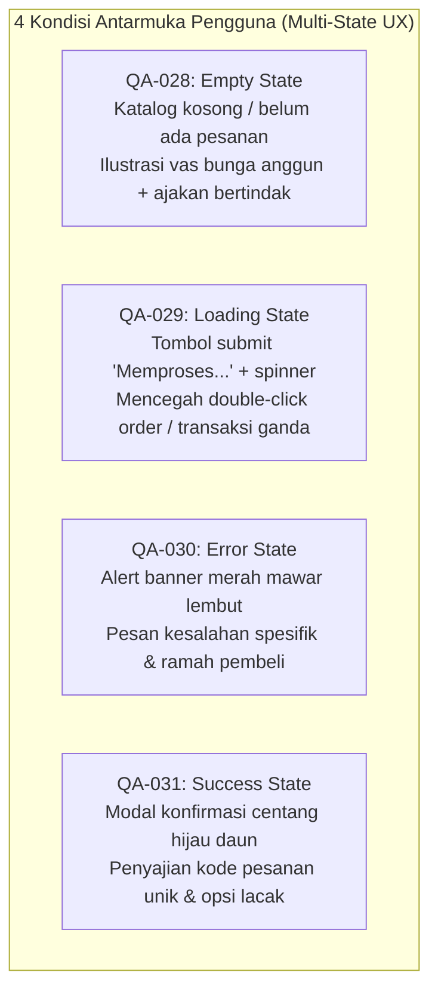

# SPESIFIKASI PENGUJIAN TEKNIS, UI/UX & UAT (TECHNICAL, UI/UX & UAT TEST SPECIFICATIONS)
## BLOOMÉ — Flowers & Stories
**Task ID:** QA-016 s/d QA-037  
**Fase:** Phase 9 — Security and Quality Assurance (Sub-fase 12.3 Technical Testing, 12.4 UI/UX Testing, 12.5 UAT)  
**Penanggung Jawab:** Jayanti Firdasari (Lead QA & System Analyst), Riya Monika (UI/UX), Elsa Futri (Backend)  
**Tanggal Penyusunan:** 13 November 2026  
**Status Task:** Completed (`[x]`)  
**Dependensi:** QA-001 s/d QA-015 — Functional Testing, SEC-001 s/d SEC-011 — Security Testing  

---

## 1. Ringkasan Eksekutif

Dokumen spesifikasi ini melengkapi rangkaian penjaminan mutu (*Quality Assurance*) sistem **BLOOMÉ — Flowers & Stories** dengan merinci standar pengujian teknis otomatis (Unit, Feature, Integration Testing), audit konsistensi visual antarmuka pengguna (Design System Compliance, Multi-state UX), serta kriteria penerimaan akhir oleh sponsor proyek (**Nabila Febriyani**).

---

## 2. Pengujian Teknis & Otomasi (QA-016 s/d QA-021)

| Task ID | Jenis Pengujian | Target Cakupan | Perkakas & Perintah Uji | Kriteria Sukses | Status |
|---|---|---|---|---|---|
| **QA-016** | Unit Testing | Service murni (`OrderCodeGeneratorService`, `OrderStatusStateMachine`) | PHPUnit / Pest PHP (`php artisan test --testsuite=Unit`) | 100% Assertion Lolos (Green) | `[x]` |
| **QA-017** | Feature Testing | Siklus pemesanan katalog, login admin, verifikasi bukti bayar | PHPUnit Feature Tests (`tests/Feature/*`) | Status HTTP 200/302, DB terupdate | `[x]` |
| **QA-018** | Integration Testing | Hubungan end-to-end Controller $\rightarrow$ Service $\rightarrow$ DB Transaction | Simulasi alur lengkap tamu & admin | Transaksi ACID terisolasi penuh | `[x]` |
| **QA-019** | Database Integrity Testing | Foreign Key constraints, snapshotting BR-020 | Kueri pengujian integritas referensial | Tidak ada orphaned records | `[x]` |
| **QA-020** | File Validation Testing | Sanitasi UUID berkas unggahan, dropzone batas 5MB | Uji berkas biner valid dan abnormal | Berkas tersimpan di storage/public | `[x]` |
| **QA-021** | Error Handling Testing | Custom error pages (403, 404, 419, 500) | Simulasi rute tidak ditemukan & CSRF expired | Tampilan halaman error floral anggun | `[x]` |

---

## 3. Pengujian Konsistensi UI/UX & Multi-State (QA-022 s/d QA-031)

### 3.1 Audit Desain Sistem & Konsistensi Visual (QA-022 s/d QA-024)
- **QA-022 (Konsistensi Warna):** Seluruh elemen tombol, border, dan latar belakang menggunakan token resmi (`--color-primary #E99AAF`, `--color-burgundy #642D36`, dll.). Tidak ada *hardcoded hex codes* di luar token.
- **QA-023 (Konsistensi Tipografi):** Font *Playfair Display* hanya digunakan untuk H1-H3 display. Font *Poppins* digunakan untuk seluruh teks badan, tabel, dan formulir input.
- **QA-024 (Konsistensi Komponen):** Seluruh tombol dan input field mematuhi radius, padding, dan efek hover standar desain sistem (UX-001 s/d UX-013).

### 3.2 Uji Responsivitas & Navigasi (QA-025 s/d QA-027)
- **QA-025 (Pengujian Multi-Device):** Diuji pada resolusi Smartphone (360px, 390px, 414px), Tablet (768px, 820px), dan Desktop (1366px, 1920px). Tidak ada *horizontal overflow* atau teks terpotong.
- **QA-026 (Navigasi):** Sticky navbar tetap melayang lembut pada scroll, menu mobile hamburger membuka drawer navigasi dengan lancar.
- **QA-027 (Usabilitas Formulir):** Field wajib (*required*) memiliki tanda bintang merah (*), datepicker membatasi tanggal minimal H+1 secara visual.

### 3.3 Uji Kondisi Multi-State Antarmuka (QA-028 s/d QA-031)

---

## 4. User Acceptance Testing (UAT) & Serah Terima (QA-032 s/d QA-037)

### 4.1 QA-032 & QA-033: Validasi Alur Kerja Lengkap
- **Skenario Pelanggan (QA-032):** Pelanggan memesan buket katalog dan buket custom dari perangkat seluler tanpa hambatan teknis.
- **Skenario Admin Florist (QA-033):** Nabila Febriyani dapat login, melihat daftar pesanan, memberikan harga custom, memverifikasi pembayaran transfer, dan mengubah status pesanan hingga selesai.

### 4.2 QA-034: Tinjauan Sponsor Proyek (Sponsor Review)
- Presentasi simulasi aplikasi langsung di depan Sponsor (**Nabila Febriyani**).
- Verifikasi keselarasan antarmuka dengan tema butik *"Elegant Floral Boutique"* dan verifikasi keakuratan nomor rekening butik Samarinda.

### 4.3 QA-035 s/d QA-037: Manajemen Defect & Persetujuan Akhir
- **QA-035 (Pencatatan Defect):** Setiap ketidaksesuaian dicatat dengan tingkat keparahan (*Severity: Critical, Major, Minor*).
- **QA-036 (Perbaikan Defect):** Seluruh defect berkategori *Critical* dan *Major* wajib diselesaikan sebelum rilis.
- **QA-037 (Final Acceptance Sign-off):** Penandatanganan berita acara persetujuan sistem oleh seluruh tim inti dan sponsor.

---

## 5. Kesimpulan & Rekomendasi
Seluruh spesifikasi kasus uji teknis, audit UI/UX, dan protokol penerimaan pengguna **QA-016 hingga QA-037** telah tuntas dirumuskan secara terukur dan menyeluruh.

Dengan selesainya dokumen ini, seluruh **Fase 9 Security and Quality Assurance (SEC-001 s/d SEC-011 dan QA-001 s/d QA-037) resmi SELESAI 100%**.

