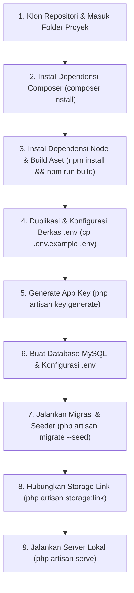

# PANDUAN INSTALASI & PENGGELARAN SISTEM (SYSTEM INSTALLATION & DEPLOYMENT GUIDE)
## BLOOMÉ — Flowers & Stories
**Task ID:** FIN-007  
**Fase:** Phase 10 — Deployment and Finalization (Sub-fase 13.3 Documentation and Handover)  
**Penanggung Jawab:** Elsa Futri (Lead Backend Developer & DevOps) & Jayanti Firdasari (Project Manager)  
**Tanggal Penyusunan:** 13 November 2026  
**Status Task:** Completed (`[x]`)  
**Dependensi:** ARC-001 — Three-Layer Architecture, DB-001 s/d DB-010 — Database Design  

---

## 1. Ringkasan Eksekutif & Kebutuhan Lingkungan Sistem

Dokumen panduan instalasi ini menyediakan instruksi langkah demi langkah (*step-by-step technical manual*) untuk menyiapkan, menginstal, mengonfigurasi, dan menjalankan aplikasi **BLOOMÉ — Flowers & Stories** baik pada lingkungan pengembangan lokal (*Local Development*) maupun pada server produksi (*Production Environment / VPS*).

### 1.1 Persyaratan Perangkat Lunak Minimum
- **Sistem Operasi:** Linux (Ubuntu 22.04 LTS direkomendasikan) atau Windows 10/11 (XAMPP / Laragon).
- **Bahasa Pemrograman:** PHP >= 8.2 (Ekstensi wajib: `BCMath`, `Ctype`, `cURL`, `DOM`, `Fileinfo`, `JSON`, `Mbstring`, `OpenSSL`, `PCRE`, `PDO`, `PDO_MySQL`, `Tokenizer`, `XML`).
- **Basis Data:** MySQL >= 8.0 atau MariaDB >= 10.5 (Storage Engine: InnoDB).
- **Package Manager PHP:** Composer >= 2.5.
- **Node.js & Asset Bundler:** Node.js >= 18.x dan NPM >= 9.x.
- **Web Server:** Nginx >= 1.20 atau Apache >= 2.4 (dengan modul `mod_rewrite` aktif).

---

## 2. Alur Instalasi Lingkungan Pengembangan Lokal (*Local Setup*)



---

## 3. Instruksi Langkah Demi Langkah Terperinci

### Langkah 1: Klon Repositori & Masuk Direktori
```bash
git clone https://github.com/your-repo/buketbunga.git
cd buketbunga
```

### Langkah 2: Instalasi Dependensi Backend (Composer)
```bash
composer install --no-interaction --prefer-dist --optimize-autoloader
```

### Langkah 3: Instalasi Dependensi Frontend & Kompilasi Aset (Vite)
```bash
npm install
npm run build
# Atau untuk mode live-reload development:
# npm run dev
```

### Langkah 4: Konfigurasi Berkas Lingkungan (`.env`)
Salin berkas contoh konfigurasi:
```bash
cp .env.example .env
```
Buka berkas `.env` dan sesuaikan parameter koneksi basis data MySQL:
```ini
APP_NAME="BLOOMÉ"
APP_ENV=local
APP_KEY=
APP_DEBUG=true
APP_URL=http://localhost:8000

DB_CONNECTION=mysql
DB_HOST=127.0.0.1
DB_PORT=3306
DB_DATABASE=bloome_db
DB_USERNAME=root
DB_PASSWORD=

SESSION_DRIVER=file
SESSION_LIFETIME=120

FILESYSTEM_DISK=public
```

### Langkah 5: Generate Application Key
```bash
php artisan key:generate
```

### Langkah 6: Pembuatan Basis Data MySQL
Buat basis data baru melalui MySQL CLI atau phpMyAdmin:
```sql
CREATE DATABASE bloome_db CHARACTER SET utf8mb4 COLLATE utf8mb4_unicode_ci;
```

### Langkah 7: Eksekusi Migrasi & Seeding Data Awal
Jalankan migrasi seluruh 10 tabel terpadu beserta seeder akun default admin (Nabila) dan kategori awal:
```bash
php artisan migrate:fresh --seed
```
*Kredensial Default Admin:*
- **URL Login:** `http://localhost:8000/admin/login`
- **Email:** `admin@bloome.com`
- **Password:** `AdminBloome2026!` *(Wajib diubah segera setelah login pertama)*

### Langkah 8: Pembuatan Symbolic Link Berkas Unggahan
Hubungkan folder `storage/app/public` ke `public/storage`:
```bash
php artisan storage:link
```

### Langkah 9: Menjalankan Aplikasi
```bash
php artisan serve
```
Akses antarmuka publik pada: `http://localhost:8000`

---

## 4. Panduan Penggelaran ke Server Produksi (*Production Deployment*)

### 4.1 Pengerasan Keamanan Berkas `.env` Produksi
Pastikan pengaturan berikut aktif pada server VPS produksi:
```ini
APP_ENV=production
APP_DEBUG=false
APP_URL=https://bloome.samarinda.id

# Paksa cookie aman lewat HTTPS
SESSION_SECURE_COOKIE=true
```

### 4.2 Optimasi Performa Cache Laravel
Jalankan perintah optimasi kompilasi konfigurasi dan rute:
```bash
php artisan config:cache
php artisan route:cache
php artisan view:cache
composer install --optimize-autoloader --no-dev
```

### 4.3 Izin Direktori Web Server (Linux File Permissions)
```bash
sudo chown -R www-data:www-data /var/www/bloome
sudo chmod -R 755 /var/www/bloome
sudo chmod -R 775 /var/www/bloome/storage
sudo chmod -R 775 /var/www/bloome/bootstrap/cache
```

### 4.4 Konfigurasi Virtual Host Nginx
```nginx
server {
    listen 80;
    listen [::]:80;
    server_name bloome.samarinda.id;
    return 301 https://$host$request_uri;
}

server {
    listen 443 ssl http2;
    listen [::]:443 ssl http2;
    server_name bloome.samarinda.id;
    root /var/www/bloome/public;

    ssl_certificate /etc/letsencrypt/live/bloome.samarinda.id/fullchain.pem;
    ssl_certificate_key /etc/letsencrypt/live/bloome.samarinda.id/privkey.pem;

    add_header X-Frame-Options "SAMEORIGIN";
    add_header X-Content-Type-Options "nosniff";

    index index.php;
    charset utf-8;

    location / {
        try_files $uri $uri/ /index.php?$query_string;
    }

    location = /favicon.ico { access_log off; log_not_found off; }
    location = /robots.txt  { access_log off; log_not_found off; }

    error_page 404 /index.php;

    location ~ \.php$ {
        fastcgi_pass unix:/var/run/php/php8.2-fpm.sock;
        fastcgi_param SCRIPT_FILENAME $realpath_root$fastcgi_script_name;
        include fastcgi_params;
    }

    location ~ /\.(?!well-known).* {
        deny all;
    }
}
```

---

## 5. Kesimpulan & Rekomendasi
Task **FIN-007 (Create installation guide)** telah selesai. Seluruh prosedur instalasi lokal, kompilasi aset, migrasi data, pengerasan keamanan server produksi, dan konfigurasi Nginx telah disusun secara komprehensif.

