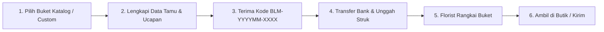

# PANDUAN PENGGUNA: PEMESANAN & PELACAKAN BUKET (CUSTOMER USER GUIDE)
## BLOOMÉ — Flowers & Stories
**Task ID:** FIN-008  
**Fase:** Phase 10 — Deployment and Finalization (Sub-fase 13.3 Documentation and Handover)  
**Penanggung Jawab:** Riya Monika (UI/UX Designer & Frontend) & Jayanti Firdasari (Project Manager)  
**Tanggal Penyusunan:** 13 November 2026  
**Status Task:** Completed (`[x]`)  
**Target Pengguna:** Pelanggan Umum & Tamu Pembeli Buket di Kota Samarinda  

---

## 1. Selamat Datang di BLOOMÉ — Flowers & Stories

Halo Pelanggan Terkasih,

Selamat datang di website resmi **BLOOMÉ — Flowers & Stories**. Kami hadir di Kota Samarinda untuk membantu Anda merayakan setiap momen berharga—mulai dari perayaan kelulusan/wisuda, hari ulang tahun, pertunangan, perayaan hari jadi, hingga ucapan simpati tulus—melalui rangkaian buket bunga artisan yang elegan dan penuh makna.

Pemesanan buket di BLOOMÉ dirancang sangat mudah, cepat, dan **tanpa perlu mendaftar akun atau mengingat kata sandi (*Guest Checkout*)**. Ikuti panduan praktis berikut untuk memulai pemesanan buket impian Anda!

---

## 2. Alur Cepat Pemesanan di BLOOMÉ

---

## 3. Langkah Demi Langkah Cara Pemesanan

### 3.1 Opsi A: Memesan Buket dari Katalog Siap Pesan
1. **Buka Menu Katalog:** Klik menu **"Katalog"** di navigasi atas halaman web.
2. **Pilih Kategori Favorit:** Gunakan filter kategori di bagian atas (*Buket Bunga Segar, Buket Uang, Buket Snack, Buket Boneka*).
3. **Lihat Rincian Bunga:** Klik foto buket yang Anda sukai untuk membaca detail jenis bunga, ukuran, dan harga.
4. **Mulai Pemesanan:** Klik tombol merah muda **"Pesan Sekarang"**.
5. **Isi Formulir Pemesanan Tamu:**
   - **Nama Anda:** Masukkan nama lengkap pemesan.
   - **Nomor WhatsApp:** Pastikan nomor aktif (contoh: `081234567890`) agar florist kami dapat menghubungi Anda.
   - **Alamat Pengiriman:** Masukkan alamat lengkap tujuan di Kota Samarinda (atau beri keterangan *"Ambil Sendiri di Butik"*).
   - **Tanggal Kebutuhan:** Pilih tanggal buket harus siap. *Catatan Penting: Pemesanan minimal H+1 (satu hari sebelum hari kebutuhan).*
   - **Pesan Kartu Ucapan:** Tuliskan kata-kata indah yang ingin kami cetak pada kartu ucapan bunga eksklusif Anda (maksimal 250 karakter).
6. **Konfirmasi Pesanan:** Periksa ringkasan pesanan, lalu klik **"Lanjut ke Pembayaran"**. Sistem akan menerbitkan kode unik pesanan Anda (contoh: `BLM-202611-0015`).

---

### 3.2 Opsi B: Mengajukan Permintaan Personalisasi Buket Custom
Jika Anda memiliki ide rangkaian sendiri, warna khusus, atau buket uang/snack dengan konsep unik:
1. Klik menu **"Custom Order"** pada navigasi utama.
2. **Tentukan Preferensi Anda:**
   - **Perkiraan Anggaran (Budget):** Masukkan nominal budget yang Anda rencanakan (misal: *Rp 250.000*).
   - **Jenis Bunga:** Pilih bunga asli segar, bunga artificial/palsu, bunga kering (*preserved*), atau uang/snack.
   - **Nuansa Warna:** Pilih palet favorit (Pastel Pink, Burgundy Bold, Earthy Sage, Putih Elegan, dll.).
   - **Jenis Kertas Pembungkus (Wrapping):** Pilih Korean Cellophane matte, Rustic Paper cokelat, atau pita satin.
   - **Catatan Khusus:** Jelaskan tema acara (misal: "Buket wisuda untuk sahabat dengan dominasi mawar putih").
3. **Unggah Foto Inspirasi/Referensi:**
   - Unggah 1 hingga 3 foto contoh buket yang Anda sukai (format JPG atau PNG, ukuran maksimal 5MB per foto).
4. Klik tombol **"Kirim Permintaan Custom"**.
5. Tiket pesanan Anda akan berstatus `Menunggu Konfirmasi Harga Custom`. Florist kami (Kak Nabila) akan meninjau ketersediaan bunga dan menetapkan harga terbaik. Anda akan menerima notifikasi pesan WhatsApp berisi nominal harga resmi.

---

## 4. Cara Melakukan Pembayaran & Konfirmasi

Setelah pesanan dibuat atau harga kustom disepakati, status pesanan Anda adalah `Menunggu Pembayaran`.

1. **Rekening Resmi Butik BLOOMÉ:**
   - **Bank BCA:** `123-456-7890` a.n. Nabila Febriyani
   - **Bank Mandiri:** `987-654-3210` a.n. Nabila Febriyani
   - **E-Wallet Dana:** `0812-5555-4321` a.n. Nabila Febriyani
   *(Gunakan tombol "Salin Nomor Rekening" agar tidak terjadi salah ketik nomor).*
2. **Transfer Sesuai Nominal:** Transfer sesuai dengan nominal total tagihan.
3. **Unggah Bukti Struk:**
   - Masuk ke halaman pembayaran (atau buka menu **"Lacak Pesanan"** dan masukkan kode `BLM-...`).
   - Pada formulir konfirmasi, pilih bank asal Anda dan unggah foto struk ATM / tangkapan layar m-banking Anda.
   - Klik **"Kirim Konfirmasi Pembayaran"**.
4. Status pesanan Anda otomatis beralih menjadi `Menunggu Verifikasi`. Tim kami akan mencocokkan mutasi dana dalam waktu 15–30 menit dan langsung mulai merangkai buket Anda!

---

## 5. Cara Melacak Status Pesanan (*Tracking*)

Anda dapat memantau perkembangan buket bunga Anda kapan saja:
1. Buka menu **"Lacak Pesanan"** di website BLOOMÉ.
2. Masukkan kode pesanan Anda (contoh: `BLM-202611-0015`).
3. Anda akan melihat garis waktu (*timeline*) langsung dari 8 status proses:
   - *Menunggu Pembayaran* $\rightarrow$ *Menunggu Verifikasi* $\rightarrow$ *Diproses Florist* $\rightarrow$ *Siap Diambil/Dikirim* $\rightarrow$ *Selesai*.
4. Anda juga dapat langsung mengklik tombol hijau **"Tanya Florist via WhatsApp"** di halaman tersebut untuk terhubung langsung dengan Nabila Febriyani.

---

## 6. Pembatalan Pesanan

- **Pembatalan Mandiri:** Jika Anda belum melakukan transfer pembayaran (status `Menunggu Pembayaran` atau `Menunggu Konfirmasi Harga`), Anda dapat membatalkan pesanan secara mandiri dengan menekan tombol *"Batalkan Pesanan"* di halaman ringkasan pesanan.
- **Pesanan Sudah Diproses:** Jika buket sudah dalam status `Diproses` (bunga sudah dipotong dan dirangkai), permohonan pembatalan harus dikonfirmasikan terlebih dahulu ke pihak florist melalui WhatsApp resmi butik.

---

## 7. Lokasi Butik & Bantuan Pelanggan

- **Alamat Butik:** Jalan Cipto Mangunkusumo, Simpang Tiga, Loa Janan Ilir, Kota Samarinda, Kalimantan Timur.
- **Jam Operasional:** Setiap Hari: 08.00 – 20.00 WITA.
- **WhatsApp Customer Service:** `+62 812-5555-4321`
- **Instagram:** `@bloome.samarinda`

