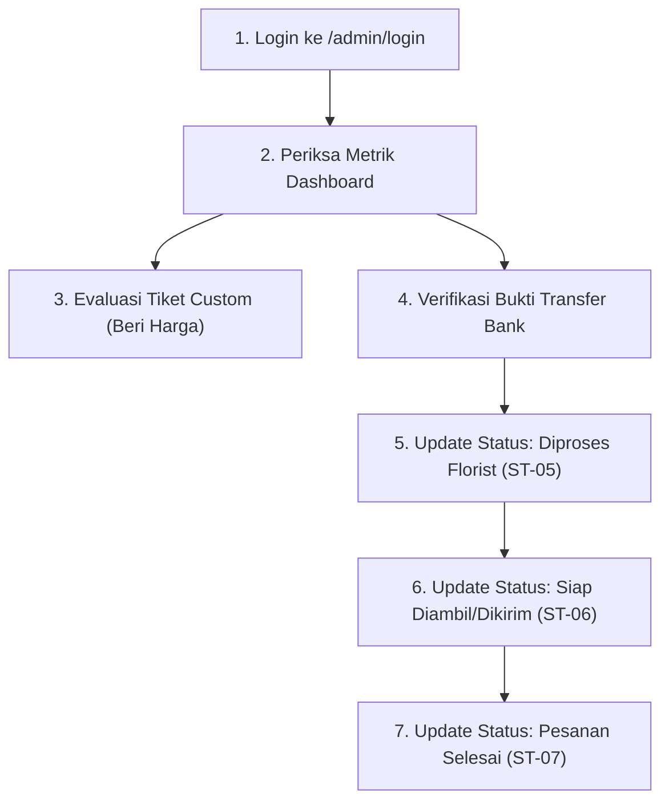

# MANUAL OPERASIONAL ADMINISTRATOR & FLORIST (ADMIN OPERATIONS MANUAL)
## BLOOMÉ — Flowers & Stories
**Task ID:** FIN-009  
**Fase:** Phase 10 — Deployment and Finalization (Sub-fase 13.3 Documentation and Handover)  
**Penanggung Jawab:** Jayanti Firdasari (Project Manager) & Elsa Futri (Backend Architect)  
**Tanggal Penyusunan:** 13 November 2026  
**Status Task:** Completed (`[x]`)  
**Target Pengguna:** Pemilik Usaha & Lead Florist BLOOMÉ (Nabila Febriyani)  

---

## 1. Pendahuluan & Peran Administrator

Manual operasional ini disusun sebagai panduan kerja standar harian (*Standard Operating Procedures - SOP*) bagi **Nabila Febriyani** selaku pemilik usaha (*Owner*) dan Florist Utama dalam mengoperasikan panel administrasi sistem informasi **BLOOMÉ — Flowers & Stories**.

Panel admin BLOOMÉ dirancang ergonomis, intuitif, dan responsif agar dapat diakses dengan nyaman melalui laptop butik maupun ponsel pintar saat merangkai bunga di butik Jl. Cipto Mangunkusumo, Samarinda.

---

## 2. Alur Kerja Harian Florist di Panel Admin

---

## 3. Prosedur Operasional Rinci

### 3.1 Login & Keamanan Sesi Admin
1. Buka peramban dan akses alamat: `https://bloome.samarinda.id/admin/login` (atau `http://localhost:8000/admin/login`).
2. Masukkan email resmi: `admin@bloome.com` dan kata sandi Anda.
3. Centang opsi *"Ingat Sesi Saya"* jika menggunakan perangkat pribadi.
4. Klik **"Masuk ke Dashboard"**.
*Catatan Keamanan:* Jika terjadi 5 kali kegagalan input kata sandi berturut-turut, sistem akan mengunci formulir login selama 60 detik demi mencegah akses ilegal.

---

### 3.2 Meninjau Metrik Operasional Harian
Setelah berhasil masuk, halaman Dashboard menampilkan 4 kartu indikator utama:
- **Pesanan Baru Masuk:** Jumlah pesanan katalog baru yang belum diproses.
- **Butuh Verifikasi Pembayaran (`ST-02`):** Jumlah bukti struk transfer yang diunggah pelanggan dan menunggu audit mutasi bank.
- **Tiket Custom Perlu Harga (`ST-04`):** Permintaan personalisasi buket yang membutuhkan penawaran harga dari florist.
- **Total Omzet Bulan Ini:** Akumulasi nilai pesanan yang pembayarannya telah terverifikasi sah.

---

### 3.3 Mengelola Master Produk & Ketersediaan Stok
1. Klik menu **"Produk"** pada navigasi atas atau bilah sisi.
2. **Menambah Buket Baru:**
   - Klik tombol **"+ Tambah Produk"**.
   - Unggah foto buket berkualitas tajam (format JPG/PNG, ukuran maks 3MB).
   - Masukkan nama buket (contoh: *Pastel Dream Bouquet*).
   - Pilih kategori yang sesuai (Buket Bunga Segar / Buket Uang / Buket Snack).
   - Masukkan harga resmi (contoh: *220000* tanpa titik atau simbol Rp).
   - Tuliskan deskripsi lengkap (komposisi bunga, jumlah tangkai, jenis kertas wrapping).
   - Klik **"Simpan Produk"**.
3. **Mengubah Stok Secara Instan (*Toggle Switch*):**
   - Jika bunga jenis tertentu habis di butik, Anda tidak perlu menghapus produk. Cukup geser toggle switch pada kolom *"Ketersediaan"* menjadi **"Habis"**. Produk tersebut otomatis tidak dapat dipesan di katalog publik.

---

### 3.4 Menangani Pengajuan Buket Custom & Menetapkan Harga
1. Klik menu **"Permintaan Custom"**. Tiket baru akan ditandai dengan badge ungu `Menunggu Konfirmasi Harga`.
2. Klik tombol **"Tinjau Permintaan"** pada tiket yang ingin diproses.
3. **Pemeriksaan Spesifikasi:**
   - Periksa perkiraan budget yang diajukan pemesan.
   - Periksa preferensi bunga, warna, tema perayaan, dan catatan khusus.
   - Klik thumbnail foto referensi untuk membuka galeri foto inspirasi berukuran besar.
4. **Penetapan Harga Penawaran:**
   - Pada panel sebelah kanan, masukkan nominal harga final yang telah Anda hitung (contoh: *275000*).
   - Masukkan catatan singkat florist (misal: "Menggunakan mawar peach asli 10 tangkai dan kertas wrapping cellophane putih list gold").
   - Klik tombol hijau **"Tetapkan Harga & Beritahu Pelanggan"**.
5. Sistem otomatis memunculkan jendela *"Kirim Notifikasi WhatsApp"*. Klik tombol tersebut untuk membuka aplikasi WhatsApp dengan pesan konfirmasi harga yang sudah terformat rapi untuk dikirimkan kepada nomor pelanggan.
6. Status pesanan resmi beralih menjadi `ST-01 Menunggu Pembayaran`.

---

### 3.5 Mengaudit & Memverifikasi Pembayaran Transfer Bank Manual
1. Klik menu **"Pembayaran"**.
2. Anda akan melihat daftar bukti transfer yang menunggu audit (`Status: Pending`).
3. Klik tombol **"Periksa Struk"** pada baris pesanan terkait.
4. Jendela pratinjau struk transfer akan muncul:
   - Periksa nama bank tujuan (BCA / Mandiri / Dana).
   - Periksa nama pemilik rekening pengirim dan tanggal transfer.
   - Periksa nominal transfer pada gambar struk apakah sama dengan total tagihan pesanan.
5. **Buka Aplikasi m-Banking / Mutasi Rekening Anda:** Pastikan dana benar-benar telah masuk ke saldo rekening butik BLOOMÉ.
6. **Eksekusi Keputusan:**
   - **Jika Dana Cocok:** Klik tombol hijau **"Verifikasi Pembayaran"**. Status pesanan otomatis berganti menjadi `ST-05 Diproses`. Pelanggan dapat melihat status buketnya mulai dirangkai saat melacak pesanan.
   - **Jika Dana Tidak Masuk / Struk Buram:** Klik tombol merah **"Tolak Pembayaran"**, lalu masukkan alasan penolakan (misal: "Struk transfer tidak terbaca, mohon unggah ulang foto yang jelas" atau "Dana belum masuk di mutasi bank kami"). Status pesanan berganti menjadi `ST-03 Pembayaran Ditolak` dan pelanggan diminta mengunggah ulang bukti yang valid.

---

### 3.6 Memperbarui Status Fisik Rangkaian Bunga
Untuk memberikan ketenangan kepada pelanggan, perbarui tahapan pesanan saat pengerjaan fisik berlangsung:
1. Buka menu **"Pesanan"** $\rightarrow$ Klik detail pesanan yang sedang Anda kerjakan.
2. **Saat Bunga Selesai Dirangkai:** Klik tombol **"Tandai Siap Diambil/Dikirim"**. Status berubah menjadi `ST-06 Siap Diambil / Dikirim`.
3. **Saat Buket Diserahkan ke Pembeli / Kurir:** Klik tombol **"Selesaikan Pesanan"**. Status berubah menjadi `ST-07 Selesai`.

---

### 3.7 Evaluasi Pengajuan Pembatalan Pesanan
1. Jika pembeli mengajukan pembatalan saat pesanan sudah masuk antrean peracikan, buka menu **"Pembatalan"**.
2. Baca alasan pembatalan pembeli:
   - Jika bunga belum dipotong/dirangkai dan Anda menyetujui pembatalan: Klik **"Setujui Pembatalan"** (Status beralih ke `ST-08 Dibatalkan`).
   - Jika bunga pesanan khusus sudah selesai dirangkai dan tidak dapat dibatalkan: Klik **"Tolak Pembatalan"** dan hubungi pembeli via WhatsApp untuk memberikan penjelasan sopan.

---

### 3.8 Mengubah Rekening Bank & Kontak Butik
1. Klik menu profil di pojok kanan atas $\rightarrow$ Pilih **"Pengaturan"**.
2. Anda dapat memperbarui nomor rekening BCA, Mandiri, Dana, nomor WhatsApp toko, maupun mengganti kata sandi login admin Anda.
3. Klik **"Simpan Perubahan"**.

---

## 4. Kesimpulan & Rekomendasi
Manual Operasional **FIN-009** ini memberikan panduan komprehensif tanpa celah teknis bagi Nabila Febriyani, menjamin operasional butik BLOOMÉ berjalan tertib, aman, dan memuaskan seluruh pelanggan.

