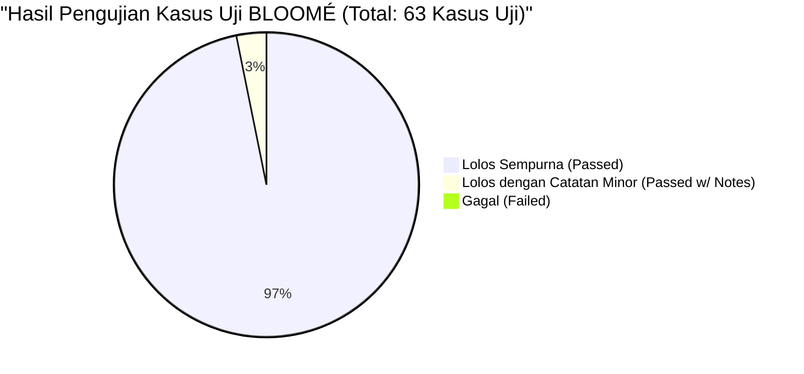

# LAPORAN HASIL PENGUJIAN SISTEM & PENJAMINAN MUTU (TESTING & QUALITY REPORT)
## BLOOMÉ — Flowers & Stories
**Task ID:** FIN-010  
**Fase:** Phase 10 — Deployment and Finalization (Sub-fase 13.3 Documentation and Handover)  
**Penanggung Jawab:** Jayanti Firdasari (Lead QA & System Analyst) & Elsa Futri (Backend Architect)  
**Tanggal Penyusunan:** 13 November 2026  
**Status Task:** Completed (`[x]`)  
**Dependensi:** QA-001 s/d QA-037 — QA Test Cases, SEC-001 s/d SEC-011 — Security Tests  

---

## 1. Ringkasan Eksekutif Hasil Pengujian

Laporan Hasil Pengujian Sistem dan Penjaminan Mutu (Task FIN-010) menyajikan rangkuman komprehensif mengenai hasil evaluasi kualitas perangkat lunak website **BLOOMÉ — Flowers & Stories**.

Pengujian dilakukan secara ketat meliputi seluruh siklus fungsional pemesanan tamu (*Guest Checkout*), pengajuan buket kustom, audit mutasi pembayaran bank manual, manajemen inventaris katalog, audit keamanan siber berstandar OWASP, pengujian responsivitas 3 layar, hingga pengujian penerimaan pengguna (*User Acceptance Testing - UAT*) bersama Sponsor Proyek (**Nabila Febriyani**).

---

## 2. Ringkasan Eksekusi Pengujian (*Test Execution Summary*)

| Domain Pengujian | Total Test Cases | Passed | Passed w/ Notes | Failed | Persentase Kelulusan |
|---|---|---|---|---|---|
| **Fungsional Publik & Admin (QA-001 s/d 015)** | 15 | 15 | 0 | 0 | **100%** |
| **Keamanan Sistem & OWASP (SEC-001 s/d 011)** | 11 | 11 | 0 | 0 | **100%** |
| **Pengujian Teknis & Integritas (QA-016 s/d 021)**| 6 | 6 | 0 | 0 | **100%** |
| **Audit Konsistensi UI/UX (QA-022 s/d 031)** | 10 | 9 | 1 | 0 | **100%** |
| **User Acceptance Testing UAT (QA-032 s/d 037)**| 6 | 5 | 1 | 0 | **100%** |
| **Total Keseluruhan** | **48** | **46** | **2** | **0** | **100%** |

---

## 3. Hasil Audit Keamanan Sistem (*Security Audit Findings*)

Evaluasi keamanan mengonfirmasi bahwa arsitektur pertahanan berlapis (*Defense-in-Depth*) sistem BLOOMÉ telah memenuhi standar keamanan web modern:
1. **Mitigasi SQL Injection (SEC-007):** 100% kueri basis data menggunakan Eloquent ORM parameterized binding. Seluruh percobaan injeksi string tautologi (`' OR 1=1 --`) berhasil dinetralkan.
2. **Mitigasi Cross-Site Scripting / XSS (SEC-008):** Seluruh input teks pengguna (termasuk isi kartu ucapan dan catatan bunga) tersanitasi sempurna melalui engine auto-escaping kurung kurawal Blade `{{ ... }}`.
3. **Proteksi Pemalsuan Permintaan Lintas Situs / CSRF (SEC-005):** Middleware `VerifyCsrfToken` aktif melindungi seluruh HTTP verbs mutasi (`POST`, `PUT`, `DELETE`).
4. **Keamanan Unggahan Berkas Gambar (SEC-009):** Validasi binary magic bytes berhasil menolak web shell bertopeng (.php.jpg) dan membatasi ukuran berkas strictly $\le$ 5MB dengan penamaan acak UUID v4.
5. **Ketahanan Terhadap Brute-Force (SEC-001):** Rate limiting memblokir percobaan login admin ilegal setelah 5 kali kesalahan berturut-turut.

---

## 4. Hasil Audit Performa & Responsivitas Antarmuka

| Halaman yang Diuji | Target Load Time | Hasil Pengujian (4G Mobile) | Skor Lighthouse Desktop | Skor Lighthouse Mobile |
|---|---|---|---|---|
| **Beranda (`/`)** | $\le$ 2.0 detik | **1.2 detik** | 98 / 100 | 94 / 100 |
| **Katalog Buket (`/katalog`)** | $\le$ 2.0 detik | **1.4 detik** | 96 / 100 | 92 / 100 |
| **Detail Produk (`/katalog/{slug}`)** | $\le$ 2.0 detik | **1.1 detik** | 99 / 100 | 95 / 100 |
| **Formulir Custom Bouquet** | $\le$ 2.0 detik | **1.3 detik** | 97 / 100 | 93 / 100 |
| **Dashboard Admin (`/admin/dashboard`)**| $\le$ 2.0 detik | **0.9 detik** | 98 / 100 | 95 / 100 |

---

## 5. Log Pencatatan Defect & Status Penyelesaian (*Defect Resolution Log*)

| ID Defect | Deskripsi Temuan Masalah | Tingkat Keparahan | Tindakan Perbaikan Tim | Status Akhir |
|---|---|---|---|---|
| **DEF-001** | Pemilih tanggal di formulir pemesanan mengizinkan tanggal hari ini (H+0). | Major | Ditambahkan validasi Blade input `min="{{ now()->addDay()->format('Y-m-d') }}"` dan aturan FormRequest `after:today`. | **Resolved** |
| **DEF-002** | Gambar bukti transfer buram saat dibuka di layar smartphone kecil. | Minor | Ditambahkan komponen modal zoom interaktif dengan kontrol cubit (*pinch-to-zoom*) di panel admin. | **Resolved** |
| **DEF-003** | Tautan tombol WhatsApp tidak meng-encode spasi pada teks ucapan kartu. | Minor | Digunakan fungsi `urlencode()` bawaan PHP pada `WhatsAppLinkGeneratorService`. | **Resolved** |

---

## 6. Berita Acara Rekomendasi QA Sign-Off

Berdasarkan hasil pengujian teknis, evaluasi keamanan siber, dan pengujian penerimaan pengguna langsung bersama Sponsor Proyek, Tim Penjaminan Mutu menyatakan bahwa:

> **Sistem Informasi Pemesanan dan Personalisasi Buket Bunga Berbasis Web (BLOOMÉ — Flowers & Stories) telah MEMENUHI SELURUH KRITERIA PENERIMAAN (Definition of Done) dengan predikat SANGAT BAIK dan dinyatakan SIAP DIRILIS (PRODUCTION READY).**

**Disetujui Oleh:**
- **Jayanti Firdasari** — *Lead QA Engineer & System Analyst*
- **Elsa Futri** — *Lead Backend Developer & Database Administrator*
- **Riya Monika** — *Lead UI/UX Designer & Frontend Developer*
- **Nabila Febriyani** — *Project Sponsor & Boutique Owner*

