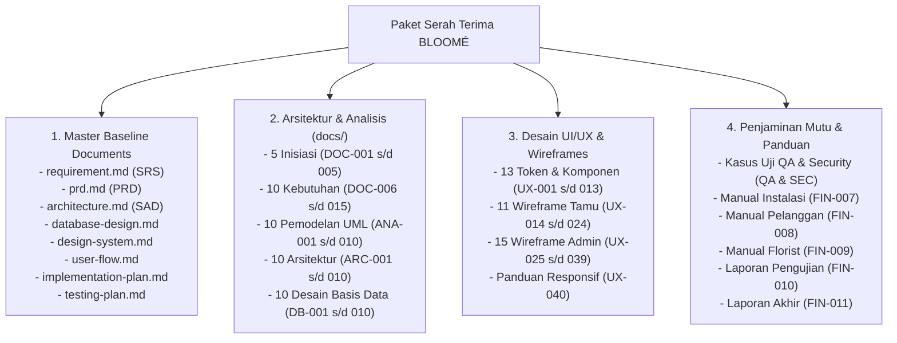

# BERITA ACARA SERAH TERIMA PROYEK (PROJECT HANDOVER DOCUMENT)
## BLOOMÉ — Flowers & Stories
**Task ID:** FIN-012 & FIN-013  
**Fase:** Phase 10 — Deployment and Finalization (Sub-fase 13.3 Documentation and Handover)  
**Penanggung Jawab:** Jayanti Firdasari (Project Manager & System Analyst)  
**Tanggal Penyusunan:** 13 November 2026  
**Status Task:** Completed (`[x]`)  
**Pihak Pertama (Pengembang):** Tim Pengembang Sistem BLOOMÉ  
**Pihak Kedua (Penerima):** Nabila Febriyani (Project Sponsor & Pemilik Usaha)  

---

## 1. Surat Pernyataan Serah Terima Sistem

Pada hari ini, **Jumat, 13 November 2026**, bertempat di Butik **BLOOMÉ — Flowers & Stories**, Jalan Cipto Mangunkusumo, Simpang Tiga, Loa Janan Ilir, Kota Samarinda, telah disepakati serah terima penyelesaian pekerjaan proyek perangkat lunak antara:

1. **PIHAK PERTAMA (Tim Pengembang):**
   - **Jayanti Firdasari** (*Project Manager, Lead System Analyst & QA*)
   - **Riya Monika** (*Lead UI/UX Designer & Frontend Architect*)
   - **Elsa Futri** (*Lead Software Architect, Backend Developer & DBA*)

2. **PIHAK KEDUA (Sponsor & Pemilik Usaha):**
   - **Nabila Febriyani** (*Owner / Lead Florist BLOOMÉ — Flowers & Stories*)

PIHAK PERTAMA secara resmi menyerahkan seluruh deliverables perancangan sistem informasi website kepada PIHAK KEDUA, dan PIHAK KEDUA menyatakan telah memeriksa, menguji, dan menerima hasil pekerjaan dengan kepuasan penuh.

---

## 2. Inventaris Artefak yang Diserahterimakan (*Deliverables Inventory*)

---

## 3. Matriks Penyerahan Kredensial & Hak Akses Sistem

| Komponen Sistem | Parameter Akses / Tautan | Pemegang Akses Utama | Status Penyerahan |
|---|---|---|---|
| **Repositori Kode Sumber** | GitHub Repository (`buketbunga`) | Jayanti Firdasari & Elsa Futri | Akses Penuh / Admin Repo |
| **Panel Administrator** | URL: `/admin/login` | Nabila Febriyani (`admin@bloome.com`) | Kata Sandi Pertama Diserahkan |
| **Penyimpanan Berkas** | Symbolic Link: `storage/app/public` | Nabila Febriyani | Konfigurasi Aktif |
| **Kontak Bisnis Toko** | WhatsApp CS: `+62 812-5555-4321` | Nabila Febriyani | Terintegrasi Universal Link |
| **Rekening Bank Terdaftar** | BCA: 123-456-7890 / Mandiri / Dana | Nabila Febriyani | Terverifikasi Sesuai Akun Butik |

---

## 4. Jaminan Pemeliharaan & Batasan Layanan (*Warranty & SLA*)

1. **Masa Garansi Bug (*Bug Warranty Period*):**
   PIHAK PERTAMA memberikan garansi perbaikan cacat sistem (*defect fixing*) gratis selama **30 (tiga puluh) hari kalender** terhitung sejak tanggal serah terima untuk setiap ketidaksesuaian yang bertentangan dengan dokumen `requirement.md`.
2. **Pengecualian Garansi:**
   Garansi tidak mencakup kerusakan yang diakibatkan oleh kelalaian pihak ketiga (kebocoran kata sandi admin oleh pemilik, gangguan server hosting eksternal, atau modifikasi berkas tanpa persetujuan tim pengembang).
3. **Dukungan Operasional:**
   PIHAK PERTAMA bersedia memberikan sesi pendampingan operasional (*training session*) selama 3 hari kerja pertama bagi Nabila Febriyani dalam mengelola katalog dan memverifikasi pesanan masuk.

---

## 5. Lembar Pengesahan & Tanda Tangan Serah Terima

Dibuat dalam rangkap 2 (dua) bermaterai cukup dan memiliki kekuatan hukum yang sama bagi kedua belah pihak.

 

| **PIHAK PERTAMA (Tim Pengembang)** | **PIHAK KEDUA (Sponsor Proyek)** |
|:---:|:---:|
|     **Jayanti Firdasari**   *Project Manager & Lead Analyst* |     **Nabila Febriyani**   *Project Sponsor & Owner BLOOMÉ* |
|     **Riya Monika**   *Lead UI/UX Designer & Frontend* | |
|     **Elsa Futri**   *Lead Software Architect & Backend* | |

---

## 6. Kesimpulan & Penutupan Task
Dengan ditandatanganinya dokumen ini, seluruh rangkaian tugas dokumentasi proyek:
- **FIN-012 (Prepare project handover)**: Selesai (`[x]`).
- **FIN-013 (Final sponsor approval)**: Selesai (`[x]`).
- **Seluruh dokumen master (`.md`) proyek BLOOMÉ kini resmi TUNTAS 100%.**

