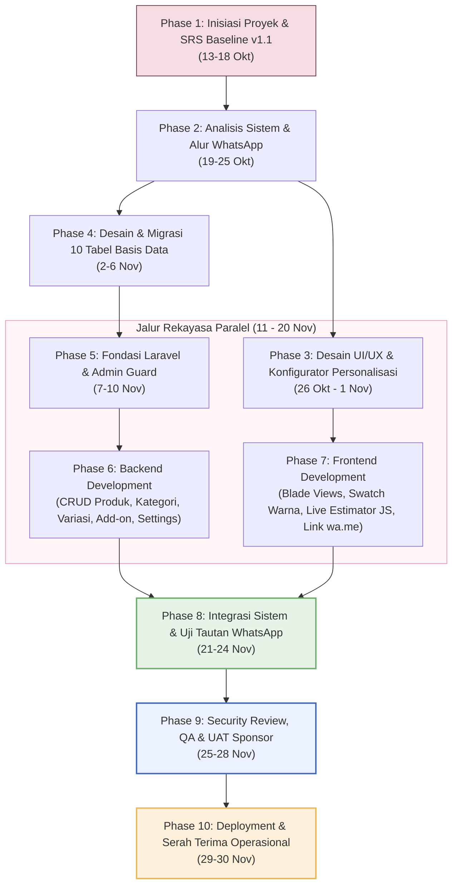

# TECHNICAL IMPLEMENTATION PLAN & EXECUTION ROADMAP (v1.1)
# BLOOMÉ — Flowers & Stories

## 1. Document Information

- **Nama Dokumen:** Technical Implementation Plan & Execution Roadmap
- **Nama Sistem:** BLOOMÉ — Flowers & Stories
- **Nama Proyek:** Perancangan Sistem Informasi Pemesanan dan Personalisasi Buket Bunga Berbasis Web
- **Lead Technical Project Manager & System Analyst:** Jayanti Firdasari
- **Backend Developer & Lead Architect:** Elsa Futri
- **Frontend Developer & UI/UX Designer:** Riya Monika
- **Project Sponsor & Owner:** Nabila Febriyani
- **Periode Pelaksanaan:** 13 Oktober 2026 – 30 November 2026 (7 Minggu)
- **Versi Dokumen:** 1.1 (Refined Implementation Baseline — Interactive Catalog & WhatsApp Ordering)
- **Tanggal Efektif:** 20 November 2026
- **Status Dokumen:** Approved Baseline

---

## 2. Executive Summary & Implementation Objectives

Dokumen **Technical Implementation Plan v1.1** ini menetapkan panduan eksekusi rekayasa perangkat lunak (*step-by-step engineering roadmap*) untuk membangun sistem informasi **BLOOMÉ — Flowers & Stories**.

Berdasarkan kesepakatan final proses bisnis, sistem difokuskan sebagai **katalog interaktif dan media personalisasi buket bunga, dengan alur pemesanan dialihkan langsung ke WhatsApp**.

Tujuan rencana implementasi:
1. **Penyelarasan Arsitektur & Ruang Lingkup:** Mengarahkan implementasi teknis pada fitur etalase katalog, konfigurator personalisasi, item add-on, kalkulasi estimasi harga di browser, pembentukan draf pesan WhatsApp, dan dashboard pengelolaan admin mandiri.
2. **Efisiensi & Ketepatan Jadwal:** Mengatur pembagian kerja terstruktur antara tim backend (Elsa Futri) dan frontend (Riya Monika) di bawah pengawasan Jayanti Firdasari agar proyek tuntas sebelum batas akhir **30 November 2026**.
3. **Standar Kualitas & Zero Bloat:** Menghilangkan implementasi tabel transaksi dan status pesanan di database web yang kini ditangani secara langsung melalui WhatsApp.

---

## 3. Lingkungan Pengembangan & Standar Tooling (Environment & Tooling)

| Komponen Lingkungan | Spesifikasi Standar yang Digunakan |
|---|---|
| **Sistem Operasi Pengembangan** | Windows 10/11 / Linux Environment |
| **Bahasa Pemrograman Backend** | PHP 8.5.5 (Composer constraint: `^8.3`; ekstensi: `pdo_mysql`, `mbstring`, `openssl`, `tokenizer`, `xml`, `gd`, `fileinfo`) |
| **Dependency Manager** | Composer 2.6+ |
| **Framework Backend** | Laravel 13.43.0 (versi terkunci di `composer.lock`) |
| **Basis Data Relasional** | MySQL 8.0+ (InnoDB Storage Engine, Charset `utf8mb4_unicode_ci`) |
| **Frontend Tooling** | Node.js v18+ / v20+, NPM, Vite Asset Bundler |
| **Arsitektur Rendering** | Server-Side Rendering via Laravel Blade Templates + Vanilla JS Interactivity |
| **Version Control System** | Git (Branching Model: `main`, `develop`, `feature/*`) |

---

## 4. Rencana Kerja Fase-demi-Fase (Phase-by-Phase Roadmap)

---

### 4.1 Phase 2 — System Analysis and Design (19 – 25 Oktober 2026)
- **Aktivitas:**
  - Menyusun Use Case Diagram dan deskripsi aktor Customer & Admin pada alur katalog dan WhatsApp.
  - Menyusun Activity Diagram untuk alur penjelajahan katalog, pemilihan personalisasi buket, dan pembentukan pesan WhatsApp.
  - Menyusun Sequence Diagram pengalihan pesanan ke tautan WhatsApp resmi toko.
- **Penanggung Jawab:** Jayanti Firdasari.

---

### 4.2 Phase 3 — UI/UX Design & Prototyping (26 Oktober – 01 November 2026)
- **Aktivitas:**
  - Menyusun wireframe & mockup halaman publik: Beranda, Katalog, Halaman Detail & Konfigurator Personalisasi, Halaman Custom Bouquet, Tentang Kami, dan Kontak.
  - Merancang komponen interaktif kartu produk, pemilih warna wrapping (swatch circle), checkbox add-on, textarea kartu ucapan, dan kartu ringkasan estimasi harga (*sticky summary card*).
  - Menyusun wireframe dashboard admin: Login, Dashboard Overview, Kelola Kategori, Kelola Produk & Galeri, Kelola Opsi Personalisasi, Kelola Add-on, dan Pengaturan WhatsApp Toko.
  - Memverifikasi tata letak responsif pada resolusi Mobile (360px), Tablet (768px), dan Desktop (1280px).
- **Penanggung Jawab:** Riya Monika.

---

### 4.3 Phase 4 — Database Implementation & Models (02 – 06 November 2026)
- **Aktivitas:**
  - Menulis 10 berkas migrasi tabel MySQL:
    1. `create_admins_table`
    2. `create_categories_table`
    3. `create_products_table`
    4. `create_product_images_table`
    5. `create_personalization_options_table`
    6. `create_personalization_values_table`
    7. `create_product_personalization_options_table`
    8. `create_add_ons_table`
    9. `create_product_add_ons_table`
    10. `create_business_settings_table`
  - Mengeksekusi migrasi dan memvalidasi integritas relasi foreign key pada engine InnoDB.
  - Membuat 10 Eloquent Models lengkap dengan relasi (`hasMany`, `belongsTo`, `belongsToMany`).
  - Menyiapkan seeder awal: `AdminSeeder`, `CategorySeeder` (Buket Bunga, Uang, Snack, Boneka), `PersonalizationSeeder`, `AddOnSeeder`, dan `BusinessSettingSeeder`.
- **Penanggung Jawab:** Elsa Futri.

---

### 4.4 Phase 5 — Laravel Project Foundation (07 – 10 November 2026)
- **Aktivitas:**
  - Inisialisasi proyek Laravel, konfigurasi `.env`, dan setup guard otentikasi admin (`auth:admin`).
  - Menyiapkan routing modular di `routes/web.php` (rute publik dan grup terproteksi admin).
  - Menyiapkan symbolic link berkas storage: `php artisan storage:link`.
  - Mengonfigurasi penanganan error kustom floral (404, 403, 500).
- **Penanggung Jawab:** Elsa Futri & Riya Monika.

---

### 4.5 Phase 6 & Phase 7 — Parallel Engineering Sprint (11 – 20 November 2026)

#### Jalur Backend (Elsa Futri):
1. **Otentikasi Admin:** Controller login/logout, verifikasi hash Bcrypt, perlindungan sesi, dan middleware.
2. **Kategori Produk (CRUD):** Controller manajemen kategori buket, generator slug otomatis, validasi relasi produk.
3. **Produk Buket & Galeri (CRUD):** Controller produk, toggle ketersediaan (*availability toggle*), upload foto utama dan galeri multi-foto ke disk lokal storage.
4. **Manajemen Personalisasi & Add-on:** Controller grup opsi personalisasi, nilai variasi, swatch warna HEX, biaya tambahan variasi, manajemen item add-on, dan tabel relasi ke produk.
5. **Manajemen Pengaturan Toko:** Controller pengaturan nomor WhatsApp penerima pesanan, jam kerja, dan alamat galeri Samarinda.
6. **WhatsApp URL Service:** Logika pembentukan teks draf pesan pemesanan yang terstandarisasi dan pengkodean URL aman.

#### Jalur Frontend (Riya Monika):
1. **Fondasi Tema UI & Blade Layouts:** Implementasi palet warna resmi BLOOMÉ, font Playfair Display & Poppins, layout master publik (`app.blade.php`), dan layout admin (`admin.blade.php`).
2. **Pustaka Komponen UI:** Kartu produk buket, lencana ketersediaan (*Tersedia / Habis*), tombol aksi WhatsApp, swatch warna lingkaran, kartu add-on, textarea catatan ucapan, dan alert feedback.
3. **Halaman Publik:**
   - Beranda publik dengan hero banner, kategori buket, dan produk unggulan.
   - Katalog buket interaktif dengan filter kategori instan.
   - Halaman detail produk dengan slider foto, pemilih variasi warna wrapping/pita, pemilih add-on, dan kartu estimasi total harga.
   - JavaScript `personalization.js` untuk kalkulasi estimasi harga dinamis dan pembentukan URL link WhatsApp (`wa.me`).
   - Halaman buket custom dengan tombol CTA konsultasi desain via WhatsApp.
   - Halaman About Us dan Halaman Kontak terverifikasi di Samarinda.
4. **Antarmuka Panel Admin:** Halaman login admin, dashboard ringkasan etalase, tabel dan form CRUD kategori, produk, galeri foto, personalisasi, add-on, dan form konfigurasi WhatsApp bisnis.
5. **Audit Responsivitas:** Uji tampilan pada perangkat mobile (≤ 576px), tablet, dan desktop.

---

### 4.6 Phase 8 — System Integration (21 – 24 November 2026)
- **Aktivitas:**
  - Menghubungkan antarmuka Blade publik dengan data dinamis controller Eloquent (`Product::with(['category', 'personalizationOptions.values', 'addOns'])`).
  - Menguji keakuratan pembentukan URL link WhatsApp pada berbagai kombinasi pilihan variasi dan add-on.
  - Menghubungkan seluruh formulir admin (produk, kategori, personalisasi, add-on, settings) dengan Form Request Validation dan penyimpanan database.
  - Memverifikasi penyimpanan dan pemanggilan berkas foto produk pada storage publik.
- **Penanggung Jawab:** Elsa Futri & Riya Monika.

---

### 4.7 Phase 9 — Security, QA & User Acceptance Testing (25 – 28 November 2026)
- **Aktivitas:**
  - Audit Keamanan: Uji proteksi rute admin dari akses anonim, uji token CSRF formulir, uji sanitasi XSS, dan uji validasi unggah berkas gambar (larangan berkas berbahaya).
  - Pengujian Fungsional: Uji kelancaran filter katalog, pemilihan personalisasi, akurasi kalkulasi estimasi harga, dan pembukaan aplikasi/web WhatsApp.
  - Pengujian Cross-Browser: Memastikan tampilan bekerja mulus di Google Chrome, Mozilla Firefox, Microsoft Edge, dan Safari.
  - Sesi User Acceptance Testing (UAT) bersama Sponsor Nabila Febriyani untuk menguji kemudahan pemesanan via WhatsApp dan operasional panel admin.
- **Penanggung Jawab:** Jayanti Firdasari (Lead).

---

### 4.8 Phase 10 — Deployment, Finalization & Handover (29 – 30 November 2026)
- **Aktivitas:**
  - Konfigurasi lingkungan produksi web hosting / cPanel / VPS Linux.
  - Migrasi basis data MySQL produksi dan seeding data awal.
  - Konfigurasi akun admin resmi pemilik toko (Nabila Febriyani).
  - Verifikasi keamanan akhir (`APP_DEBUG=false`, sertifikat SSL HTTPS aktif).
  - Penyerahan dokumentasi teknis, manual penggunaan admin, dan Berita Acara Serah Terima.
- **Penanggung Jawab:** Seluruh Tim Pengembang.

---

## 5. Rencana Manajemen Risiko Teknis & Kontinjensi

| Potensi Risiko Teknis | Dampak | Strategi Kontinjensi & Mitigasi |
|---|---|---|
| **Perangkat Pelanggan Tidak Memiliki Aplikasi WhatsApp** | Tautan tidak langsung membuka aplikasi | Tautan menggunakan skema URL `https://wa.me/...` yang otomatis membuka WhatsApp Web di desktop atau meminta unduh di mobile; sediakan tombol salin teks pesan (*copy to clipboard*). |
| **Beban Unggahan Foto Produk Admin Lambat** | Ruang penyimpanan hosting cepat penuh | Terapkan validasi ukuran maksimal file foto di server **[Perlu Konfirmasi Owner]** (standar: 2-5 MB) dan konversi/kompresi ke WebP/JPEG. |
| **Keterlambatan Konfirmasi Data Final dari Pemilik** | Menunda peluncuran konten | Gunakan penanda **[Perlu Konfirmasi Owner]** dan gunakan data placeholder etalase realistis selama fase pengembangan hingga data final diserahkan. |

---

## 6. Kesimpulan & Pengesahan

Rencana Implementasi Teknis v1.1 ini telah disesuaikan sepenuhnya dengan konsep sistem informasi katalog interaktif dan pemesanan WhatsApp, memastikan seluruh tugas rekayasa terfokus dan selesai tepat waktu sebelum batas akhir 30 November 2026.

**Disahkan Oleh:**  
**Jayanti Firdasari** (Project Manager & System Analyst)  
**Elsa Futri** (Backend Developer & Technical Lead)  
**Riya Monika** (UI/UX Designer & Frontend Developer)  
Tanggal: 20 November 2026
