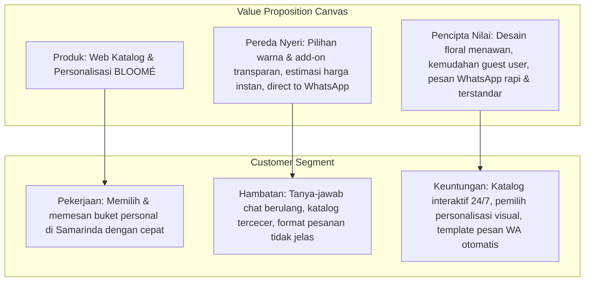
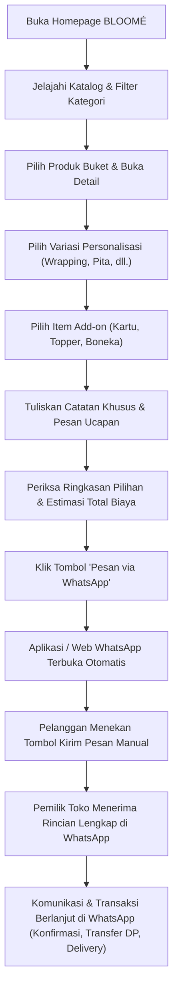
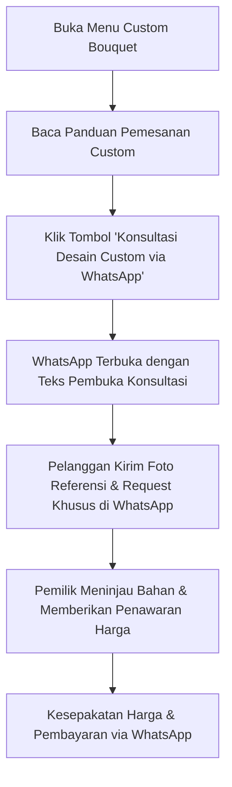

# PRODUCT REQUIREMENTS DOCUMENT (PRD) (v1.1)
# BLOOMÉ — Flowers & Stories

## Document Information

- **Nama Dokumen:** Product Requirements Document (PRD)
- **Nama Produk:** BLOOMÉ — Flowers & Stories
- **Nama Proyek:** Perancangan Sistem Informasi Pemesanan dan Personalisasi Buket Bunga Berbasis Web
- **Project Sponsor / Owner:** Nabila Febriyani (Pemilik Usaha BLOOMÉ)
- **Lokasi Usaha:** Jalan Cipto Mangunkusumo, Simpang Tiga, Loa Janan Ilir, Kota Samarinda, Kalimantan Timur
- **Product Manager & System Analyst:** Jayanti Firdasari
- **UI/UX Designer & Frontend Developer:** Riya Monika
- **Backend Developer & Database Administrator:** Elsa Futri
- **Versi Dokumen:** 1.1 (Refined Product Baseline — Interactive Catalog & Personalization with WhatsApp Ordering)
- **Tanggal Efektif:** 20 November 2026
- **Status Dokumen:** Approved Baseline

---

# 1. Product Overview

**BLOOMÉ — Flowers & Stories** adalah platform sistem informasi berbasis web yang berfungsi sebagai **katalog interaktif dan media personalisasi buket bunga** bagi usaha *florist boutique* BLOOMÉ di Kota Samarinda.

Berdasarkan kesepakatan final proses bisnis antara tim pengembang dan pemilik usaha, sistem web difokuskan untuk memfasilitasi eksplorasi visual produk yang kaya dan memudahkan pelanggan memilih buket serta preferensi variasinya secara mandiri, sedangkan transaksi pemesanan, verifikasi pembayaran, negosiasi, dan koordinasi pengiriman dilanjutkan secara langsung melalui WhatsApp.

Sistem web mencakup 3 pilar layanan utama:
1. **Interactive Catalog & Category Showcase:** Etalase buket siap pesan dengan navigasi kategori dinamis, galeri multi-foto, rincian komposisi buket, harga dasar, dan indikator ketersediaan stok.
2. **Interactive Bouquet Personalization & Add-on Selector:** Antarmuka interaktif bagi pelanggan untuk memilih variasi personalisasi (warna kertas pembungkus/wrapping, jenis pita satin, nuansa warna), memilih item add-on (kartu ucapan, boneka wisuda, lampu LED, topper akrilik), menuliskan catatan ucapan, serta melihat estimasi total harga secara *real-time*.
3. **Automated WhatsApp Order Dispatcher:** Tombol tindakan terintegrasi yang menyusun seluruh preferensi buket ke dalam draf pesan WhatsApp yang rapi dan terstruktur, serta membuka tautan chat resmi pemilik (`https://wa.me/...`) tanpa perantara API gateway berbayar.
4. **Pusat Kendali Pengelola (Admin Dashboard):** Panel administrasi terproteksi bagi pemilik usaha untuk mengelola katalog, kategori, foto galeri, variasi personalisasi, item add-on, ketersediaan produk, dan nomor WhatsApp tujuan pemesanan secara mandiri.

---

# 2. Product Vision & Positioning

### 2.1 Visi Produk
Menjadi platform katalog digital dan butik buket bunga terdepan di Samarinda yang menghadirkan pengalaman visual estetis, kemudahan personalisasi buket secara interaktif, dan alur pemesanan yang ramah dan personal melalui WhatsApp, memperkuat filosofi merangkai cerita di setiap buket (*Flowers & Stories*).

### 2.2 Positioning Produk
BLOOMÉ memposisikan diri sebagai butik buket bunga artistik (*artisan floral boutique*) yang memadukan keindahan visual web modern dengan kedekatan komunikasi personal WhatsApp, tanpa membebani pelanggan dengan kewajiban registrasi akun atau alur checkout yang kaku.

### 2.3 Nilai Tambah Produk (Value Proposition)
- **Bagi Pelanggan (Customer):**
  - *No-Login Browsing:* Menjelajahi katalog lengkap dengan informasi harga transparan tanpa hambatan membuat akun.
  - *Interactive Personalization:* Memilih warna wrapping, pita, dan add-on secara visual dengan estimasi harga yang terhitung otomatis.
  - *Instant WhatsApp Hand-off:* Rincian pesanan tersusun otomatis menjadi teks pesan yang siap kirim ke WhatsApp toko dalam satu klik.
  - *Custom Consultation Channel:* Akses langsung ke pemilik untuk konsultasi buket custom unik di luar katalog.
- **Bagi Pemilik Usaha (Admin):**
  - *Structured Incoming Chats:* Pesan WhatsApp dari pelanggan sudah berformat rapi dan memuat rincian lengkap, memangkas tanya-jawab berulang.
  - *Zero Web Transaction Maintenance:* Tidak perlu memelihara sistem transaksi perbankan, gateway, atau audit database pesanan di web.
  - *Full Content Autonomy:* Kebebasan mengelola foto buket, harga, ketersediaan stok, variasi warna, dan add-on secara instan melalui dashboard.

---

# 3. Business Problem and Opportunity

### 3.1 Masalah Bisnis yang Dihadapi (Problem Statement)
Sebelum adanya sistem web BLOOMÉ v1.1, operasional bisnis bertumpu penuh pada obrolan pesan WhatsApp tanpa etalase digital:
1. **Katalog Tidak Terpusat:** Foto buket tersebar di galeri ponsel atau media sosial tanpa kepastian harga dan stok bahan terkini.
2. **Tanya-Jawab Berulang:** Admin harus berulang kali mengetik daftar harga, mengirimkan foto contoh warna wrapping, dan menjelaskan opsi kartu ucapan satu per satu.
3. **Format Chat Pelanggan Berantakan:** Pelanggan mengirimkan pesan yang tidak lengkap (hanya foto tanpa menyebutkan warna pita, ucapan, atau tanggal kebutuhan), sehingga memperpanjang waktu konfirmasi.
4. **Keterbatasan Waktu Pemilik:** Pemilik usaha mengelola perangkaian bunga sekaligus melayani chat, sehingga membutuhkan media etalase yang mampu mengedukasi pembeli sebelum memulai percakapan.

### 3.2 Peluang Produk (Product Opportunity)
Katalog web interaktif BLOOMÉ menjadi solusi tepat guna untuk:
- Mengedukasi pelanggan mengenai variasi warna, add-on, dan kisaran harga buket sebelum menghubungi toko.
- Membakukan format rincian pemesanan melalui template pesan WhatsApp otomatis.
- Menghemat waktu komunikasi awal pemilik toko hingga lebih dari 50%.

---

# 4. Product Goals and Objectives

| Kategori Tujuan | Sasaran Strategis Produk | Indikator Keberhasilan Fungsional |
|---|---|---|
| **Customer Experience** | Menghadirkan pengalaman eksplorasi buket yang cepat, indah, dan interaktif. | 100% halaman responsif mobile; konfigurasi personalisasi dan kalkulasi estimasi harga selesai dalam ≤ 2 menit. |
| **Ordering Efficiency** | Mempercepat pembentukan pesan pemesanan ke WhatsApp toko. | Tombol "Pesan via WhatsApp" berhasil menyusun pesan rapi dengan 100% akurasi pilihan produk, variasi, dan add-on. |
| **Content Autonomy** | Memberikan kemudahan bagi pemilik dalam memperbarui katalog dan variasi. | Admin dapat menambah/mengubah produk, mengunggah foto, dan mengatur variasi personalisasi tanpa bantuan developer. |
| **System Reliability** | Menyediakan web katalog yang ringan, cepat, dan aman. | Waktu muat halaman (*page load time*) ≤ 2 detik; arsitektur Three-Layer bersih tanpa tabel transaksi usang. |

---

# 5. Target Users & User Personas

### 5.1 Persona 1: Customer (Guest User)
- **Nama Representatif:** Dinda Kirana (22 Tahun, Mahasiswi / Pekerja Muda Samarinda).
- **Karakteristik:** Estetis, sibuk, mengutamakan kemudahan belanja via smartphone, menyukai hadiah buket yang dipersonalisasi.
- **Tujuan (Goals):**
  - Melihat katalog buket dengan foto jelas dan harga pasti tanpa harus bertanya di chat awal.
  - Memilih warna kertas wrapping dan pita yang cocok dengan warna favorit sahabat.
  - Menambahkan kartu ucapan dan boneka mini dalam satu alur interaktif.
  - Mengirim rincian pesanan langsung ke WhatsApp toko tanpa registrasi akun.
- **Pain Points:**
  - Malas mengunduh aplikasi atau mengisi form registrasi akun hanya untuk membeli buket.
  - Sering bingung memilih kombinasi warna jika tidak ada contoh katalog yang rapi.

### 5.2 Persona 2: Administrator / Business Owner
- **Nama Representatif:** Nabila Febriyani (Pemilik Usaha BLOOMÉ).
- **Karakteristik:** Kreatif, teliti dalam merangkai bunga, mengelola usaha butik bunga secara langsung.
- **Tujuan (Goals):**
  - Menerima pesan pesanan di WhatsApp yang sudah lengkap dengan pilihan warna wrapping, add-on, dan teks kartu ucapan.
  - Memperbarui stok buket (*tersedia / habis*) dengan cepat dari smartphone atau laptop saat bahan bunga kosong.
  - Mengelola etalase foto buket agar selalu tampil modern dan profesional.
- **Pain Points:**
  - Capek melayani chat pembeli yang hanya menanyakan "ini harganya berapa?" berulang kali.
  - Tidak ingin dibebani sistem administrasi web yang rumit seperti rekonsiliasi payment gateway atau database order tracking di web.

---

# 6. Value Proposition Canvas

---

# 7. Product Scope: In-Scope vs Out-of-Scope

### 7.1 In-Scope (Rilis v1.1)
- **Antarmuka Publik Pelanggan:**
  - Halaman Beranda (Hero, Cerita Usaha, Produk Unggulan, Kategori, CTA Custom Bouquet, Kontak, Footer).
  - Katalog Produk Interaktif & Filter Kategori (Buket Bunga, Uang, Snack, Boneka).
  - Halaman Detail Produk & Status Ketersediaan Pengerjaan.
  - Konfigurator Personalisasi Buket (Warna Wrapping, Warna Pita Satin, Nuansa Warna).
  - Pemilih Item Add-on (Kartu Ucapan, Topper, Boneka Wisuda, Lampu LED).
  - Kolom Input Catatan Khusus & Teks Ucapan.
  - Ringkasan Konfigurasi & Kalkulasi Estimasi Total Harga secara *real-time*.
  - Generator Draf Pesan Pemesanan WhatsApp & Tautan Direct Link (`wa.me`).
  - Halaman / Tombol Konsultasi Buket Custom via WhatsApp.
  - Halaman Profil Toko (*About Us*) dan Informasi Kontak Samarinda (*Contact Us*).
- **Antarmuka Dashboard Admin:**
  - Otentikasi Admin tunggal dengan hashing sandi dan session guard.
  - Dashboard Overview Metrik Master Data (Produk, Kategori, Add-on, Stok).
  - Modul Manajemen Kategori Buket (CRUD Categories).
  - Modul Manajemen Produk Buket (CRUD Products, Foto Utama, Deskripsi, Harga Dasar).
  - Toggle Cepat Ketersediaan Produk (*Tersedia* / *Habis*).
  - Modul Galeri Multi-Foto Produk (CRUD Product Images).
  - Modul Manajemen Opsi Personalisasi & Nilai Variasi (CRUD Options & Values).
  - Penetapan Opsi Personalisasi ke Produk (*Product Personalization Assignment*).
  - Modul Manajemen Item Add-on & Harga (CRUD Add-ons).
  - Penetapan Item Add-on ke Produk (*Product Add-on Assignment*).
  - Modul Pengaturan Kontak & Nomor WhatsApp Toko (*Business Settings*).

### 7.2 Out-of-Scope (Dikecualikan Secara Tegas dari Sistem Web)
- Pendaftaran akun, login, dan profil pelanggan di website.
- Keranjang belanja multi-langkah (*shopping cart*) dan alur checkout di web.
- Penyimpanan transaksi pesanan (*orders / order_details*) di basis data web.
- Pelacakan status pengerjaan pesanan di web (status ST-01 s/d ST-08 di web dieliminasi).
- Pembayaran di web dan integrasi *payment gateway* (Midtrans, Xendit, dll.).
- Formulir unggah bukti transfer pembayaran di website.
- Manajemen negosiasi harga di website.
- Integrasi bot otomatis WhatsApp API gateway berbayar (pengiriman dilakukan manual oleh pemesan melalui tautan URL scheme).
- Sistem live-tracking kurir atau integrasi ekspedisi otomatis.
- Sistem multi-role admin (hanya satu akun admin pemilik usaha).

---

# 8. Functional Product Features (F-001 s/d F-029)

Seluruh fitur produk didefinisikan secara presisi dan konsisten dengan batasan ruang lingkup v1.1:

| Feature ID | Nama Fitur | Aktor | Deskripsi & Kriteria Perilaku | Prioritas |
|---|---|---|---|:---:|
| **F-001** | Homepage | Customer | Menyajikan identitas butik, hero banner, showcase produk favorit, kategori, dan kontak. | Must Have |
| **F-002** | Interactive Product Catalog | Customer | Menampilkan kartu produk buket dengan filter kategori dan penanda ketersediaan. | Must Have |
| **F-003** | Product Detail View | Customer | Halaman rincian foto, komposisi buket, harga dasar, deskripsi, dan panel personalisasi. | Must Have |
| **F-004** | Category Browsing & Filter | Customer | Navigasi interaktif untuk memfilter buket berdasarkan kelompok kategori spesifik. | Must Have |
| **F-005** | Bouquet Personalization Selector | Customer | Komponen pemilihan variasi personalisasi (wrapping paper, pita, dll.) berbasis database. | Must Have |
| **F-006** | Add-on Selector & Cost Calculation | Customer | Pemilihan item tambahan (kartu, topper, boneka, lampu LED) beserta rincian biaya tambahannya. | Must Have |
| **F-007** | Order Notes & Greeting Card Input | Customer | Area teks input untuk instruksi khusus pelanggan dan pesan kartu ucapan. | Must Have |
| **F-008** | Real-Time Summary & Price Estimation | Customer | Kalkulasi estimasi total biaya secara dinamis di browser sebelum dialihkan ke WA. | Must Have |
| **F-009** | WhatsApp Order Message Generator | Customer | Mengompilasi pilihan produk dan personalisasi menjadi draf pesan WhatsApp terstruktur (`wa.me`). | Must Have |
| **F-010** | Multi-Bouquet Order Formulation | Customer | Opsi perangkuman beberapa buket ke dalam satu pesan WhatsApp **[Perlu Konfirmasi Owner]**. | Could Have |
| **F-011** | Custom Bouquet WhatsApp CTA | Customer | Tombol tautan chat cepat ke WhatsApp toko untuk konsultasi desain buket kreasi bebas. | Must Have |
| **F-012** | Business Profile & Store Contact | Customer | Informasi profil usaha, alamat galeri di Samarinda, jam operasional, dan tautan medsos. | Must Have |
| **F-013** | Single Admin Authentication | Admin | Form login dan logout aman dengan hashing sandi Bcrypt dan token CSRF. | Must Have |
| **F-014** | Admin Dashboard Overview | Admin | Tampilan ringkasan master data (jumlah produk aktif, kategori, variasi, add-on). | Should Have |
| **F-015** | Category Management (CRUD) | Admin | Kelola master kategori buket dengan validasi nama unik dan slug otomatis. | Must Have |
| **F-016** | Product Catalog Management (CRUD) | Admin | Tambah, ubah, dan hapus data buket katalog, harga dasar, deskripsi, dan foto utama. | Must Have |
| **F-017** | Product Availability Toggle | Admin | Mengubah status ketersediaan buket (*Tersedia* / *Habis*) dalam satu klik. | Must Have |
| **F-018** | Product Gallery Management | Admin | Mengunggah dan mengatur multi-foto pendukung produk buket. | Must Have |
| **F-019** | Personalization Options Management | Admin | Kelola kelompok opsi variasi buket (nama opsi, tipe input: select/radio/swatch). | Must Have |
| **F-020** | Personalization Values Management | Admin | Kelola nilai variasi spesifik, biaya tambahan, kode hex swatch warna, dan stok variasi. | Must Have |
| **F-021** | Product Personalization Assignment | Admin | Mengaitkan opsi personalisasi yang berlaku pada produk buket tertentu. | Must Have |
| **F-022** | Add-on Master Management | Admin | Kelola data master item tambahan buket (nama, harga satuan, deskripsi, thumbnail). | Must Have |
| **F-023** | Product Add-on Assignment | Admin | Mengonfigurasi pilihan item add-on yang dapat dipilih pada produk buket tertentu. | Must Have |
| **F-024** | Business Settings Management | Admin | Memperbarui nomor WhatsApp resmi toko, jam operasional, dan alamat toko Samarinda. | Must Have |
| **F-025** | Responsive Mobile-First Navigation | System | Layout antarmuka responsif optimal untuk layar smartphone, tablet, dan desktop. | Must Have |
| **F-026** | Visual Color Swatch & Selection Indicator | UI/UX | Visual swatch warna dan lencana indikator status pilihan pada antarmuka pengguna. | Should Have |
| **F-027** | Web Security & Form Protection | System | Proteksi CSRF, sanitasi input XSS, dan perlindungan route admin via middleware. | Must Have |
| **F-028** | Media Upload & File Validation | System | Validasi format (JPG, PNG, WebP) dan ukuran berkas foto di sisi server. | Must Have |
| **F-029** | Database Seeding & Maintenance Routine | System | Skrip seeder data awal dan prosedur backup berkala basis data MySQL. | Should Have |

---

# 9. User Stories & Acceptance Scenarios

### 9.1 Kisah Pengguna Pelanggan (Customer Stories)
- **US-01 (Katalog & Filter):** *Sebagai pelanggan, saya ingin menjelajahi katalog buket dan memfilter berdasarkan kategori, agar saya dapat menemukan buket yang cocok dengan cepat.*
  - *Acceptance:* Filter kategori berfungsi instan menampilkan produk aktif dengan foto, nama, harga, dan status ketersediaan.
- **US-02 (Personalisasi Buket):** *Sebagai pelanggan, saya ingin memilih warna wrapping paper dan pita satin pada buket pilihan saya, agar buket tersebut sesuai dengan selera penerima.*
  - *Acceptance:* Pilihan variasi tampil jelas dengan swatch warna dan langsung tercermin pada ringkasan pesanan.
- **US-03 (Pemilihan Add-on):** *Sebagai pelanggan, saya ingin menambahkan kartu ucapan cetak atau boneka mini, agar hadiah saya lebih berkesan.*
  - *Acceptance:* Add-on dapat dicentang, harga otomatis ditambahkan ke estimasi total harga di halaman detail.
- **US-04 (Ringkasan & Pesan via WhatsApp):** *Sebagai pelanggan, saya ingin melihat ringkasan estimasi total biaya dan menekan tombol pesan ke WhatsApp, agar rincian pesanan saya langsung terkirim tanpa harus mengetik ulang.*
  - *Acceptance:* Klik tombol "Pesan via WhatsApp" membuka WhatsApp dengan pesan terisi rapi memuat produk, variasi, add-on, catatan, dan estimasi total.
- **US-05 (Konsultasi Custom):** *Sebagai pelanggan, saya ingin mengklik tombol konsultasi buket custom, agar saya dapat mendiskusikan buket impian saya langsung dengan florist melalui WhatsApp.*
  - *Acceptance:* Tombol mengarahkan ke chat WhatsApp pemilik dengan teks pembuka konsultasi custom.

### 9.2 Kisah Pengguna Administrator (Admin Stories)
- **US-06 (Login Aman):** *Sebagai admin, saya ingin login ke dashboard menggunakan email dan password yang terenkripsi, agar data etalase terlindungi dari akses publik.*
  - *Acceptance:* Sistem memvalidasi kredensial aman; rute admin tidak dapat diakses tanpa login.
- **US-07 (Kelola Produk & Stok):** *Sebagai admin, saya ingin menambah buket baru dan mengubah status ketersediaan buket, agar informasi di katalog selalu akurat dengan stok bahan fisik.*
  - *Acceptance:* Admin dapat mengedit data produk dan mengubah status *Tersedia / Habis* yang langsung berpengaruh pada web katalog.
- **US-08 (Kelola Variasi & Add-on):** *Sebagai admin, saya ingin menambahkan pilihan warna kertas wrapping baru dan item add-on beserta harganya, agar pelanggan memiliki variasi pilihan yang dinamis.*
  - *Acceptance:* Admin dapat membuat opsi personalisasi dan add-on baru serta menautkannya ke produk buket.
- **US-09 (Pengaturan WhatsApp Bisnis):** *Sebagai admin, saya ingin memperbarui nomor WhatsApp toko melalui pengaturan dashboard, agar saat nomor toko berganti, tombol pemesanan di web langsung terarah ke nomor baru.*
  - *Acceptance:* Perubahan nomor WhatsApp di `business_settings` otomatis mengupdate link `wa.me` di sisi publik.

---

# 10. User Journeys & Product Flows

### 10.1 Alur Pelanggan: Katalog, Personalisasi, dan Pemesanan WhatsApp

### 10.2 Alur Pelanggan: Konsultasi Buket Custom

---

# 11. Batas Proses Pemesanan & Alur Transaksi WhatsApp (Off-Web Process)

Berikut adalah batasan arsitektural dan operasional antara website dan komunikasi WhatsApp:

1. **Website Tidak Melakukan Checkout:** Seluruh proses checkout transaksi formal dihentikan di web. Website hanya bertindak sebagai kalkulator estimasi dan generator pesan.
2. **Pengiriman Manual oleh Pelanggan:** Pengguna wajib menekan tombol kirim di WhatsApp. Web tidak memiliki kuasa mengirimkan pesan otomatis tanpa persetujuan pengguna.
3. **Konfirmasi Ketersediaan & Total Final:** Pemilik toko mengonfirmasi ketersediaan slot pengerjaan dan ongkos kirim area Samarinda melalui percakapan WhatsApp.
4. **Pembayaran Transaksi:** Pembayaran dilakukan melalui transfer rekening bank atau e-wallet resmi yang diinformasikan langsung oleh pemilik di WhatsApp.
5. **Bukti Pembayaran:** Pelanggan mengirimkan tangkapan layar bukti transfer ke WhatsApp toko. Verifikasi dilakukan langsung oleh pemilik tanpa upload ke web.
6. **Ketentuan DP 50%:** Pemilik toko menerima uang muka 50% untuk memulai pembuatan buket, dengan pelunasan sesuai jadwal yang disepakati **[Perlu Konfirmasi Owner]**.
7. **Pengiriman (*Delivery*):** Pemilik toko mengoordinasikan jadwal dan titik antar buket menggunakan layanan kurir lokal di Samarinda **[Perlu Konfirmasi Owner]**.
8. **Pembatalan & Pengembalian Dana:** Dibicarakan langsung dengan pemilik sebelum buket dirangkai; kebijakan refund belum ditetapkan **[Perlu Konfirmasi Owner]**.

---

# 12. Product Prioritization (MoSCoW Framework)

### 12.1 Must Have (Wajib Ada pada Rilis v1.1)
- Beranda publik dengan visual identitas brand BLOOMÉ yang konsisten.
- Katalog buket interaktif dengan filter kategori dinamis.
- Halaman detail produk dengan galeri foto, deskripsi, dan ketersediaan.
- Antarmuka pemilihan personalisasi buket (warna wrapping, pita, dll.).
- Antarmuka pemilihan add-on beserta penambahan biaya satuan.
- Input catatan khusus pelanggan untuk pesan ucapan.
- Ringkasan konfigurasi dan kalkulasi estimasi total harga di sisi browser.
- Generator teks draf pesan WhatsApp dan tombol direct link `wa.me`.
- Tombol konsultasi buket custom langsung ke WhatsApp.
- Login dan logout admin tunggal dengan session guard dan proteksi CSRF.
- CRUD kategori produk buket.
- CRUD produk buket, toggle ketersediaan, dan galeri multi-foto.
- CRUD opsi dan nilai personalisasi beserta penetapannya ke produk.
- CRUD item add-on beserta penetapannya ke produk.
- Pengaturan nomor WhatsApp toko dan informasi kontak di dashboard.

### 12.2 Should Have (Sangat Dianjurkan)
- Tampilan kartu ringkasan metrik etalase di dashboard admin.
- Visual color swatch interaktif pada pilihan warna variasi buket.
- Indikator feedback visual multi-state (*loading skeleton, empty illustration, error alerts*).
- Validasi berkas upload gambar di server (JPG, PNG, WebP).

### 12.3 Could Have (Fitur Pelengkap Masa Depan)
- Fitur pemilihan beberapa buket dalam satu pesan WhatsApp (*multi-bouquet order in single message*) **[Perlu Konfirmasi Owner]**.
- Duplikasi cepat produk katalog lama untuk mempermudah admin menginput buket baru.

### 12.4 Won't Have (Dieliminasi dari Ruang Lingkup Web)
- Pendaftaran akun, login, dan profil pelanggan.
- Modul keranjang belanja (*shopping cart*) dan alur checkout di web.
- Penyimpanan data pesanan transaksi resmi di basis data web.
- Manajemen 8 status pesanan (ST-01 s/d ST-08) di website.
- Integrasi *payment gateway* otomatis pihak ketiga.
- Formulir upload bukti transfer dan verifikasi pembayaran di web.
- Manajemen negosiasi harga dan pembatalan di web.
- Integrasi WhatsApp Business API bot berbayar.
- Tracking live GPS kurir atau integrasi ekspedisi.
- Manajemen multi-role admin.

---

# 13. Success Metrics & Product KPIs

| Indikator Sukses | Deskripsi Metrik | Metode Pengukuran | Target Keberimaan Produk |
|---|---|---|---|
| **Catalog Browsing Experience** | Kelancaran eksplorasi katalog dan filter kategori. | Pengujian fungsional filter kategori pada perangkat mobile & desktop. | 100% produk aktif terfilter dengan benar tanpa error. |
| **Personalization Usability** | Kemudahan memilih variasi dan item add-on. | Uji interaksi pemilihan opsi personalisasi dan penambahan add-on. | Estimasi harga terhitung otomatis dan akurat secara *real-time*. |
| **WhatsApp Dispatch Accuracy** | Ketepatan penyusunan draf pesan WhatsApp. | Pengujian klik tombol "Pesan via WhatsApp" pada berbagai skenario pilihan. | 100% format pesan memuat rincian produk, variasi, add-on, catatan, dan estimasi total dengan benar. |
| **Admin Content Management** | Kemudahan admin memperbarui konten etalase. | Uji tambah produk, upload foto, ubah stok, dan ubah nomor WhatsApp. | Data langsung tersimpan di MySQL dan tampil instan di web publik. |
| **Multi-Device Adaptability** | Tampilan web pada berbagai ukuran layar. | Audit responsif pada resolusi 360px (mobile), 768px (tablet), 1280px (desktop). | Skor usability 100% tanpa elemen tumpang-tindih. |
| **Page Speed Performance** | Kecepatan render antarmuka pengguna. | Browser DevTools Network tab. | Initial Page Load ≤ 2,0 detik pada koneksi internet 4G. |

---

# 14. Log Parameter Menunggu Konfirmasi (`[Perlu Konfirmasi Owner]`)

Seluruh parameter berikut berstatus terbuka dan dilarang diasumsikan secara sepihak:

| No. | Parameter / Kebijakan Operasional | Keterangan & Catatan Kebutuhan |
|:---:|---|---|
| 1 | **Nomor WhatsApp Resmi Bisnis** | Nomor WhatsApp toko definitif penerima pesanan. |
| 2 | **Daftar Master Produk & Foto Final** | Foto asli beresolusi tinggi dan nama resmi buket yang dijual. |
| 3 | **Struktur Harga Produk Final** | Harga dasar definitif untuk setiap varian buket di etalase. |
| 4 | **Daftar Variasi Personalisasi Resmi** | Pilihan resmi warna wrapping, pita, dan kepastian biaya variasinya. |
| 5 | **Daftar Item Add-on & Harga Final** | Daftar barang pelengkap resmi (kartu, boneka, topper, lampu LED) beserta harga jualnya. |
| 6 | **Pemesanan Multi-Buket dalam Satu Pesan** | Keputusan apakah pelanggan boleh merangkum banyak buket dalam satu pesan WhatsApp. |
| 7 | **Format Data Pelanggan yang Diperlukan** | Rincian data pengiriman yang wajib dicantumkan pada chat WhatsApp pemesan. |
| 8 | **Format Alamat & Jam Pengantaran Samarinda** | Wilayah cakupan pengantaran lokal Samarinda dan batas waktu order *same-day delivery*. |
| 9 | **Penerapan DP 50% & Batas Waktu Pelunasan** | Ketentuan pembayaran uang muka 50% dan batas waktu pelunasan (sebelum dirangkai atau sebelum dikirim). |
| 10 | **Detail Rekening Bank & E-Wallet Toko** | Nomor rekening BCA/BRI dan akun e-wallet resmi untuk transaksi di WhatsApp. |
| 11 | **Kebijakan Pembatalan & Refund** | Aturan baku pembatalan pesanan dan persentase pengembalian dana jika pesanan dibatalkan. |
| 12 | **Tautan Resmi Profil Media Sosial** | Akun Instagram dan TikTok resmi BLOOMÉ Samarinda. |
| 13 | **Batas Ukuran & Resolusi Foto Admin** | Batas maksimal ukuran file foto upload produk (contoh: 2 MB atau 5 MB). |
| 14 | **Rencana Hosting, Domain & Jadwal Backup** | Nama domain pilihan, penyedia hosting, dan frekuensi pencadangan basis data. |

---

# 15. Pengesahan Dokumen PRD

Dokumen Product Requirements Document (PRD) v1.1 ini telah disesuaikan dan disahkan sebagai acuan tunggal keselarasan produk dan perancangan teknis arsitektur sistem informasi BLOOMÉ:

- **Disusun Oleh:** Jayanti Firdasari (Project Manager & Lead System Analyst)
- **Ditinjau Bersama:** Riya Monika (UI/UX Designer & Frontend Developer) & Elsa Futri (Backend Developer & DBA)
- **Disetujui Oleh:** Nabila Febriyani (Project Sponsor / Owner BLOOMÉ)
- **Tanggal:** 20 November 2026
