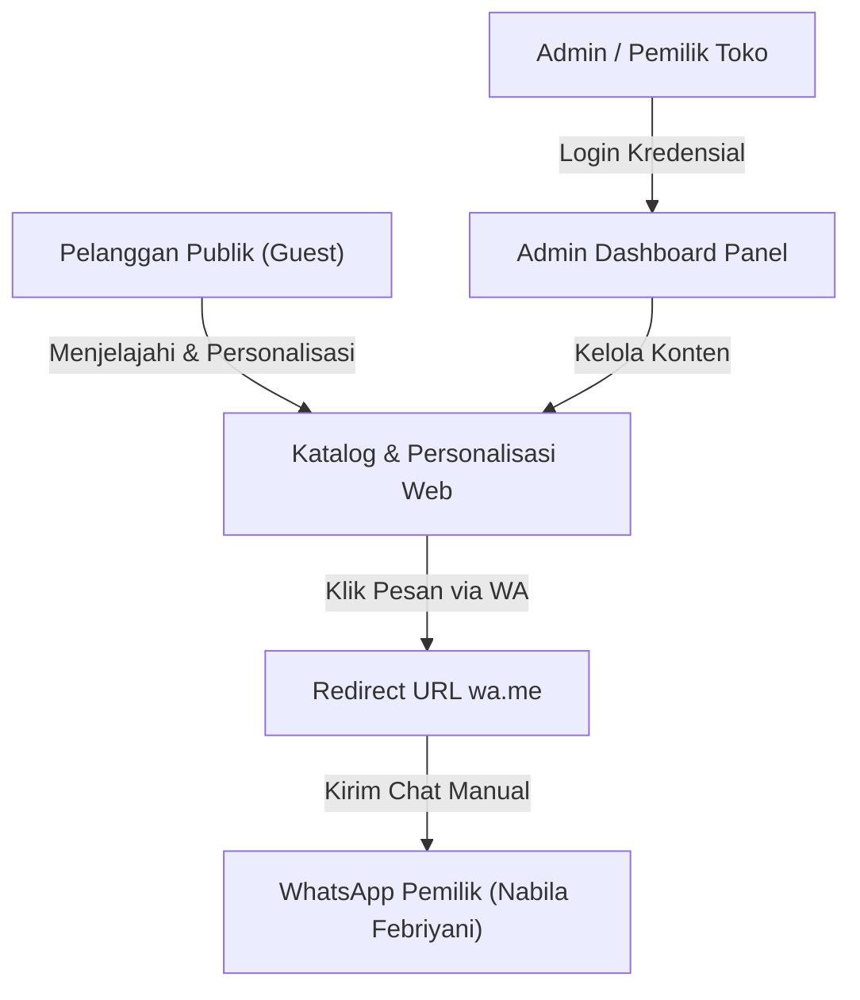
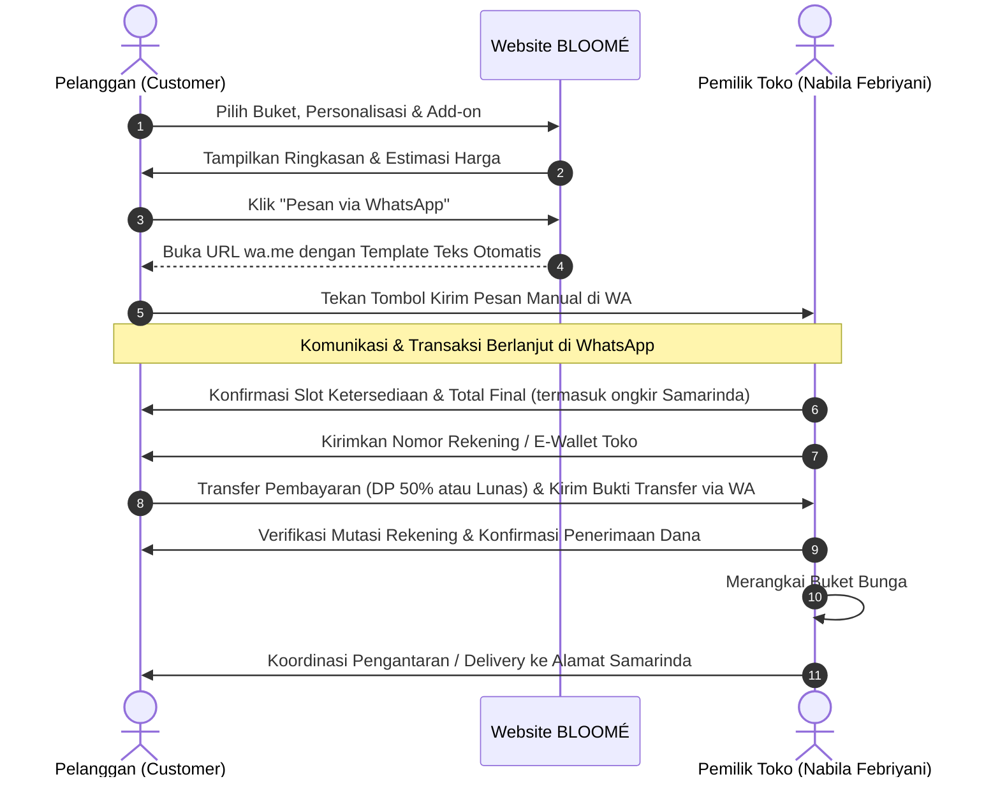

# REQUIREMENT.md
# BLOOMÉ — Flowers & Stories
## Software Requirements Specification (SRS)

**Nama Proyek:** Perancangan Sistem Informasi Pemesanan dan Personalisasi Buket Bunga Berbasis Web  
**Nama Sistem:** BLOOMÉ — Flowers & Stories  
**Jenis Sistem:** Web-Based Bouquet Interactive Catalog & Personalization Information System (with WhatsApp Ordering)  
**Project Sponsor / Owner:** Nabila Febriyani  
**Lokasi Usaha:** Jalan Cipto Mangunkusumo, Simpang Tiga, Loa Janan Ilir, Kota Samarinda, Kalimantan Timur  
**Metodologi Pengembangan:** Waterfall  
**Backend Framework:** Laravel (PHP)  
**Frontend:** HTML, CSS, JavaScript, Blade, Vite  
**Database:** MySQL 8.0+ (InnoDB)  
**Dokumen:** Software Requirements Specification (SRS)  
**Status:** Approved Requirement Baseline (Revisi Konsensus Sistem v1.1)  
**Versi Dokumen:** 1.1  
**Tanggal Efektif:** 20 November 2026  

---

# 1. PROJECT OVERVIEW

## 1.1 Project Description

BLOOMÉ — Flowers & Stories merupakan sistem informasi berbasis web yang berfungsi sebagai **katalog produk interaktif dan media konfigurasi personalisasi buket bunga**. Sistem ini dirancang untuk mendigitalkan dan meningkatkan daya tarik display produk buket bunga usaha BLOOMÉ di Samarinda.

Berdasarkan kesepakatan final proses bisnis, sistem web difokuskan untuk memberikan pengalaman pemilihan produk yang kaya visual dan interaktif bagi pelanggan:
1. **Interactive Catalog & Showcase:** Pelanggan dapat menjelajahi etalase buket siap pesan, memfilter berdasarkan kategori, dan memeriksa deskripsi detail serta harga dasar.
2. **Interactive Bouquet Personalization & Add-ons:** Pelanggan dapat memilih variasi personalisasi (seperti warna kertas wrapping, jenis pita, nuansa bunga/kertas), memilih item tambahan (*add-on* seperti kartu ucapan, topper, boneka mini), serta menambahkan catatan khusus secara interaktif.
3. **Automated WhatsApp Order Message Formulation:** Sistem menghitung estimasi total harga secara *real-time* di sisi antarmuka, kemudian menyusun rincian pesanan ke dalam format teks pesan WhatsApp terstruktur dan mengarahkan pelanggan langsung ke aplikasi WhatsApp toko melalui skema tautan URL (`wa.me`).
4. **Custom Bouquet Consultation Channel:** Untuk pesanan buket khusus (*fully custom design*) di luar katalog standar, pelanggan disediakan tombol tindakan cepat untuk langsung terhubung dan berkonsultasi via WhatsApp dengan pemilik usaha.

**Proses pemesanan resmi, konfirmasi ketersediaan slot pengerjaan, negosiasi harga, pembayaran DP/lunas, pengiriman bukti transfer, dan koordinasi jadwal pengantaran dilanjutkan sepenuhnya melalui percakapan WhatsApp.**

Website **tidak** melakukan transaksi pembayaran, tidak menyimpan catatan transaksi di database web, tidak menyediakan sistem pelacakan status pesanan internal, dan tidak memerlukan login bagi pelanggan.

Admin (pemilik usaha) memiliki panel dashboard tunggal yang aman untuk mengelola kategori produk, katalog buket, foto galeri, opsi variasi personalisasi, item add-on, ketersediaan stok produk, serta pengaturan kontak bisnis dan nomor WhatsApp.

## 1.2 Project Objectives

Tujuan pengembangan sistem BLOOMÉ v1.1:

1. Menyediakan katalog produk buket bunga digital yang elegan, modern, dan responsif.
2. Menyediakan fitur konfigurasi personalisasi dan add-on interaktif yang memudahkan pelanggan menentukan preferensi buket sebelum memesan.
3. Menghitung ringkasan estimasi harga pesanan secara otomatis di sisi antarmuka web.
4. Mempercepat proses pemesanan dengan menyusun template pesan WhatsApp otomatis yang rapi dan terstandarisasi.
5. Membantu pemilik toko menerima rincian pesanan pelanggan dalam format yang jelas dan lengkap di WhatsApp tanpa perlu menanyakan preferensi satu per satu secara berulang.
6. Menyediakan antarmuka pengelolaan mandiri bagi admin untuk memperbarui produk, kategori, variasi personalisasi, add-on, dan informasi kontak bisnis tanpa ketergantungan pengembang.
7. Menghilangkan kerumitan pemeliharaan modul pembayaran dan pengelolaan akun pelanggan yang tidak diperlukan oleh skala operasional toko saat ini.

## 1.3 Project Scope

### In Scope (Ruang Lingkup Termasuk)

Fitur yang dikembangkan pada sistem web:

- **Halaman Beranda Publik (*Public Homepage*):** Identitas brand, hero banner, pengenalan usaha, produk unggulan, kategori buket, sorotan layanan, dan kontak.
- **Katalog Produk Interaktif (*Interactive Catalog*):** Tampilan grid produk buket, filter kategori dinamis, penanda ketersediaan (*availability badge*).
- **Halaman Detail Produk (*Product Detail Page*):** Slider galeri foto, deskripsi produk, harga dasar, serta status ketersediaan.
- **Konfigurator Personalisasi (*Personalization Selector*):** Pemilihan opsi variasi buket (warna wrapping, warna pita, dll.) yang terhubung ke basis data.
- **Pemilihan Add-on (*Add-ons Selector*):** Pemilihan opsi tambahan (kartu ucapan, boneka wisuda, lampu LED, topper akrilik) beserta penambahan biaya.
- **Input Catatan Khusus (*Special Notes*):** Formulir teks singkat untuk instruksi khusus pelanggan (misal: tulisan pada kartu ucapan atau preferensi perangkaian).
- **Ringkasan Pilihan & Estimasi Harga (*Interactive Order Summary & Price Estimation*):** Perhitungan estimasi total biaya secara otomatis di antarmuka web sebelum pemesanan diteruskan.
- **Generator Pesan Pemesanan WhatsApp (*WhatsApp Order Message Generator*):** Penyusunan teks pesan WhatsApp otomatis terstruktur dan pembuatan tautan langsung (`https://wa.me/<nomor>?text=...`).
- **Fitur Konsultasi Desain Custom (*Custom Consultation CTA*):** Tautan cepat ke WhatsApp pemilik untuk mendiskusikan rancangan buket custom yang belum ada di katalog.
- **Otentikasi Admin Tunggal (*Single Admin Authentication*):** Halaman login dan logout terproteksi menggunakan keamanan Laravel.
- **Admin Dashboard Overview:** Tampilan ringkasan master data (jumlah produk aktif, kategori, variasi personalisasi, item add-on).
- **Manajemen Kategori Buket (*Category Management*):** Tambah, lihat, ubah, dan hapus kategori buket.
- **Manajemen Produk Buket (*Product Management*):** Tambah, lihat, ubah, hapus produk, serta toggle ketersediaan buket.
- **Manajemen Galeri Foto Produk (*Product Gallery Management*):** Pengelolaan multi-foto buket.
- **Manajemen Personalisasi (*Personalization Options & Values Management*):** Kelola opsi variasi buket, nilai variasi, biaya tambahan, dan penetapannya ke produk.
- **Manajemen Add-on (*Add-on Management*):** Kelola item tambahan, harga, deskripsi, dan penetapannya ke produk.
- **Manajemen Pengaturan Bisnis (*Business Settings Management*):** Kelola nomor WhatsApp tujuan pemesanan resmi, jam operasional, dan alamat toko di Samarinda.

### Out of Scope (Di Luar Ruang Lingkup Sistem Web)

Fitur yang secara tegas **tidak** dikembangkan di dalam sistem web:

- Registrasi akun pelanggan (*customer registration*).
- Login dan dashboard akun pelanggan (*customer dashboard*).
- Keranjang belanja multi-langkah dan modul *checkout* pembayaran di web.
- Penyimpanan data transaksi pesanan (*orders / order_details*) ke dalam basis data web.
- Pengelolaan status pesanan internal dan riwayat status (*order status lifecycle tracking* / ST-01 s/d ST-08 di web).
- Integrasi *payment gateway* otomatis (Midtrans, Xendit, dll.).
- Formulir unggah bukti transfer pembayaran di website.
- Verifikasi mutasi pembayaran di website.
- Negosiasi harga dan tawar-menawar di website.
- Otomasi notifikasi WhatsApp melalui WhatsApp Business API Gateway (hanya memanfaatkan skema tautan URL WhatsApp `wa.me` yang dikirim manual oleh pemesan).
- Sistem manajemen kurir, penghitungan ongkir otomatis berbasis GPS/ekspedisi, dan live-tracking pengiriman.
- Akun multi-admin atau pembagian hak akses bertingkat (*multi-role RBAC*).
- Sistem akuntansi keuangan dan pembukuan laba-rugi otomatis.

---

# 2. SYSTEM USERS AND ACTORS

Sistem memiliki dua aktor:



## 2.1 Customer (Pelanggan Publik)

Pelanggan merupakan pengguna publik yang mengakses website sebagai tamu (*guest*) tanpa perlu melakukan registrasi atau login.

**Hak Akses Pelanggan (*Customer Permissions*):**
- Mengakses halaman beranda (*homepage*).
- Menjelajahi katalog produk buket bunga.
- Memfilter produk berdasarkan kategori yang tersedia.
- Melihat halaman rincian produk, galeri foto, deskripsi, dan harga dasar.
- Memilih variasi personalisasi buket yang disediakan.
- Memilih opsi *add-on* pelengkap buket.
- Menuliskan catatan khusus atau pesan ucapan.
- Melihat ringkasan konfigurasi pilihan dan estimasi total harga secara *real-time*.
- Mengklik tombol "Pesan via WhatsApp" untuk mengarahkan rincian pesanan ke aplikasi/web WhatsApp.
- Mengklik tombol "Konsultasi Desain Custom via WhatsApp" untuk konsultasi model buket di luar katalog.
- Mengakses informasi profil toko, jam operasional, dan kontak bisnis.

**Batasan Pelanggan (*Customer Restrictions*):**
- Tidak memiliki akun, profil pengguna, atau sesi login di website.
- Tidak dapat mengakses antarmuka atau rute dashboard admin.
- Tidak dapat memanipulasi data master produk, kategori, harga, personalisasi, atau pengaturan sistem.
- Tidak melakukan pembayaran di website.
- Tidak mengunggah bukti transfer pembayaran ke website.
- Tidak melacak status pesanan melalui portal website.

## 2.2 Admin (Pemilik Toko / Nabila Febriyani)

Admin merupakan pengelola operasional tunggal website yang mengelola seluruh konten etalase digital.

**Hak Akses Admin (*Admin Permissions*):**
- Mengakses halaman otentikasi login admin yang terproteksi.
- Mengakses dashboard overview data katalog.
- Mengelola kategori produk buket (Create, Read, Update, Delete).
- Mengelola data master produk buket (Create, Read, Update, Delete, Toggle Availability).
- Mengunggah dan mengatur galeri foto produk.
- Mengelola grup opsi personalisasi dan nilai variasi spesifik beserta biaya tambahan.
- Menetapkan opsi personalisasi yang berlaku untuk masing-masing produk buket.
- Mengelola master data item add-on beserta harga dan foto thumbnail.
- Menetapkan item add-on yang dapat dipilih pada produk buket tertentu.
- Memperbarui parameter pengaturan bisnis (nomor WhatsApp penerimaan pesanan, jam kerja, alamat toko Samarinda).
- Melakukan logout secara aman dari sesi panel admin.

**Batasan Admin (*Admin Restrictions*):**
- Hanya ada 1 akun admin aktif (tidak ada penambahan multi-role admin).
- Admin tidak memproses transaksi, verifikasi bukti transfer, atau perubahan status pesanan melalui web (seluruh aktivitas operasional pemesanan tersebut dilakukan langsung di WhatsApp toko).

---

# 3. FUNCTIONAL REQUIREMENTS (FR)

## 3.1 Antarmuka Pelanggan Publik (*Customer Public Web*)

### FR-001 — Halaman Beranda (Homepage)
Sistem harus menyajikan halaman beranda publik yang mencakup:
- Identitas brand resmi BLOOMÉ — Flowers & Stories.
- Navigasi utama (Beranda, Katalog, Kategori, Tentang Kami, Kontak, Tombol WhatsApp).
- *Hero banner* bertema elegan floristik dengan ajakan bertindak (*Call to Action*).
- Pengenalan singkat nilai dan layanan usaha buket.
- Bagian produk buket unggulan (*featured bouquets*).
- Daftar navigasi kategori buket bunga.
- Seksi promosi pemesanan buket custom via WhatsApp.
- Informasi kontak dan footer toko.

### FR-002 — Katalog Produk Interaktif (Product Catalog)
Sistem harus menampilkan katalog produk buket dalam tata letak kartu grid yang responsif.  
Setiap kartu produk menampilkan:
- Foto thumbnail produk buket.
- Nama produk buket.
- Kategori produk.
- Harga dasar produk dalam format mata uang Rupiah.
- Lencana ketersediaan (*Tersedia* / *Habis*).
- Tombol aksi menuju halaman detail produk.

### FR-003 — Filter Kategori Katalog
Sistem harus menyediakan navigasi filter kategori untuk menyaring produk secara cepat berdasarkan kelompok kategori (contoh: *Buket Bunga, Buket Uang, Buket Snack, Buket Boneka*).

### FR-004 — Halaman Detail Produk (Product Detail)
Sistem harus menyediakan halaman detail komprehensif untuk setiap produk buket, meliputi:
- Galeri foto produk (foto utama dan thumbnail sudut lain jika ada).
- Nama produk dan kategori.
- Label ketersediaan pengerjaan buket.
- Harga dasar produk.
- Deskripsi lengkap (komposisi bunga/bahan, dimensi perkiraan, nuansa warna).
- Panel konfigurasi personalisasi dan add-on.

### FR-005 — Pemilih Personalisasi Buket (Personalization Selector)
Sistem harus menyediakan antarmuka interaktif bagi pelanggan untuk memilih variasi personalisasi yang terhubung dengan produk tersebut:
- Memilih warna kertas pembungkus (*wrapping paper*).
- Memilih variasi pita satin (*ribbon color*).
- Memilih preferensi variasi tambahan sesuai konfigurasi admin.
- Menampilkan indikasi swatch warna visual jika data hex warna tersedia.
- Menampilkan penyesuaian biaya tambahan secara transparan apabila variasi tertentu memiliki selisih harga.

### FR-006 — Pemilih Item Add-on (Add-on Selector)
Sistem harus menyediakan daftar pilihan item tambahan (*add-on*) yang dapat ditambahkan pelanggan:
- Kartu ucapan cetak (*custom printed greeting card*).
- Topper akrilik ucapan (Happy Birthday, Graduation, Anniversary).
- Boneka wisuda mini / boneka aksesoris.
- Lampu LED string (*fairy lights*).
- Paper bag premium transparan / pelindung buket.
- Setiap pilihan add-on wajib menampilkan harga satuan tambahan secara jelas.

### FR-007 — Input Catatan Khusus & Pesan Ucapan (Order Notes)
Sistem harus menyediakan area input teks (*textarea*) bagi pelanggan untuk mencantumkan:
- Teks ucapan untuk kartu ucapan (jika memilih add-on kartu).
- Instruksi khusus perangkaian atau tanggal kebutuhan buket di Samarinda.

### FR-008 — Ringkasan Pilihan & Estimasi Harga (Interactive Order Summary & Price Estimation)
Sistem harus menyediakan kartu ringkasan interaktif di halaman detail:
- Merangkum produk yang dipilih, variasi personalisasi yang dipilih, dan daftar add-on terpilih.
- Menghitung estimasi total biaya secara otomatis di sisi browser:
  $$\text{Estimasi Total} = \text{Harga Dasar Produk} + \sum(\text{Biaya Tambahan Personalisasi}) + \sum(\text{Harga Add-on})$$
- Menampilkan catatan disclamer yang jelas bahwa total biaya merupakan **estimasi harga produk**, sedangkan konfirmasi ketersediaan bahan, ongkos kirim area Samarinda, dan total final akan disepakati bersama pemilik melalui WhatsApp.

### FR-009 — Generator Pesan Pemesanan WhatsApp (WhatsApp Order Message Generator)
Sistem harus menyusun seluruh preferensi pilihan pelanggan menjadi draf pesan teks WhatsApp yang terstruktur, rapi, dan terenkode URL (`urlencode`), dengan format baku:

```text
Halo BLOOMÉ, saya ingin memesan buket berikut:

🌸 Produk: [Nama Produk]
💰 Estimasi Harga Produk: Rp [Harga Dasar]
🎨 Personalisasi:
- Warna Wrapping: [Nilai Pilihan]
- Warna Pita: [Nilai Pilihan]
- [Opsi Lain]: [Nilai Pilihan]
✨ Add-on Tambahan:
- [Nama Add-on 1] (Rp [Harga])
- [Nama Add-on 2] (Rp [Harga])
📝 Catatan Khusus: [Isi Catatan Pelanggan]
💵 Estimasi Total: Rp [Estimasi Total]

Mohon konfirmasi ketersediaan slot pengerjaan dan jadwal pengirimannya. Terima kasih!
```

Sistem harus memicu pembukaan tautan WhatsApp resmi toko (`https://wa.me/<whatsapp_number>?text=<encoded_text>`) saat tombol **"Pesan via WhatsApp"** diklik.

### FR-010 — Ketentuan Pemesanan Multi-Buket dalam Satu Pesan [Perlu Konfirmasi Owner]
Apabila disetujui pemilik, sistem dapat mengizinkan pelanggan merangkum lebih dari satu rangkaian buket ke dalam satu kompilasi pesan WhatsApp sebelum dialihkan ke chat pemilik. Ketentuan teknis dan batasan jumlah item buket dalam satu sesi pemesanan berstatus **[Perlu Konfirmasi Owner]**.

### FR-011 — Tombol Konsultasi Buket Custom via WhatsApp (Custom Bouquet CTA)
Sistem harus menyediakan halaman/seksi khusus "Custom Bouquet" yang menjelaskan layanan pembuatan buket custom sesuai bujet dan keinginan pelanggan, dilengkapi tombol CTA **"Konsultasi Desain Custom via WhatsApp"** yang membuka chat WhatsApp dengan template pesan:
```text
Halo BLOOMÉ, saya ingin berkonsultasi mengenai pemesanan buket custom dengan desain khusus di luar katalog. Mohon info ketersediaan slot dan ketentuannya.
```

### FR-012 — Informasi Kontak & Profil Usaha
Sistem harus menyediakan halaman Tentang Kami (*About*) dan Kontak (*Contact*) yang menyajikan alamat resmi galeri di Samarinda (Jl. Cipto Mangunkusumo, Simpang Tiga, Loa Janan Ilir), jam operasional, serta tautan ke media sosial resmi **[Perlu Konfirmasi Owner]**.

---

## 3.2 Antarmuka Pengelola Administrator (*Admin Panel*)

### FR-013 — Otentikasi Login Admin
Sistem harus menyediakan formulir login admin yang memvalidasi email dan kata sandi menggunakan hashing Bcrypt/Argon2. Rute admin harus dilindungi middleware otentikasi.

### FR-014 — Logout Admin
Sistem harus menyediakan fungsi keluar (*logout*) yang menghancurkan sesi otentikasi secara aman dan mengarahkan kembali ke form login.

### FR-015 — Dashboard Overview
Sistem harus menampilkan ringkasan data etalase pada halaman dashboard admin:
- Jumlah total produk aktif di etalase.
- Jumlah produk yang sedang berstatus stok habis / slot penuh.
- Jumlah kategori produk terdaftar.
- Jumlah opsi personalisasi dan item add-on aktif.
- Akses pintas (*quick links*) ke penambahan produk baru dan konfigurasi WhatsApp toko.

### FR-016 — Manajemen Kategori Produk (Category Management)
Admin dapat:
- Melihat daftar seluruh kategori buket beserta status aktifnya.
- Menambahkan kategori baru (nama, slug otomatis, deskripsi).
- Mengubah informasi kategori.
- Menghapus kategori (dilindungi validasi: kategori tidak dapat dihapus jika masih menaungi produk aktif).

### FR-017 — Manajemen Produk Buket (Product Management)
Admin dapat:
- Melihat daftar produk buket lengkap dengan thumbnail foto, harga dasar, kategori, dan status ketersediaan.
- Menambahkan produk baru (nama, slug, kategori, harga dasar, deskripsi, foto utama).
- Mengubah rincian data produk dan foto utama.
- Menghapus produk buket.

### FR-018 — Pengaturan Ketersediaan Produk (Availability Toggle)
Admin dapat mengubah status ketersediaan produk buket (*Tersedia* atau *Habis/Slot Penuh*) dengan cepat, yang langsung berdampak pada tampilan lencana di katalog publik.

### FR-019 — Manajemen Galeri Foto Produk (Product Gallery Management)
Admin dapat mengunggah multi-foto untuk produk buket tertentu, mengatur urutan tampil (*sort order*), dan menghapus foto galeri pendukung.

### FR-020 — Manajemen Opsi Personalisasi (Personalization Options CRUD)
Admin dapat membuat dan mengelola grup opsi personalisasi (contoh: *Warna Wrapping, Warna Pita, Nuansa Kertas*) dan menentukan jenis kontrol UI (`select`, `radio`, `color_swatch`).

### FR-021 — Manajemen Nilai Variasi Personalisasi (Personalization Values CRUD)
Admin dapat menambahkan nilai-nilai variasi spesifik ke dalam opsi personalisasi (misal: *Blush Pink, Sage Green, Champagne White*), menentukan kode warna HEX untuk swatch, menetapkan biaya tambahan (*additional price* jika ada), dan menandai ketersediaan stok warna.

### FR-022 — Penetapan Personalisasi ke Produk (Product Personalization Assignment)
Admin dapat memilih opsi personalisasi mana saja yang relevan dan aktif untuk produk buket tertentu melalui antarmuka centang/pilih relasi.

### FR-023 — Manajemen Item Add-on (Add-on Management CRUD)
Admin dapat:
- Melihat daftar seluruh item tambahan buket (*add-ons*).
- Menambahkan item add-on baru (nama item, harga satuan, deskripsi, foto thumbnail).
- Mengubah data dan harga add-on.
- Menghapus item add-on.
- Mengubah status ketersediaan item add-on.

### FR-024 — Penetapan Add-on ke Produk (Product Add-on Assignment)
Admin dapat mengonfigurasi add-on apa saja yang dapat dipilih pada produk buket tertentu.

### FR-025 — Manajemen Pengaturan Bisnis & WhatsApp (Business Settings Management)
Admin dapat mengelola data konfigurasi dinamis toko pada basis data:
- Nomor kontak WhatsApp resmi toko penerima pesanan.
- Alamat operasional toko di Samarinda.
- Tautan media sosial Instagram dan TikTok toko **[Perlu Konfirmasi Owner]**.
- Catatan jam kerja operasional penerimaan pesanan dan jam pengantaran.

---

# 4. ALUR OPERASIONAL PEMESANAN VIA WHATSAPP (OFF-WEB PROCESS)

Proses setelah penekanan tombol WhatsApp diatur berdasarkan batasan operasional berikut:



## 4.1 Batas Proses Website & Tanggung Jawab WhatsApp
1. **Penyusunan Pesan:** Website hanya berperan menyusun template pesan rincian pesanan.
2. **Pengiriman Manual:** Pelanggan wajib menekan tombol kirim pesan secara sadar di aplikasi WhatsApp miliknya.
3. **Tanpa Klaim Palsu:** Antarmuka website dilarang menampilkan klaim "Pesanan Anda Berhasil Diterima Toko" hanya karena tautan WhatsApp berhasil dibuka.
4. **Konfirmasi Pemilik:** Transaksi pesanan dianggap sah hanya setelah pemilik toko mengonfirmasi slot pengerjaan dan menerima bukti pembayaran di WhatsApp.
5. **Kebijakan Pembayaran:**
   - Metode: Transfer Bank dan E-Wallet (BCA, BRI, DANA, GoPay) **[Perlu Konfirmasi Owner]**.
   - Skema DP: Pembayaran uang muka (DP) 50% diperbolehkan untuk mengunci pesanan, dengan ketentuan batas waktu pelunasan **[Perlu Konfirmasi Owner]**.
6. **Kebijakan Pengiriman:** Layanan pesanan berfokus pada pengiriman kurir (*delivery*) ke alamat tujuan di Samarinda; bukan sistem ambil sendiri (*pickup*) **[Perlu Konfirmasi Owner]**.
7. **Kebijakan Pembatalan & Pengembalian Dana:**
   - Pembatalan pesanan hanya dapat diajukan pelanggan melalui komunikasi chat WhatsApp langsung ke pemilik sebelum buket mulai dirangkai, disertai alasan yang sah.
   - Kebijakan pemotongan atau pengembalian dana (*refund*) belum ditentukan dan berstatus **[Perlu Konfirmasi Owner]**.

---

# 5. BUSINESS RULES (BR)

| Kode BR | Aturan Bisnis (*Business Rule*) |
|---|---|
| **BR-001** | Pelanggan mengakses sistem web sebagai tamu (*guest*) tanpa proses registrasi akun atau login. |
| **BR-002** | Sistem web hanya menggunakan 1 (satu) akun administrator yang memegang hak kelola penuh katalog dan konten etalase. |
| **BR-003** | Website tidak memproses transaksi checkout, tidak menampung pembayaran, dan tidak menyimpan data transaksi di basis data web. |
| **BR-004** | Produk wajib dikelompokkan ke dalam kategori yang aktif dan terdaftar di basis data. |
| **BR-005** | Harga dasar produk buket dan harga item add-on dikelola oleh admin dan dinyatakan dalam mata uang Rupiah. |
| **BR-006** | Variasi personalisasi (wrapping, pita, dll.) dan item add-on dapat dikonfigurasikan per produk atau berlaku secara umum. |
| **BR-007** | Total biaya yang dihitung di web merupakan **estimasi harga produk & variasi**; konfirmasi harga akhir dan ongkos kirim Samarinda disepakati melalui WhatsApp. |
| **BR-008** | Teks pesan WhatsApp disusun otomatis oleh sistem web menggunakan pengkodean URL standar (`wa.me` query string). |
| **BR-009** | Pelanggan harus menekan tombol kirim secara manual di aplikasi WhatsApp untuk menyelesaikan inisiasi pemesanan. |
| **BR-010** | Permintaan desain buket custom bebas di luar katalog diarahkan melalui tautan konsultasi chat WhatsApp langsung ke pemilik. |
| **BR-011** | Pembayaran dilakukan via transfer bank atau e-wallet melalui informasi nomor rekening yang dikirimkan pemilik via WhatsApp. |
| **BR-012** | Bukti transfer pembayaran dikirimkan oleh pelanggan melalui percakapan WhatsApp dan diverifikasi langsung oleh pemilik. |
| **BR-013** | Skema uang muka (DP) 50% diperbolehkan untuk memulai perangkaian buket, dengan pelunasan sesuai kesepakatan **[Perlu Konfirmasi Owner]**. |
| **BR-014** | Perubahan spesifikasi pesanan atau negosiasi harga dilakukan secara langsung melalui percakapan WhatsApp. |
| **BR-015** | Layanan pemesanan buket difokuskan untuk pengantaran langsung (*delivery*) area Samarinda **[Perlu Konfirmasi Owner]**. |
| **BR-016** | Pembatalan pesanan wajib dibicarakan via WhatsApp sebelum buket mulai dirangkai dan harus disertai alasan yang jelas. |
| **BR-017** | Kebijakan pengembalian dana (*refund policy*) belum ditetapkan secara resmi **[Perlu Konfirmasi Owner]**. |
| **BR-018** | Nomor tujuan WhatsApp resmi dan parameter kontak toko dikelola secara terpusat pada tabel `business_settings`. |
| **BR-019** | Berkas foto produk yang diunggah admin wajib berformat JPG, JPEG, PNG, atau WebP dengan batas ukuran maksimal yang divalidasi server **[Perlu Konfirmasi Owner]**. |
| **BR-020** | Kategori tidak dapat dihapus apabila masih memiliki produk yang berelasi aktif di dalamnya (*foreign key restrict*). |

---

# 6. NON-FUNCTIONAL REQUIREMENTS (NFR)

## 6.1 Usability (Kemudahan Penggunaan)
- Tata letak antarmuka katalog ramah pengguna, memudahkan navigasi visual buket.
- Antarmuka pemilihan personalisasi dan add-on bersifat intuitif (menggunakan radio button, visual color swatch, dan checkbox yang jelas).
- Tombol aksi utama "Pesan via WhatsApp" memiliki kontras warna tinggi dan mudah dijangkau pada tampilan mobile.

## 6.2 Responsiveness & Mobile First
- Sistem web harus responsif secara optimal di perangkat Mobile (smartphone), Tablet, dan Desktop.
- Desain diutamakan untuk perangkat mobile (*mobile-first approach*) mengingat sebagian besar pengguna akan membuka WhatsApp melalui smartphone.

## 6.3 Performance
- Waktu muat halaman (*page load time*) katalog dan detail buket tidak boleh melebihi 2 detik pada koneksi internet standar 4G.
- Optimasi aset gambar produk menggunakan kompresi efisien agar tidak membebani kuota data pelanggan.
- Kueri basis data Eloquent memanfaatkan *eager loading* (`with(['category', 'personalizationOptions', 'addOns'])`) guna mencegah masalah kueri $N+1$.

## 6.4 Security
- Seluruh rute panel admin wajib dilindungi middleware otentikasi sesi Laravel (`auth`).
- Kata sandi admin wajib dienkripsi menggunakan algoritma hashing modern (Bcrypt/Argon2id).
- Seluruh formulir admin wajib dilindungi dari serangan *Cross-Site Request Forgery* (CSRF) via `@csrf`.
- Sanitasi input dan proteksi terhadap serangan *Cross-Site Scripting* (XSS) dan *SQL Injection* menggunakan Eloquent ORM parameterized queries.
- Berkas gambar produk yang diunggah admin wajib divalidasi tipe MIME dan ekstensinya di sisi server.

## 6.5 Maintainability & Architecture
- Arsitektur sistem wajib mengikuti Three-Layer Architecture (Presentation Layer, Application/Service Layer, Data Layer).
- Struktur kode modular mengikuti kaidah konvensi resmi Laravel (Model-View-Controller).

---

# 7. USER INTERFACE & VISUAL IDENTITY REQUIREMENTS

## 7.1 Visual Brand Identity
- **Nama Brand:** BLOOMÉ — Flowers & Stories
- **Konsep Visual:** *Elegant Floral Boutique, soft feminine, modern, minimalist, premium.*
- Karakteristik: Tampilan visual bersih, bernuansa pastel hangat, tipografi berkelas, tata letak luas (*spacious*), dan dekorasi bunga yang anggun tanpa berlebihan.

## 7.2 Locked Color Palette (Palet Warna Resmi)

| Token Warna | Nilai Hex | Peruntukan Elemen UI |
|---|---|---|
| **Primary Pink** | `#E99AAF` | Tombol utama, aksen aktif, elemen fokus |
| **Primary Hover** | `#D98296` | Status hover tombol utama |
| **Soft Pink** | `#F6DDE3` | Latar kartu sekunder, header kartu, aksen lembut |
| **Blush Background** | `#FFF5F6` | Warna latar belakang seluruh halaman (*canvas*) |
| **Warm White** | `#FFFCFB` | Warna permukaan kartu produk, modal, dan container utama |
| **Burgundy** | `#642D36` | Judul utama (*headings*), teks sorotan bernuansa mewah |
| **Primary Text** | `#493335` | Teks tubuh utama (*body text*), paragraf, label form |
| **Secondary Text**| `#898080` | Teks pendukung, deskripsi singkat, teks breadcrumb |
| **Muted Text** | `#B09A9C` | Placeholder form, teks petunjuk, teks footer |
| **Sage Green** | `#A8B5A0` | Aksen daun botani, lencana ketersediaan ramah lingkungan |
| **Border Color** | `#F0E1E4` | Garis tepi kartu, pemisah seksi, border input |
| **Success** | `#6EAD70` | Lencana status tersedia, notifikasi sukses simpan |
| **Warning** | `#E8B85B` | Lencana peringatan stok terbatas, perhatian |
| **Danger** | `#D96B75` | Lencana stok habis, tombol hapus, pesan kesalahan |
| **Information** | `#9B83B9` | Lencana informasi variasi, tips personalisasi |

## 7.3 Typography
- **Heading / Judul Utama:** `Playfair Display`, serif berkarakter elegan dan anggun untuk `h1`, `h2`, dan judul nama produk.
- **Body & Elemen Antarmuka:** `Poppins`, sans-serif modern yang sangat nyaman dibaca untuk paragraf, navigasi, form, label, dan tombol.

## 7.4 Bentuk Elemen & Border Radius
- Sudut kartu besar / container: `18px`.
- Kartu produk / kartu add-on: `16px`.
- Tombol aksi utama & tombol WhatsApp: `12px`.
- Input field form: `10px`.
- Lencana status / badge: `full-rounded (9999px)`.
- Bayangan (*shadow*): Bayangan halus berwarna lembut (`rgba(100, 45, 54, 0.06)`), melarang penggunaan bayangan hitam pekat (*harsh black shadow*).

---

# 8. STRUKTUR HALAMAN WEBSITE (PAGE INVENTORY)

## 8.1 Halaman Publik (Customer Pages)
1. **PAGE-C01 — Homepage (Beranda):** Hero section, filosofi brand, produk pilihan, direktori kategori, CTA custom bouquet, informasi galeri toko di Samarinda.
2. **PAGE-C02 — Product Catalog (Katalog Produk):** Grid kartu buket bunga lengkap dengan tombol filter kategori dan badge ketersediaan.
3. **PAGE-C03 — Product Detail & Personalization (Detail Produk & Personalisasi):** Tampilan galeri foto produk, deskripsi, pemilih opsi variasi, pemilih add-on, input catatan khusus, ringkasan kalkulasi estimasi harga, dan tombol CTA **"Pesan via WhatsApp"**.
4. **PAGE-C04 — Custom Bouquet Page (Konsultasi Buket Custom):** Penjelasan layanan buket kreasi bebas, panduan konsultasi bahan dan bujet, serta tombol langsung menuju percakapan WhatsApp pemilik.
5. **PAGE-C05 — About Us (Tentang BLOOMÉ):** Cerita pendirian, dedikasi merangkai bunga, dan lokasi workshop Samarinda.
6. **PAGE-C06 — Contact & Social (Kontak & Media Sosial):** Tautan WhatsApp, alamat terverifikasi, jam kerja, dan tautan akun media sosial resmi.

## 8.2 Halaman Panel Admin (Admin Pages)
1. **PAGE-A01 — Admin Login:** Formulir otentikasi login pemilik toko.
2. **PAGE-A02 — Admin Dashboard:** Ringkasan statistik etalase produk, kategori aktif, dan status sistem.
3. **PAGE-A03 — Category Management:** Daftar tabel kategori, form tambah, edit, dan hapus kategori.
4. **PAGE-A04 — Product Management:** Daftar katalog produk buket, toggle status ketersediaan, aksi edit dan hapus.
5. **PAGE-A05 — Add/Edit Product Form:** Input rincian produk buket, harga dasar, upload foto utama, dan pemilihan kategori.
6. **PAGE-A06 — Product Gallery Manager:** Upload dan tata kelola galeri multi-foto untuk produk terpilih.
7. **PAGE-A07 — Personalization Manager:** Kelola kelompok opsi personalisasi, nilai variasi, swatch warna, biaya variasi, dan relasi per produk.
8. **PAGE-A08 — Add-on Manager:** Kelola master item tambahan pelengkap, penetapan harga add-on, dan relasi ke produk.
9. **PAGE-A09 — Business & WhatsApp Settings:** Formulir pengaturan nomor WhatsApp pemesanan, jam buka/tutup, dan alamat fisik toko.

---

# 9. KRITERIA PENERIMAAN SISTEM (ACCEPTANCE CRITERIA)

## 9.1 Kriteria Penerimaan Sisi Pelanggan
- [ ] Pelanggan dapat mengakses seluruh halaman publik dengan lancar tanpa perlu registrasi atau login.
- [ ] Pelanggan dapat memfilter katalog buket berdasarkan kategori yang dipilih.
- [ ] Pelanggan dapat memilih opsi variasi personalisasi (wrapping paper, pita, dll.) dan melihat perubahan estimasi harga jika ada biaya tambahan.
- [ ] Pelanggan dapat memilih satu atau beberapa add-on dan melihat kalkulasi penambahan total biaya secara instan di halaman detail produk.
- [ ] Pelanggan dapat menuliskan instruksi khusus pada kolom catatan.
- [ ] Saat tombol "Pesan via WhatsApp" diklik, aplikasi/web WhatsApp terbuka secara otomatis dengan teks draf pemesanan yang memuat rincian produk, pilihan personalisasi, add-on, catatan, dan estimasi total harga secara akurat.
- [ ] Halaman buket custom menyediakan tombol konsultasi langsung ke WhatsApp pemilik.
- [ ] Tampilan halaman responsif dan rapi di layar smartphone, tablet, dan desktop.

## 9.2 Kriteria Penerimaan Sisi Admin
- [ ] Admin dapat melakukan login secara aman ke dashboard dengan email dan kata sandi yang valid.
- [ ] Pengguna anonim ditolak dan dialihkan ke form login saat mencoba mengakses rute admin.
- [ ] Admin dapat menambah, mengubah, dan menghapus kategori produk.
- [ ] Admin dapat menambah, mengubah, menghapus, serta mengubah status ketersediaan produk buket.
- [ ] Admin dapat mengunggah foto produk utama dan galeri tambahan dengan validasi berkas yang tepat.
- [ ] Admin dapat menambah opsi dan nilai personalisasi beserta biaya tambahan dan menetapkannya ke produk.
- [ ] Admin dapat menambah item add-on beserta harganya dan menetapkannya ke produk.
- [ ] Admin dapat memperbarui nomor WhatsApp bisnis pada menu pengaturan dan nomor tersebut langsung menjadi rujukan tautan tombol pemesanan WhatsApp di katalog publik.
- [ ] Admin dapat melakukan logout secara aman.

---

# 10. HAL-HAL YANG MEMERLUKAN KONFIRMASI PEMILIK (`[Perlu Konfirmasi Owner]`)

Informasi berikut belum ditetapkan secara final oleh pemilik usaha (Nabila Febriyani) dan tidak boleh diasumsikan atau dikarang sepihak:

| No. | Parameter / Kebijakan Operasional | Keterangan & Catatan Kebutuhan |
|:---:|---|---|
| 1 | **Nomor WhatsApp Resmi Toko** | Nomor ponsel bisnis aktif yang menjadi tujuan tautan tombol "Pesan via WhatsApp". |
| 2 | **Daftar Master Produk & Foto Final** | Rincian nama produk buket, foto asli beresolusi tinggi, dan deskripsi resmi etalase. |
| 3 | **Struktur Harga Produk Final** | Harga dasar definitif untuk setiap varian buket yang dijual di katalog. |
| 4 | **Daftar Variasi Personalisasi Resmi** | Pilihan resmi warna kertas wrapping, jenis pita, serta kepastian ada/tidaknya biaya tambahan pada variasi tertentu. |
| 5 | **Daftar Item Add-on & Harga Final** | Daftar definitif barang pelengkap (kartu ucapan, topper, boneka, lampu LED) beserta harga jual tambahannya. |
| 6 | **Pemesanan Multi-Buket dalam Satu Pesan** | Keputusan apakah sistem perlu menampung pemilihan beberapa jenis buket dalam satu format pesan WhatsApp atau cukup satu jenis buket per pemesanan. |
| 7 | **Format Data Pelanggan yang Diperlukan** | Rincian data pengiriman yang wajib dicantumkan pada chat WhatsApp (contoh: Nama Pemesan, Nama Penerima, Alamat Detail, Titik Patokan). |
| 8 | **Format Alamat & Jam Pengantaran Samarinda** | Wilayah cakupan pengantaran lokal Samarinda dan batas waktu pemesanan untuk pengantaran di hari yang sama (*same-day delivery*). |
| 9 | **Penerapan DP 50% & Batas Waktu Pelunasan** | Ketentuan pembayaran uang muka 50% dan batas waktu pelunasan (sebelum dirangkai atau sebelum dikirimkan kurir). |
| 10 | **Detail Rekening Bank & E-Wallet Toko** | Nomor rekening BCA/BRI dan nomor akun e-wallet resmi yang digunakan saat transaksi di WhatsApp. |
| 11 | **Kebijakan Pembatalan & Refund** | Aturan baku batas pembatalan pesanan dan persentase pengembalian dana jika pesanan dibatalkan. |
| 12 | **Tautan Resmi Profil Media Sosial** | Akun Instagram dan TikTok resmi BLOOMÉ Samarinda untuk disematkan pada footer dan halaman kontak. |
| 13 | **Batas Ukuran & Resolusi Foto Admin** | Batas maksimal ukuran file foto upload produk (contoh: 2 MB atau 5 MB) dan rasio dimensi standar. |
| 14 | **Rencana Hosting, Domain & Jadwal Backup** | Nama domain yang akan digunakan, penyedia shared/cloud hosting, dan frekuensi pencadangan basis data. |

---

# 11. PENGESAHAN DOKUMEN SRS

Dokumen Software Requirements Specification (SRS) v1.1 ini telah disesuaikan secara menyeluruh dan disetujui sebagai pedoman resmi pengembangan sistem:

- **Disusun Oleh:** Jayanti Firdasari (Project Manager & Lead System Analyst)
- **Ditinjau Bersama:** Riya Monika (UI/UX Designer & Frontend Developer) & Elsa Futri (Backend Developer & DBA)
- **Disetujui Oleh:** Nabila Febriyani (Project Sponsor / Owner BLOOMÉ)
- **Tanggal:** 20 November 2026
