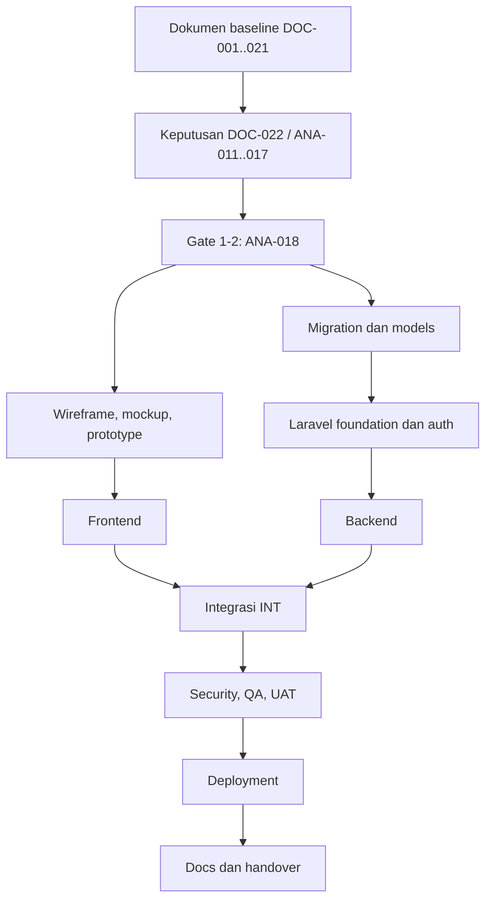

# MASTER TASK MANAGEMENT DOCUMENT
# BLOOMÉ — Flowers & Stories

## 1. Informasi Proyek

| Item | Keterangan |
|---|---|
| Nama proyek | Perancangan Sistem Informasi Pemesanan dan Personalisasi Buket Bunga Berbasis Web |
| Produk / sponsor | BLOOMÉ — Flowers & Stories / Nabila Febriyani |
| Lokasi | Jalan Cipto Mangunkusumo, Simpang Tiga, Loa Janan Ilir, Kota Samarinda |
| Teknologi | Laravel, PHP, Blade, HTML, CSS, JavaScript, Vite, MySQL |
| Arsitektur / metodologi | Three-Layer Architecture / Waterfall dengan quality gate |
| Periode baseline | 13 Oktober–30 November 2026 |
| Tanggal pembaruan | 13 November 2026 |

## 2. Tujuan, Scope, dan Batas Pelaksanaan

Dokumen ini menjadi master checklist, panduan tim/AI, pemantauan progres, acuan QA, serta pembagian tugas untuk proyek dari perencanaan hingga handover. Scope v1.0: website publik, katalog dan detail produk, pemesanan guest, permintaan custom dan gambar referensi, persetujuan harga manual, pembayaran transfer/e-wallet manual, admin tunggal, pengelolaan produk/kategori/order/status/pembatalan, QA, deployment, dokumentasi, dan serah terima.

Registrasi/login pelanggan, payment gateway, bot WhatsApp, kalkulasi harga custom otomatis, live tracking kurir, multi-role admin, dan akuntansi otomatis dikecualikan kecuali disetujui sponsor sebagai perubahan scope.

**Permintaan saat ini menyelesaikan dokumentasi Markdown saja. Semua implementasi kode, database fisik, pengujian aplikasi, dan deployment di bawah adalah task lanjutan berstatus Not Started; tidak ada coding yang dilakukan.**

## 3. Sumber Kebenaran dan Keputusan Terbuka

Gunakan Project Charter/laporan review di `docs/01-foundation/`, `requirement.md`, `prd.md`, `architecture.md`, `design-system.md`, `user-flow.md`, `database-design.md`, `implementation-plan.md`, `testing-plan.md`, serta diagram dan laporan validasi di `docs/`. Jika ada perbedaan, jangan memilih sepihak; catat keputusan dan minta persetujuan sponsor. Tanggal aktual tidak boleh dikarang.

Hal-hal yang masih perlu keputusan tertulis:
- Delapan status ST-01–ST-08 pada PRD/diagram berbeda dengan teks yang menyebut tujuh status atau label lain. Gunakan delapan status hanya sebagai baseline sementara sampai disahkan.
- Penolakan harga custom disebut sebagai pembatalan atau opsi revisi; tetapkan hasil final dan cara menyimpan riwayat penawaran.
- Konfirmasi pembayaran pelanggan, upload bukti transfer, dan verifikasi mutasi manual belum konsisten. Jangan menganggap upload bukti wajib.
- Mekanisme aman bagi pelanggan untuk menyetujui/menolak harga tanpa akun atau self-service tracking belum ditentukan.
- Rekening/e-wallet, delivery atau pickup, jumlah maksimum foto referensi, hosting/domain, serta SLA pascarilis belum dikonfirmasi.
- Jadwal baseline sebagian sudah lewat pada tanggal dokumen ini; tidak ditemukan bukti kode pada workspace. PM perlu mencatat kondisi aktual dan menerbitkan re-baseline jika dibutuhkan.

## 4. Aturan Pengelolaan Task

Setiap task mencatat ID unik, fase/nama, PIC, prioritas, status, dependency, deliverable, dan acceptance criteria (AC). Status: `[ ]` Not Started, `[~]` In Progress, `[x]` Completed, `[!]` Blocked, `[-]` Cancelled. Prioritas: P0 Critical, P1 High, P2 Medium, P3 Low. `—` berarti tanpa dependency.

Completed hanya bila deliverable tersedia dan AC diverifikasi. Task kode perlu test relevan; task dokumen perlu review format, link, konsistensi, dan sumber. Tidak ada tanggal aktual tanpa bukti. Perubahan scope/business rule memerlukan persetujuan sponsor.

### Definition of Done

- Deliverable dapat diperiksa dan memenuhi AC serta baseline yang disetujui.
- Review dan test relevan lulus; defect P0/P1 terkait ditutup.
- Dokumen dan status diperbarui, dependency serta blocker dicatat.
- Task coding terintegrasi dan diuji; task desain direview pada breakpoint relevan.

## 5. Fase, Jadwal, dan Quality Gates

| Fase | Jadwal baseline [PROPOSED] | Quality gate / hasil |
|---|---|---|
| 1. Inisiasi dan dokumentasi | 13–18 Okt | Gate 1: requirement, scope, aturan bisnis, open questions disetujui |
| 2. Analisis dan arsitektur | 19–25 Okt | Gate 2: diagram, alur, arsitektur, ERD, keputusan tervalidasi |
| 3. UI/UX | 26 Okt–1 Nov | Wireframe, mockup, prototype, responsive review disetujui |
| 4. Database | 2–6 Nov | Skema/migration tervalidasi; Gate 3 siap pengembangan |
| 5. Fondasi Laravel | 7–10 Nov | Konfigurasi, route contract, storage, DB siap |
| 6–7. Backend/frontend | 11–20 Nov | Fitur inti selesai pada jalur paralel |
| 8. Integrasi | 21–24 Nov | Gate 4: alur tersambung dan data persisten |
| 9. Security, QA, UAT | 25–28 Nov | Gate 5: P0/P1 tutup, test lulus, UAT disetujui |
| 10. Deployment/handover | 29–30 Nov | Gate 6: deployment sesuai keputusan, docs, sign-off |

Tanggal bersumber dari laporan DOC-004 dan implementation plan. Planned start/end mengikuti rentang fase; actual start/end belum tercatat. Jadwal yang lewat harus dire-baseline oleh PM tanpa mengarang actual.

Untuk task tanpa tanggal rinci, Planned Start, Planned End, dan Estimated Duration mewarisi window fase pada tabel ini sampai PM menerbitkan jadwal per task. Actual Start dan Actual End tetap `— (belum dicatat)` hingga ada bukti pelaksanaan. Ini bukan tanggal aktual dan bukan klaim durasi task yang sudah diukur.

## 6. Fase 1 — Inisiasi dan Dokumentasi

File/laporan tersedia, sehingga task dasar dicatat selesai berdasarkan bukti file. Open questions tetap terbuka.

| ID | Task | PIC | Pri | Status | Dependency | Deliverable | AC |
|---|---|---|---|---|---|---|---|
| DOC-001 | Review Project Charter | Jayanti | P0 | [x] | — | `docs/01-foundation/DOC-001-project-charter-review.md` | Identitas, tujuan, scope, tim, jadwal, open questions tercatat. |
| DOC-002 | Review ruang lingkup | Jayanti | P0 | [x] | DOC-001 | `docs/01-foundation/DOC-002-project-scope-review.md` | In/out scope dapat ditelusuri. |
| DOC-003 | Review pembagian tim | Jayanti | P1 | [x] | DOC-001 | `docs/01-foundation/DOC-003-team-assignment-review.md` | PIC dan tanggung jawab dicatat. |
| DOC-004 | Verifikasi jadwal | Jayanti | P0 | [x] | DOC-001,DOC-003 | `docs/01-foundation/DOC-004-project-schedule-verification.md` | Baseline, dependency, gate, risiko tercatat; actual tidak dikarang. |
| DOC-005 | Struktur dokumentasi | Jayanti | P2 | [x] | DOC-001 | `docs/01-foundation/DOC-005-documentation-structure.md` | Direktori dan penamaan terdokumentasi. |
| DOC-006 | Susun requirement/SRS | Jayanti | P0 | [x] | DOC-001,DOC-002 | `requirement.md`, laporan DOC-006 | Kebutuhan dan aturan dapat ditelusuri. |
| DOC-007 | Review functional requirements | Jayanti | P0 | [x] | DOC-006 | `docs/02-requirements/DOC-007-functional-requirements-review.md` | Fitur terinventarisasi dan direview. |
| DOC-008 | Review non-functional requirements | Jayanti | P1 | [x] | DOC-006 | `docs/02-requirements/DOC-008-non-functional-requirements-review.md` | Kriteria kualitas/verifikasi tercatat. |
| DOC-009 | Review business rules | Jayanti | P0 | [x] | DOC-006 | `docs/02-requirements/DOC-009-business-rules-review.md` | Rule IDs dan konflik terbuka ditandai. |
| DOC-010 | Review acceptance criteria | Jayanti | P0 | [x] | DOC-007,DOC-009 | `docs/02-requirements/DOC-010-acceptance-criteria-review.md` | Kriteria teruji dan terkait kebutuhan. |
| DOC-011 | Susun PRD | Jayanti | P0 | [x] | DOC-006 | `prd.md`, laporan DOC-011 | Vision, scope, fitur, persona, prioritas, acceptance tersedia. |
| DOC-012 | Review product vision | Jayanti | P2 | [x] | DOC-011 | `docs/02-requirements/DOC-012-product-vision-review.md` | Vision/value proposition konsisten. |
| DOC-013 | Review persona | Jayanti | P2 | [x] | DOC-011 | `docs/02-requirements/DOC-013-user-personas-review.md` | Persona utama tercakup. |
| DOC-014 | Review user stories | Jayanti | P1 | [x] | DOC-011 | `docs/02-requirements/DOC-014-user-stories-review.md` | Stories terpetakan ke fitur. |
| DOC-015 | Review prioritas produk | Jayanti | P1 | [x] | DOC-011 | `docs/02-requirements/DOC-015-product-priorities-review.md` | Prioritas dan out-of-scope tercatat. |
| DOC-016 | Susun architecture.md | Elsa, Jayanti | P0 | [x] | DOC-006,DOC-011 | `architecture.md`, laporan DOC-016 | Layer, modul, routing, storage, security, deployment terdokumentasi. |
| DOC-017 | Susun database design | Elsa | P0 | [x] | DOC-006,DOC-016 | `database-design.md`, laporan DOC-017 | ERD, entitas, keys, data dictionary tersedia. |
| DOC-018 | Susun design system | Riya | P1 | [x] | DOC-011 | `design-system.md`, laporan DOC-018 | Token, komponen, UI states, breakpoint tersedia. |
| DOC-019 | Susun user flow | Riya, Jayanti | P1 | [x] | DOC-006,DOC-011 | `user-flow.md`, laporan DOC-019 | Alur katalog/custom/payment/cancel/admin tersedia. |
| DOC-020 | Susun implementation plan | Jayanti, Elsa, Riya | P1 | [x] | DOC-016..018 | `implementation-plan.md`, laporan DOC-020 | Fase, toolchain, jalur, risiko, gate tercatat. |
| DOC-021 | Susun testing plan | Jayanti, Elsa, Riya | P1 | [x] | DOC-006,DOC-019 | `testing-plan.md`, laporan DOC-021 | Skenario, tingkat test, security, UAT, exit criteria ada. |
| DOC-022 | Konsolidasi keputusan lintas dokumen | Jayanti; Nabila approver | P0 | [x] | DOC-006..021 | Decision log disetujui | Tiap konflik bagian 3 punya keputusan dan sumber diperbarui. |
| DOC-023 | Lengkapi traceability matrix | Jayanti | P1 | [x] | DOC-022 | Matriks FR/BR/F/US→task/test | Semua kebutuhan in-scope punya task dan test ID. |
| DOC-024 | Final review Markdown baseline | Jayanti | P1 | [x] | DOC-022,DOC-023 | Review checklist | Link, ID, istilah, status, scope tervalidasi. |

## 7. Fase 2 — Analisis dan Arsitektur

### 7.1 Validasi kebutuhan dan pemodelan

| ID | Task | PIC | Pri | Status | Dependency | Deliverable | AC |
|---|---|---|---|---|---|---|---|
| ANA-001 | Use case diagram | Jayanti | P1 | [x] | DOC-006,DOC-011 | `docs/03-analysis-and-design/ANA-001-use-case-diagram.md` | Guest/admin dan use case tercakup. |
| ANA-002 | Use case descriptions | Jayanti | P1 | [x] | ANA-001 | `docs/03-analysis-and-design/ANA-002-use-case-descriptions.md` | Prakondisi, alur, alternatif, hasil tercatat. |
| ANA-003 | Activity katalog | Jayanti | P1 | [x] | ANA-002 | `docs/03-analysis-and-design/ANA-003-activity-diagram-catalog-order.md` | Stok, validasi, simpan, hasil dimodelkan. |
| ANA-004 | Activity custom | Jayanti | P1 | [x] | ANA-002 | `docs/03-analysis-and-design/ANA-004-activity-diagram-custom-order.md` | Upload, harga, keputusan dimodelkan. |
| ANA-005 | Activity payment | Jayanti | P1 | [x] | ANA-002 | `docs/03-analysis-and-design/ANA-005-activity-diagram-payment.md` | Konfirmasi pelanggan dan verifikasi admin dimodelkan. |
| ANA-006 | Activity cancellation | Jayanti | P1 | [x] | ANA-002 | `docs/03-analysis-and-design/ANA-006-activity-diagram-cancellation.md` | Batas status dan keputusan admin dimodelkan. |
| ANA-007 | Sequence ordering | Jayanti | P1 | [x] | ANA-003,ANA-004 | `docs/03-analysis-and-design/ANA-007-sequence-diagram-ordering.md` | Layer/DB/storage berinteraksi sesuai arsitektur. |
| ANA-008 | Sequence payment | Jayanti | P1 | [x] | ANA-005 | `docs/03-analysis-and-design/ANA-008-sequence-diagram-payment.md` | Konfirmasi/verifikasi/status digambarkan. |
| ANA-009 | Sequence order management | Jayanti | P1 | [x] | ANA-006 | `docs/03-analysis-and-design/ANA-009-sequence-diagram-order-management.md` | Status dan audit history digambarkan. |
| ANA-010 | Validasi diagram | Jayanti | P1 | [x] | ANA-001..009 | `docs/03-analysis-and-design/ANA-010-diagram-validation-report.md` | Konsistensi dan validasi dilaporkan. |
| ANA-011 | Validasi kebutuhan customer | Jayanti,Nabila | P0 | [x] | DOC-022 | Notulen | Field, guest flow, keputusan harga disetujui. |
| ANA-012 | Validasi kebutuhan admin | Jayanti,Nabila | P1 | [x] | DOC-022 | Notulen | Dashboard dan tugas admin cocok dengan operasi. |
| ANA-013 | Validasi alur katalog | Jayanti,Riya,Elsa | P0 | [x] | ANA-003,DOC-022 | Flow final | Harga, stok, alamat, tanggal, kartu, status awal dipastikan. |
| ANA-014 | Validasi alur custom | Jayanti,Nabila | P0 | [x] | ANA-004,DOC-022 | Flow final | Field, revisi, keputusan harga, reject state disetujui. |
| ANA-015 | Validasi payment/cancel | Jayanti,Nabila | P0 | [x] | ANA-005,ANA-006,DOC-022 | Rules final | Bukti bayar, verifikasi, refund, batas cancel dipastikan. |
| ANA-016 | Validasi 8 status pesanan | Jayanti,Nabila | P0 | [x] | ANA-009,DOC-022 | Transition table | Label, kode, state sah/terminal, aktor disepakati. |
| ANA-017 | Validasi open questions | Jayanti,Nabila | P0 | [x] | DOC-001,DOC-022 | Register keputusan | Item konfirmasi punya keputusan/pengecualian tertulis. |
| ANA-018 | Tutup Gate 1 dan 2 | Jayanti | P0 | [x] | ANA-011..017,ARC-010,DB-010 | Sign-off | Kebutuhan/desain disetujui sebelum coding bergantung padanya. |

### 7.2 Arsitektur sistem

| ID | Task | PIC | Pri | Status | Dependency | Deliverable | AC |
|---|---|---|---|---|---|---|---|
| ARC-001 | Three-Layer Architecture | Elsa | P1 | [x] | DOC-016 | `architecture.md` | Tiga layer dan tanggung jawab ditetapkan. |
| ARC-002 | High-level diagram | Elsa | P1 | [x] | ARC-001 | `docs/04-technical-and-architecture/ARC-002-high-level-architecture-diagram.md` | Browser, Laravel, MySQL, storage terpetakan. |
| ARC-003 | Component diagram | Elsa | P1 | [x] | ARC-001 | `docs/04-technical-and-architecture/ARC-003-component-diagram.md` | Modul dan dependensi utama tergambar. |
| ARC-004 | Application modules | Elsa,Jayanti | P1 | [x] | ARC-001,ARC-003 | `docs/04-technical-and-architecture/ARC-004-application-modules.md` | Batas/tanggung jawab modul tercatat. |
| ARC-005 | Routing architecture | Elsa | P1 | [x] | ARC-004 | `architecture.md` | Public, submission, auth, protected routes dipetakan. |
| ARC-006 | Controller responsibilities | Elsa | P1 | [x] | ARC-004 | `architecture.md` | Tanggung jawab sesuai modul dan tidak tumpang tindih. |
| ARC-007 | Service responsibilities | Elsa | P2 | [x] | ARC-006 | `architecture.md` | Service domain dan batas tanggung jawab dijelaskan. |
| ARC-008 | Model relationships | Elsa | P1 | [x] | DOC-017 | `architecture.md`,`database-design.md` | Relasi konsisten dengan ERD/FK. |
| ARC-009 | File storage architecture | Elsa | P1 | [x] | DOC-017 | `architecture.md` | Lokasi, nama, validasi, dan akses berkas didefinisikan. |
| ARC-010 | Security architecture | Elsa | P0 | [x] | ARC-005..009 | `architecture.md` | Auth, CSRF, validation, upload, hashing, data protection tercakup. |

## 8. Fase 3 — UI/UX Design

Task layar UX-014–UX-039 menghasilkan wireframe dan high-fidelity mockup untuk layar terkait. Prototype dan pemeriksaan responsive dicatat pada UX-040–UX-043; semua deliverable desain tersebut belum ada bukti file dan tetap Not Started.

| ID | Task | PIC | Pri | Status | Dependency | Deliverable | AC |
|---|---|---|---|---|---|---|---|
| UX-001 | Color tokens | Riya | P1 | [x] | DOC-018 | `design-system.md` | Nilai/peran token ditentukan. |
| UX-002 | Typography | Riya | P2 | [x] | DOC-018 | `design-system.md` | Font dan type scale ditentukan. |
| UX-003 | Spacing system | Riya | P2 | [x] | DOC-018 | `design-system.md` | Skala spacing dapat diterapkan. |
| UX-004 | Border radius | Riya | P3 | [x] | DOC-018 | `design-system.md` | Radius komponen didefinisikan. |
| UX-005 | Shadow/border | Riya | P3 | [x] | DOC-018 | `design-system.md` | Elevation/border tokens tercatat. |
| UX-006 | Button components spec | Riya | P1 | [x] | DOC-018 | `design-system.md` | Variant dan states didefinisikan. |
| UX-007 | Form components spec | Riya | P1 | [x] | DOC-018 | `design-system.md` | Input, textarea, upload, focus/hint ditentukan. |
| UX-008 | Product card spec | Riya | P1 | [x] | DOC-018 | `design-system.md` | Foto, kategori, harga, aksi ditentukan. |
| UX-009 | Table component spec | Riya | P2 | [x] | DOC-018 | Admin table spec | Sort/filter, empty, mobile overflow, aksi terdefinisi. |
| UX-010 | Badge/status spec | Riya | P1 | [x] | DOC-018 | `design-system.md` | Badge merujuk status final. |
| UX-011 | Navbar/footer spec | Riya | P2 | [x] | DOC-018 | `design-system.md` | Navigasi dan footer ditentukan. |
| UX-012 | Admin sidebar/header spec | Riya | P2 | [x] | DOC-018 | `design-system.md` | Layout admin ditentukan. |
| UX-013 | Floral illustration assets | Riya | P3 | [x] | DOC-018 | Aset dan sumber | Lisensi/sumber aset tercatat. |
| UX-014 | Homepage wireframe | Riya | P1 | [x] | UX-001..008,ANA-018 | Wireframe | Section/CTA memenuhi FR-001 dan disetujui. |
| UX-015 | Catalog wireframe | Riya | P1 | [x] | UX-014 | Wireframe | Kategori, stok, produk mudah dipahami. |
| UX-016 | Product detail wireframe | Riya | P1 | [x] | UX-015 | Wireframe | Harga, stok, detail, CTA tampil. |
| UX-017 | Catalog order form wireframe | Riya | P0 | [x] | UX-016,ANA-013 | Wireframe | Field/error state sesuai aturan. |
| UX-018 | Custom form wireframe | Riya | P0 | [x] | ANA-014 | Wireframe | Field, tanggal, catatan, kontak tercakup. |
| UX-019 | Reference upload wireframe | Riya | P1 | [x] | UX-018 | Wireframe | Batas format/size, preview/error jelas. |
| UX-020 | Order summary wireframe | Riya | P1 | [x] | UX-017,ANA-013 | Wireframe | Item, total, tanggal, pemesan tepat. |
| UX-021 | Payment information wireframe | Riya | P0 | [x] | ANA-015 | Wireframe | Instruksi resmi jelas tanpa data rekening asumsi. |
| UX-022 | Order confirmation wireframe | Riya | P1 | [x] | UX-020 | Wireframe | Hasil dan langkah selanjutnya tampil. |
| UX-023 | About wireframe | Riya | P3 | [x] | DOC-018 | Wireframe | Konten sesuai informasi disetujui. |
| UX-024 | Contact wireframe | Riya | P2 | [x] | ANA-017 | Wireframe | Kontak resmi terkonfirmasi. |
| UX-025 | Admin login wireframe | Riya | P1 | [x] | ARC-010 | Wireframe | Error/loading/accessibility tercakup. |
| UX-026 | Dashboard wireframe | Riya | P1 | [x] | UX-025 | Wireframe | Metrik sesuai scope. |
| UX-027 | Product management wireframe | Riya | P1 | [x] | UX-026 | Wireframe | List, filter, stok, aksi jelas. |
| UX-028 | Add/edit product wireframe | Riya | P1 | [x] | UX-027 | Wireframe | Field, upload, validation, confirm tercakup. |
| UX-029 | Category management wireframe | Riya | P2 | [x] | UX-027 | Wireframe | CRUD dan kategori terpakai terlihat. |
| UX-030 | Order management wireframe | Riya | P0 | [x] | UX-026,ANA-016 | Wireframe | Status, tanggal, search/filter tersedia. |
| UX-031 | Order detail wireframe | Riya | P0 | [x] | UX-030 | Wireframe | Snapshot, pelanggan, item, payment, history. |
| UX-032 | Custom request list wireframe | Riya | P1 | [x] | UX-030 | Wireframe | Antrean dan status review terbaca. |
| UX-033 | Custom detail wireframe | Riya | P1 | [x] | UX-032 | Wireframe | Spesifikasi/referensi ditampilkan aman. |
| UX-034 | Custom price wireframe | Riya | P0 | [x] | ANA-014 | Wireframe | Harga manual, validasi, keputusan terlihat. |
| UX-035 | Payment list wireframe | Riya | P0 | [x] | ANA-015 | Wireframe | Status dan order terkait terlihat. |
| UX-036 | Payment detail wireframe | Riya | P1 | [x] | UX-035 | Wireframe | Nilai, metode, verifikasi terbedakan. |
| UX-037 | Status management wireframe | Riya | P0 | [x] | ANA-016 | Wireframe | Hanya transisi sah dapat dipilih. |
| UX-038 | Cancellation wireframe | Riya | P1 | [x] | ANA-015 | Wireframe | Alasan, keputusan admin, hasil terlihat. |
| UX-039 | Admin settings wireframe | Riya | P3 | [x] | DOC-002 | Keputusan scope | Tidak dibuat sebelum sponsor menyetujui scope. |
| UX-040 | Responsive review | Riya | P1 | [x] | UX-014..038 | Review 360/768/1280px | Halaman utama tanpa overflow/clipping. |
| UX-041 | Catalog prototype | Riya | P1 | [x] | UX-014..017 | Prototype | Browse hingga confirmation bisa ditelusuri. |
| UX-042 | Custom/payment/cancel prototype | Riya | P1 | [x] | UX-018..022,UX-038 | Prototype | Cabang keputusan sesuai aturan sponsor. |
| UX-043 | Admin operations prototype | Riya | P2 | [x] | UX-025..038 | Prototype | CRUD, custom review, payment, status dapat direview. |

## 9. Fase 4 — Database Design dan Implementasi

| ID | Task | PIC | Pri | Status | Dependency | Deliverable | AC |
|---|---|---|---|---|---|---|---|
| DB-001 | Identifikasi entitas | Elsa | P1 | [x] | DOC-017 | ERD/dictionary | Entitas inti dan alasan tercatat. |
| DB-002 | Tentukan atribut | Elsa | P1 | [x] | DB-001 | Data dictionary | Field/type/nullability/batasan didefinisikan. |
| DB-003 | Tentukan primary keys | Elsa | P1 | [x] | DB-001 | ERD | Semua entitas memiliki PK. |
| DB-004 | Tentukan foreign keys | Elsa | P1 | [x] | DB-001 | ERD | Referensi dan delete policy tercatat. |
| DB-005 | Tentukan relasi | Elsa | P1 | [x] | DB-004 | ERD | Kardinalitas sesuai alur. |
| DB-006 | Buat ERD | Elsa | P1 | [x] | DB-001..005 | `database-design.md` | Semua entitas transaksi/custom/payment/audit tergambar. |
| DB-007 | Normalisasi | Elsa | P2 | [x] | DB-006 | `database-design.md` | Normalisasi dan snapshot historis dijelaskan. |
| DB-008 | Tentukan indexing | Elsa | P2 | [x] | DB-006 | `database-design.md` | Index mendukung query prioritas. |
| DB-009 | Review integritas data | Elsa | P1 | [x] | DB-006..008 | `database-design.md` | Constraint/transaksi cocok dengan rules. |
| DB-010 | Validasi database baseline | Elsa,Jayanti | P0 | [x] | DB-001..009 | `docs/04-technical-and-architecture/DOC-017-database-design-report.md` | Skema disetujui; konflik dicatat. |
| DB-011 | Migration admins | Elsa | P1 | [x] | DB-010,BE-002 | Migration | PK/email/hash/timestamps sesuai desain. |
| DB-012 | Migration categories | Elsa | P1 | [x] | DB-010 | Migration | Name/slug unique. |
| DB-013 | Migration products | Elsa | P1 | [x] | DB-012 | Migration | Category FK, price, image, stock/index sesuai. |
| DB-014 | Migration customers | Elsa | P1 | [x] | DB-010 | Migration | Guest fields/index sesuai keputusan. |
| DB-015 | Migration orders | Elsa | P0 | [x] | DB-014,ANA-016 | Migration | Code unique, dates/status/total/FK valid. |
| DB-016 | Migration order_details | Elsa | P0 | [x] | DB-013,DB-015 | Migration | Quantity, subtotal, FK, snapshot valid. |
| DB-017 | Migration custom_requests | Elsa | P0 | [x] | DB-015,ANA-014 | Migration | Specification/offer/decision termodelkan. |
| DB-018 | Migration custom_references | Elsa | P1 | [x] | DB-017 | Migration | Path, filename, size, relation tercatat. |
| DB-019 | Migration payments | Elsa | P0 | [x] | DB-015,ANA-015 | Migration | Amount/method/verification sesuai keputusan. |
| DB-020 | Migration status histories | Elsa | P0 | [x] | DB-015,DB-011,ANA-016 | Migration | Perubahan status dapat diaudit. |
| DB-021 | Jalankan migrations lokal | Elsa | P0 | [ ] | DB-011..020,BE-004 | Migration report | Fresh migrate dan rollback berhasil. |
| DB-022 | Validasi foreign keys | Elsa | P0 | [ ] | DB-021 | Schema test | Invalid relation ditolak; delete policy benar. |
| DB-023 | Eloquent models/relationships | Elsa | P1 | [x] | DB-021 | 10 model | 10 Model Eloquent terdefinisi dengan relasi & scope. |
| DB-024 | Seeders/factories | Elsa | P2 | [x] | DB-023 | Seeders/factories | AdminSeeder, CategorySeeder, ProductSeeder siap. |

## 10. Fase 5 — Laravel Project Foundation

| ID | Task | PIC | Pri | Status | Dependency | Deliverable | AC |
|---|---|---|---|---|---|---|---|
| BE-001 | Verifikasi versi PHP/Laravel | Elsa | P0 | [x] | ANA-018 | Environment report | Runtime sesuai baseline dan tersedia (PHP 8.5, Composer 2.9, Node 24). |
| BE-002 | Siapkan Laravel project | Elsa | P0 | [x] | BE-001 | Laravel app | Struktur aplikasi modular Three-Layer Architecture siap. |
| BE-003 | Konfigurasi environment | Elsa | P0 | [x] | BE-002 | `.env.example` | Konfigurasi .env dan .env.example siap. |
| BE-004 | Hubungkan MySQL | Elsa | P0 | [ ] | BE-003 | DB config | Koneksi dev berhasil. |
| BE-005 | Konfigurasi migrations | Elsa | P0 | [x] | BE-004,DB-010 | Migration baseline | 10 migrasi terstruktur urut sesuai ERD. |
| BE-006 | Struktur controllers | Elsa | P2 | [x] | BE-002,ARC-006 | Controllers | Seluruh controller publik dan admin terstruktur. |
| BE-007 | Struktur models | Elsa | P1 | [x] | BE-002,DB-023 | Models | 10 Model Eloquent terdefinisi dengan relasi & scope. |
| BE-008 | Services bila diperlukan | Elsa | P2 | [x] | BE-006,ARC-007 | Domain services | 5 Domain Services terstruktur di app/Services. |
| BE-009 | Form Requests | Elsa | P1 | [x] | BE-002,ANA-018 | Validators | 8 Form Requests validasi terpusat di app/Http/Requests. |
| BE-010 | Middleware/admin guard | Elsa | P0 | [ ] | BE-002,ARC-010 | Auth config | Admin routes terlindungi. |
| BE-011 | Route groups | Elsa | P1 | [x] | BE-006,ARC-005 | Web routes | Public, submission, dan admin routes di routes/web.php. |
| BE-012 | Error handling | Elsa,Riya | P2 | [ ] | BE-002,UX-014 | Error pages/logging | 403/404/500 aman dan terbaca. |
| BE-013 | Uji koneksi DB | Elsa | P0 | [ ] | BE-004,DB-021 | Test report | Query dan migration dev lulus. |

## 11. Fase 6 — Backend Development

Semua BE-014–BE-080 Not Started. Mulai setelah dependency dan keputusan terkait ditutup.

| ID | Task | PIC | Pri | Status | Dependency | Deliverable | AC |
|---|---|---|---|---|---|---|---|
| BE-014 | Admin login | Elsa | P0 | [x] | BE-010,DB-011,UX-025 | Auth handler | Valid login session; invalid ditolak. |
| BE-015 | Password hashing | Elsa | P0 | [x] | BE-014 | Auth config | Password hanya tersimpan sebagai hash Bcrypt. |
| BE-016 | Admin logout | Elsa | P1 | [x] | BE-014 | Logout action | Sesi dibatalkan; route protected tertutup. |
| BE-017 | Protected routes | Elsa | P0 | [ ] | BE-010,BE-014 | Middleware | Seluruh route admin butuh auth. |
| BE-018 | Test akses tanpa auth | Elsa | P0 | [ ] | BE-017 | Feature tests | Guest ditolak tanpa data bocor. |
| BE-019 | Category index | Elsa | P2 | [x] | DB-023 | Query/view data | AdminCategoryController@index siap. |
| BE-020 | Category create | Elsa | P2 | [x] | BE-019 | Form action | Admin dapat membuka form modal. |
| BE-021 | Category store | Elsa | P1 | [x] | BE-020,BE-025 | Store action | Kategori valid tersimpan sekali. |
| BE-022 | Category edit | Elsa | P2 | [x] | BE-019 | Edit action | Kategori tepat dimuat. |
| BE-023 | Category update | Elsa | P1 | [x] | BE-022,BE-025 | Update action | Update tidak melanggar unique rule. |
| BE-024 | Category delete | Elsa | P2 | [x] | BE-019,BE-025 | Delete action | Kategori terpakai ditolak sesuai policy. |
| BE-025 | Category validation | Elsa | P1 | [x] | BE-009,DB-012 | Request/tests | Required/unique/slug/delete rules tervalidasi. |
| BE-026 | Product index | Elsa | P1 | [x] | BE-023,DB-013 | Query/controller | AdminProductController@index siap. |
| BE-027 | Product create | Elsa | P2 | [x] | BE-026 | Form action | Form admin dapat dibuka. |
| BE-028 | Product store | Elsa | P1 | [x] | BE-027,BE-034 | Store action | Produk dan kategori tersimpan benar. |
| BE-029 | Product edit | Elsa | P2 | [x] | BE-026 | Edit action | Data produk benar dimuat. |
| BE-030 | Product update | Elsa | P1 | [x] | BE-029,BE-034 | Update action | Update tidak merusak snapshot order lama. |
| BE-031 | Product delete | Elsa | P2 | [x] | BE-026 | Delete action | Riwayat transaksi tetap utuh (Restrict). |
| BE-032 | Product image upload | Elsa | P1 | [x] | BE-009,ARC-009 | Storage handler | Tipe/size/nama UUID aman tersimpan. |
| BE-033 | Product availability | Elsa | P1 | [x] | BE-028 | Toggle/action | Toggle status stok instan siap. |
| BE-034 | Product validation | Elsa | P1 | [x] | BE-009,DB-013 | Request/tests | StoreProductRequest & UpdateProductRequest tervalidasi. |
| BE-035 | Validasi data customer | Elsa | P0 | [ ] | ANA-013,DB-014 | Request | Field kontak sesuai keputusan sponsor. |
| BE-036 | Buat data customer | Elsa | P1 | [ ] | BE-035 | Customer action | Data tersimpan tanpa akun customer. |
| BE-037 | Relasi customer-order | Elsa | P0 | [ ] | DB-015,DB-023 | Model/tests | Order menunjuk customer benar. |
| BE-038 | Ambil info customer | Elsa | P1 | [ ] | BE-037,BE-017 | Admin query | Hanya admin berwenang dapat membaca. |
| BE-039 | Pilih produk katalog | Elsa | P0 | [ ] | BE-026,ANA-013 | Order handler | Hanya produk valid dapat dipilih. |
| BE-040 | Validasi availability | Elsa | P0 | [ ] | BE-039,BE-033 | Stock guard/tests | Request langsung tak dapat pesan stok habis. |
| BE-041 | Submission data customer | Elsa | P0 | [ ] | BE-035,BE-039 | Order request | Input lengkap tervalidasi server-side. |
| BE-042 | Buat order | Elsa | P0 | [ ] | BE-041,DB-015 | Transaction action | Order atomik; status awal sesuai keputusan. |
| BE-043 | Buat order detail | Elsa | P0 | [ ] | BE-042,DB-016 | OrderDetail | Snapshot, quantity, subtotal konsisten. |
| BE-044 | Hitung total order | Elsa | P0 | [ ] | BE-043 | Calculation/tests | Total dihitung server-side dari subtotal. |
| BE-045 | Generate order code | Elsa | P1 | [ ] | BE-042 | Generator/tests | Format disetujui; collision ditangani. |
| BE-046 | Order confirmation | Elsa | P1 | [ ] | BE-042,UX-022 | Response/view data | Hanya order baru ditampilkan. |
| BE-047 | Validasi custom form | Elsa | P0 | [ ] | ANA-014,DB-017 | Custom Request | Field sesuai keputusan dan tervalidasi. |
| BE-048 | Simpan custom specification | Elsa | P0 | [ ] | BE-047,DB-017 | Custom action | Bahan/warna/tema/catatan tersimpan. |
| BE-049 | Validasi reference image | Elsa | P0 | [ ] | ARC-009,ANA-017 | File tests | Format dan ukuran divalidasi server-side. |
| BE-050 | Simpan reference image | Elsa | P1 | [ ] | BE-049,DB-018 | Storage action | Nama random; storage/DB dan akses konsisten. |
| BE-051 | Buat custom request | Elsa | P0 | [ ] | BE-047..050 | Transaction | Customer/order/request/history atomik. |
| BE-052 | Relasi custom-order | Elsa | P0 | [ ] | DB-017,DB-023 | Model/tests | Order custom menunjuk request tepat. |
| BE-053 | Daftar custom request | Elsa | P1 | [ ] | BE-017,BE-052 | Admin list | Admin saja dapat meninjau request. |
| BE-054 | Detail custom request | Elsa | P1 | [ ] | BE-053 | Admin detail | Spec/reference tampil aman. |
| BE-055 | Review custom admin | Elsa | P1 | [ ] | BE-054 | Review workflow | Hanya request eligible dapat direview. |
| BE-056 | Input harga custom | Elsa | P0 | [ ] | ANA-014,BE-055 | Price action | Admin memasukkan harga manual tervalidasi. |
| BE-057 | Simpan proposed price | Elsa | P0 | [ ] | BE-056,DB-017 | Persisted offer | Nilai, waktu, pelaku dapat diaudit. |
| BE-058 | Catat approve harga | Elsa | P0 | [ ] | ANA-014,ANA-017 | Decision action | Aksi sah dan mencatat actor/time. |
| BE-059 | Catat reject harga | Elsa | P0 | [ ] | ANA-014,ANA-017 | Decision action | Hasil sesuai state final/revisi disetujui. |
| BE-060 | Tangani revisi custom | Elsa | P2 | [ ] | ANA-014,BE-058,BE-059 | Revision workflow | Jejak penawaran tak tertimpa; revisi sesuai scope. |
| BE-061 | Admin order list | Elsa | P1 | [ ] | BE-017,BE-042 | Order list | Status/tanggal/filter benar. |
| BE-062 | Admin order detail | Elsa | P1 | [ ] | BE-061 | Order detail | Customer/item/payment/custom/history terkait tampil. |
| BE-063 | Search/filter order | Elsa | P2 | [ ] | BE-061 | Query/filter | Pencarian/filter benar dan terotorisasi. |
| BE-064 | Update order status | Elsa | P0 | [ ] | ANA-016,BE-017 | Status action | Hanya transisi disahkan diizinkan. |
| BE-065 | Validasi transisi status | Elsa | P0 | [ ] | BE-064 | Status service/tests | Transisi ilegal/terminal ditolak. |
| BE-066 | Order history | Elsa | P1 | [ ] | DB-020,BE-062 | History view/query | Kronologis dan tidak dapat diubah customer. |
| BE-067 | Simpan status history | Elsa | P0 | [ ] | BE-064,DB-020 | History writer | Status dan history commit atomik. |
| BE-068 | Payment method handling | Elsa | P1 | [ ] | ANA-015 | Payment methods | Metode disetujui sponsor saja. |
| BE-069 | Simpan payment information | Elsa | P0 | [ ] | DB-019,ANA-015 | Payment action | Nilai/order konsisten; rekening belum di-hardcode. |
| BE-070 | Payment list | Elsa | P1 | [ ] | BE-017,BE-069 | Admin list | Payment terkait order/status tampil. |
| BE-071 | Payment detail | Elsa | P1 | [ ] | BE-070 | Admin detail | Detail hanya untuk admin. |
| BE-072 | Manual payment verification | Elsa | P0 | [ ] | ANA-015,BE-071 | Verify action | Admin mencatat verifikasi mutasi; bukan gateway. |
| BE-073 | Update payment/order status | Elsa | P0 | [ ] | BE-072,BE-065 | Transaction | Payment/order/history konsisten. |
| BE-074 | Payment-order relationship | Elsa | P0 | [ ] | DB-019,DB-023 | Model/tests | Payment terhubung ke order. |
| BE-075 | Record cancellation request | Elsa | P1 | [ ] | ANA-015,DB-015 | Cancellation action | Request/alasan terkait order. |
| BE-076 | Store cancellation reason | Elsa | P1 | [ ] | BE-075 | Persisted reason | Alasan tidak mengubah status sebelum keputusan admin. |
| BE-077 | Admin cancellation review | Elsa | P1 | [ ] | BE-017,BE-075 | Review action | Admin melihat request eligible. |
| BE-078 | Approve cancellation | Elsa | P0 | [ ] | BE-077,ANA-016 | Approve action | Terminal status dan history atomik. |
| BE-079 | Reject cancellation | Elsa | P1 | [ ] | BE-077 | Reject action | Status aktif dipertahankan dan keputusan tercatat. |
| BE-080 | Cancellation status validation | Elsa | P0 | [ ] | ANA-016,BE-078,BE-079 | Policy/tests | Tahap terlarang ditolak sesuai rule final. |

## 12. Fase 7 — Frontend Development

Seluruh FE-001–FE-053 Not Started; pengerjaan menunggu desain dan permintaan coding.

| ID | Task | PIC | Pri | Status | Dependency | Deliverable | AC |
|---|---|---|---|---|---|---|---|
| FE-001 | Asset management | Riya | P1 | [ ] | BE-002,UX-013 | Vite/assets | Build berjalan dan aset bersumber jelas. |
| FE-002 | Global CSS | Riya | P1 | [ ] | UX-001..005 | CSS baseline | Token global konsisten. |
| FE-003 | Typography | Riya | P2 | [ ] | UX-002 | Font setup | Font/fallback terbaca. |
| FE-004 | Color tokens | Riya | P1 | [ ] | UX-001 | CSS variables | UI memakai warna baseline. |
| FE-005 | Spacing tokens | Riya | P2 | [ ] | UX-003 | CSS variables | Spacing konsisten. |
| FE-006 | Reusable components | Riya | P1 | [ ] | UX-006..012 | Blade components | Komponen dapat dipakai lintas halaman. |
| FE-007 | Responsive utilities | Riya | P1 | [ ] | UX-040 | CSS utilities | Layout tidak overflow pada breakpoint. |
| FE-008 | Navbar | Riya | P1 | [ ] | FE-006,UX-011 | Blade component | Navigasi keyboard/mobile berfungsi. |
| FE-009 | Footer | Riya | P2 | [ ] | FE-006,ANA-017 | Blade component | Kontak/jam hanya data terkonfirmasi. |
| FE-010 | Product card | Riya | P1 | [ ] | FE-006,UX-008 | Blade component | Harga/stok/gambar/CTA sesuai data. |
| FE-011 | Category card | Riya | P2 | [ ] | FE-006,UX-015 | Blade component | Kategori jelas dan accessible. |
| FE-012 | Buttons | Riya | P1 | [ ] | FE-006,UX-006 | Blade/CSS | Variant/state konsisten. |
| FE-013 | Input fields | Riya | P1 | [ ] | FE-006,UX-007 | Blade component | Label/error/focus accessible. |
| FE-014 | Select components | Riya | P2 | [ ] | FE-006,UX-007 | Blade component | Selection/validation benar. |
| FE-015 | Upload component | Riya | P1 | [ ] | FE-006,UX-019 | Upload UI | Preview/error sesuai batas. |
| FE-016 | Status badges | Riya | P1 | [ ] | FE-006,ANA-016 | Badge component | Kode/label cocok status final. |
| FE-017 | Modal | Riya | P2 | [ ] | FE-006 | Modal component | Focus/close/confirm bekerja. |
| FE-018 | Alert/notification | Riya | P1 | [ ] | FE-006 | Alert component | Feedback jelas. |
| FE-019 | Homepage | Riya | P1 | [ ] | UX-014,FE-008..010 | Blade view | FR-001 terpenuhi; data tidak dipalsukan. |
| FE-020 | Product catalog | Riya | P0 | [ ] | UX-015,FE-010,FE-011 | Blade view | Filter dan availability bekerja. |
| FE-021 | Product detail | Riya | P1 | [ ] | UX-016,FE-010 | Blade view | Harga, stok, detail, CTA benar. |
| FE-022 | Catalog order form | Riya | P0 | [ ] | UX-017,FE-013,BE-041 | Blade view | Field/error/submit cocok backend. |
| FE-023 | Custom form | Riya | P0 | [ ] | UX-018,BE-047 | Blade view | Field sesuai keputusan sponsor. |
| FE-024 | Reference upload UI | Riya | P1 | [ ] | UX-019,FE-015,BE-049 | Blade/JS | Preview/error/removal bekerja. |
| FE-025 | Order summary | Riya | P1 | [ ] | UX-020,BE-044 | Blade view | Total berasal server. |
| FE-026 | Payment information | Riya | P0 | [ ] | UX-021,BE-068 | Blade view | Rekening resmi disetujui. |
| FE-027 | Order confirmation | Riya | P1 | [ ] | UX-022,BE-046 | Blade view | Hanya order hasil submission. |
| FE-028 | About page | Riya | P3 | [ ] | UX-023 | Blade view | Profil usaha disetujui. |
| FE-029 | Contact page | Riya | P2 | [ ] | UX-024 | Blade view | Kontak resmi valid. |
| FE-030 | Admin login | Riya | P1 | [ ] | UX-025,BE-014 | Blade view | Feedback aman tanpa membocorkan credential. |
| FE-031 | Admin layout | Riya | P1 | [ ] | UX-012,FE-006 | Blade layout | Layout admin konsisten. |
| FE-032 | Sidebar | Riya | P2 | [ ] | FE-031 | Component | Active state/mobile nav berfungsi. |
| FE-033 | Header | Riya | P2 | [ ] | FE-031 | Component | Identitas/logout aman. |
| FE-034 | Dashboard | Riya | P1 | [ ] | UX-026,BE-061 | Blade view | Statistik dari DB; empty state tersedia. |
| FE-035 | Product management | Riya | P1 | [ ] | UX-027,BE-026 | Blade view | List/stok/aksi admin berfungsi. |
| FE-036 | Add/edit product form | Riya | P1 | [ ] | UX-028,BE-027 | Blade view | Validation/upload usable. |
| FE-037 | Category management | Riya | P2 | [ ] | UX-029,BE-019 | Blade view | CRUD dan constraint terlihat. |
| FE-038 | Order management | Riya | P0 | [ ] | UX-030,BE-061 | Blade view | Filter/status/date/empty state bekerja. |
| FE-039 | Order detail | Riya | P0 | [ ] | UX-031,BE-062 | Blade view | Snapshot/payment/audit tersaji. |
| FE-040 | Custom request management | Riya | P1 | [ ] | UX-032,BE-053 | Blade view | Antrean/status tampil. |
| FE-041 | Custom detail | Riya | P1 | [ ] | UX-033,BE-054 | Blade view | Spesifikasi/gambar aman. |
| FE-042 | Custom price form | Riya | P0 | [ ] | UX-034,BE-056 | Blade view | Harga manual tervalidasi. |
| FE-043 | Payment management | Riya | P0 | [ ] | UX-035,BE-070 | Blade view | Status payment dapat dibedakan. |
| FE-044 | Payment detail | Riya | P1 | [ ] | UX-036,BE-071 | Blade view | Hanya informasi perlu yang tampil. |
| FE-045 | Order status management | Riya | P0 | [ ] | UX-037,BE-064 | Blade view | Pilihan mengikuti transisi sah. |
| FE-046 | Cancellation management | Riya | P1 | [ ] | UX-038,BE-077 | Blade view | Alasan/approve/reject dan confirm tersedia. |
| FE-047 | Admin settings | Riya | P3 | [ ] | UX-039,DOC-022 | Decision/view | Tidak dibuat sebelum scope disetujui. |
| FE-048 | Desktop responsive | Riya | P1 | [ ] | FE-019..047,UX-040 | UI review | Tidak ada clipping/overlap. |
| FE-049 | Tablet responsive | Riya | P1 | [ ] | FE-019..047,UX-040 | UI review | Layout dapat digunakan. |
| FE-050 | Mobile responsive | Riya | P0 | [ ] | FE-019..047,UX-040 | UI review | Alur utama usable. |
| FE-051 | Responsive tables | Riya | P1 | [ ] | UX-009,FE-038,FE-043 | Table behavior | Data dapat dibaca/dioperasikan. |
| FE-052 | Mobile navigation | Riya | P1 | [ ] | FE-008,FE-032 | Navigation | Touch/keyboard open/close berfungsi. |
| FE-053 | Responsive admin sidebar | Riya | P1 | [ ] | FE-032 | Sidebar behavior | Tidak menutup konten/navigasi. |

## 13. Fase 8 — Integrasi

| ID | Task | PIC | Pri | Status | Dependency | Deliverable | AC |
|---|---|---|---|---|---|---|---|
| INT-001 | Hubungkan homepage dengan data | Elsa,Riya | P1 | [ ] | FE-019,BE-026 | Integrated page | Produk unggulan hanya produk aktif. |
| INT-002 | Hubungkan katalog ke DB | Elsa,Riya | P0 | [ ] | FE-020,BE-026 | Integrated catalog | Kategori/stok/filter konsisten. |
| INT-003 | Hubungkan detail produk | Elsa,Riya | P1 | [ ] | FE-021,BE-026 | Integrated detail | Produk benar; invalid 404. |
| INT-004 | Integrasi order katalog | Elsa,Riya | P0 | [ ] | FE-022,BE-039..046 | E2E flow | Order atomik; error kembali ke form. |
| INT-005 | Integrasi custom form | Elsa,Riya | P0 | [ ] | FE-023,BE-047..052 | E2E flow | Request dan relasi tersimpan. |
| INT-006 | Integrasi image upload | Elsa,Riya | P0 | [ ] | FE-024,BE-049..050 | Upload flow | Valid diterima; invalid ditolak. |
| INT-007 | Integrasi order summary | Elsa,Riya | P1 | [ ] | FE-025,BE-044 | Summary flow | Nilai sama dengan kalkulasi server. |
| INT-008 | Integrasi order confirmation | Elsa,Riya | P1 | [ ] | FE-027,BE-046 | Confirmation flow | Hanya order baru terlihat; tak ada IDOR. |
| INT-009 | Integrasi admin login | Elsa,Riya | P0 | [ ] | FE-030,BE-014..018 | Auth flow | Login/logout/proteksi berjalan. |
| INT-010 | Dashboard statistics | Elsa,Riya | P2 | [ ] | FE-034,BE-061 | Dashboard data | Metrik sesuai query uji. |
| INT-011 | Integrasi product management | Elsa,Riya | P1 | [ ] | FE-035,FE-036,BE-026..034 | Product flow | CRUD dan katalog sinkron. |
| INT-012 | Integrasi category management | Elsa,Riya | P2 | [ ] | FE-037,BE-019..025 | Category flow | Constraint dan katalog sinkron. |
| INT-013 | Integrasi order management | Elsa,Riya | P0 | [ ] | FE-038..039,BE-061..067 | Order flow | List/detail/status/history sesuai hak akses. |
| INT-014 | Integrasi custom management | Elsa,Riya | P1 | [ ] | FE-040..041,BE-053..055 | Custom review | Admin melihat spec/reference terkait. |
| INT-015 | Integrasi custom price | Elsa,Riya | P0 | [ ] | FE-042,BE-056..060 | Price flow | Harga/keputusan sesuai aturan final. |
| INT-016 | Integrasi payment management | Elsa,Riya | P0 | [ ] | FE-026,FE-043..044,BE-068..074 | Payment flow | Instruksi dan verifikasi konsisten. |
| INT-017 | Integrasi order status | Elsa,Riya | P0 | [ ] | FE-045,BE-064..067 | Status flow | Status/history atomik dan tepat. |
| INT-018 | Integrasi cancellation | Elsa,Riya | P1 | [ ] | FE-046,BE-075..080 | Cancellation flow | Request/review mengikuti aturan final. |
| INT-019 | Validasi DB persistence | Elsa | P0 | [ ] | INT-004..018 | Integration tests | Data benar antar request/session. |
| INT-020 | Validasi komunikasi FE/BE | Elsa,Riya | P1 | [ ] | INT-001..018 | Integration report | Request/error/redirect/response konsisten. |
| INT-021 | Validasi relasi order | Elsa | P0 | [ ] | INT-019 | Integrity report | Customer/item/custom/payment/history terhubung benar. |
| INT-022 | Validasi file storage | Elsa,Riya | P0 | [ ] | INT-006,INT-014 | Storage report | Upload/read/delete/access mengikuti policy. |
| INT-023 | Validasi business workflows | Jayanti,Nabila | P0 | [ ] | INT-004..018,ANA-018 | Sign-off | Alur utama lulus review. |

## 14. Fase 9 — Security, QA, dan UAT

### Security

| ID | Task | PIC | Pri | Status | Dependency | Deliverable | AC |
|---|---|---|---|---|---|---|---|
| SEC-001 | Validasi admin authentication | Elsa | P0 | [ ] | INT-009 | Security tests | Login/session/logout lulus. |
| SEC-002 | Validasi protected routes | Elsa | P0 | [ ] | BE-017 | Route tests | Guest ditolak dari semua route admin. |
| SEC-003 | Validasi authorization | Elsa | P0 | [ ] | SEC-002 | Authz tests | Tidak ada akses data/aksi lintas peran/order. |
| SEC-004 | Validasi password hashing | Elsa | P0 | [ ] | BE-015 | Test result | Tidak ada plaintext di DB/log/response. |
| SEC-005 | Validasi CSRF | Elsa | P0 | [ ] | INT-004..018 | CSRF tests | Mutasi tanpa token ditolak. |
| SEC-006 | Validasi input | Elsa | P0 | [ ] | INT-004..018 | Validation tests | Server menolak input invalid meski client bypass. |
| SEC-007 | Review SQL injection | Elsa | P0 | [ ] | SEC-006 | Security review | ORM/binding digunakan; input tidak mengubah query. |
| SEC-008 | Review XSS | Elsa,Riya | P0 | [ ] | FE-019..047 | Security review | User output di-escape. |
| SEC-009 | Keamanan file upload | Elsa | P0 | [ ] | INT-006,INT-022 | Upload report | MIME/size/type/path diuji; script tak dieksekusi. |
| SEC-010 | Perlindungan data sensitif | Elsa | P1 | [ ] | INT-009..018 | Privacy review | PII hanya terlihat sesuai otorisasi. |
| SEC-011 | Review environment | Elsa | P0 | [ ] | DEP-003 | Config checklist | Secret aman; debug off di production. |

### Functional, technical, UI/UX, UAT

| ID | Task | PIC | Pri | Status | Dependency | Deliverable | AC |
|---|---|---|---|---|---|---|---|
| QA-001 | Homepage test | Riya | P2 | [ ] | INT-001 | Test result | FR-001, links, layout lulus. |
| QA-002 | Catalog test | Riya,Elsa | P0 | [ ] | INT-002 | Test result | Produk aktif/kategori/stok benar. |
| QA-003 | Product detail test | Riya,Elsa | P1 | [ ] | INT-003 | Test result | Harga/stok/CTA benar; invalid 404. |
| QA-004 | Catalog order test | Elsa | P0 | [ ] | INT-004 | Test report | Guest order tersimpan; invalid tak membuat data parsial. |
| QA-005 | Custom bouquet test | Elsa | P0 | [ ] | INT-005 | Test report | Spesifikasi dan alur sesuai rules. |
| QA-006 | Upload test | Elsa | P0 | [ ] | INT-006,SEC-009 | Test report | Gambar valid diterima; format/size salah ditolak. |
| QA-007 | Custom price workflow test | Elsa,Jayanti | P0 | [ ] | INT-015 | Test report | Manual price/approve/reject/revision sesuai keputusan. |
| QA-008 | Payment test | Elsa | P0 | [ ] | INT-016 | Test report | Instruksi dan state konsisten. |
| QA-009 | Manual verification test | Elsa | P0 | [ ] | INT-016 | Test report | Hanya admin verifikasi; hasil tercatat. |
| QA-010 | Order status test | Elsa | P0 | [ ] | INT-017 | Test report | Transisi sah; ilegal ditolak; history lengkap. |
| QA-011 | Cancellation test | Elsa | P1 | [ ] | INT-018 | Test report | Eligibility/approve/reject/status benar. |
| QA-012 | Admin authentication test | Elsa | P0 | [ ] | INT-009 | Test report | Login, logout, session diuji. |
| QA-013 | Product management test | Elsa,Riya | P1 | [ ] | INT-011 | Test report | CRUD/upload/availability/validation lulus. |
| QA-014 | Category management test | Elsa,Riya | P2 | [ ] | INT-012 | Test report | CRUD/unique/used-category lulus. |
| QA-015 | Dashboard test | Elsa,Riya | P2 | [ ] | INT-010 | Test result | Metrik dan empty state benar. |
| QA-016 | Unit testing | Elsa | P1 | [ ] | BE-001..080 | Test report | Logic penting lulus dan reproducible. |
| QA-017 | Feature testing | Elsa | P0 | [ ] | BE-001..080 | Test report | Request/validation/middleware/CRUD lulus. |
| QA-018 | Integration testing | Elsa | P0 | [ ] | INT-001..023 | Test report | Transaksi lintas modul/tabel lulus. |
| QA-019 | Database integrity tests | Elsa | P0 | [ ] | DB-022,INT-019 | Test report | FK/unique/snapshot/rollback diuji. |
| QA-020 | File validation tests | Elsa | P0 | [ ] | SEC-009 | Test report | MIME spoof, size, format, naming diuji. |
| QA-021 | Error handling tests | Elsa | P1 | [ ] | BE-012 | Test report | Error tidak bocor; feedback UI jelas. |
| QA-022 | Color review | Riya | P2 | [ ] | UX-001,FE-019..047 | UI review | Token/keterbacaan sesuai baseline. |
| QA-023 | Typography review | Riya | P2 | [ ] | UX-002,FE-019..047 | UI review | Hierarki konsisten; teks tidak terpotong. |
| QA-024 | Component consistency review | Riya | P2 | [ ] | UX-006..012,FE-006 | UI review | Komponen konsisten antar halaman. |
| QA-025 | Responsive testing | Riya | P0 | [ ] | FE-048..053 | Report/screenshots | Mobile/tablet/desktop tanpa overlap/overflow. |
| QA-026 | Navigation testing | Riya | P1 | [ ] | FE-008,FE-032 | Test result | Link/focus/menu/route bekerja. |
| QA-027 | Form usability review | Riya,Jayanti | P1 | [ ] | FE-022..024,FE-036 | Review report | Label/error/required/keyboard jelas. |
| QA-028 | Empty state testing | Riya | P2 | [ ] | FE-019..047 | UI result | Empty catalog/list tertangani. |
| QA-029 | Loading state testing | Riya | P2 | [ ] | FE-022..024 | UI result | Feedback submit ada; double submit dicegah. |
| QA-030 | Error state testing | Riya | P1 | [ ] | FE-018,FE-022..047 | UI result | Pesan jelas dan input tak hilang tanpa sebab. |
| QA-031 | Success state testing | Riya | P2 | [ ] | FE-018,FE-027 | UI result | Sukses hanya setelah server mengonfirmasi. |
| QA-032 | UAT customer workflow | Jayanti,Nabila | P0 | [ ] | QA-001..008 | UAT record | Sponsor mencoba katalog/custom dan catat pass/fail. |
| QA-033 | UAT admin workflow | Jayanti,Nabila | P0 | [ ] | QA-009..015 | UAT record | Sponsor mencoba operasi admin dan catat pass/fail. |
| QA-034 | Sponsor review | Jayanti,Nabila | P0 | [ ] | QA-032,QA-033 | Sign-off/feedback | Feedback dan keputusan rilis tercatat. |
| QA-035 | Defect log | Jayanti | P1 | [ ] | QA-001..034 | Bug log | Setiap bug punya ID, severity, repro, owner. |
| QA-036 | Perbaiki defect disetujui | PIC modul | P0 | [ ] | QA-035 | Fix/regression result | P0/P1 ditutup; regresi lulus. |
| QA-037 | Final acceptance | Jayanti,Nabila | P0 | [ ] | QA-034,QA-036 | UAT sign-off | Sponsor setuju; tidak ada release blocker. |

## 15. Fase 10 — Deployment dan Handover

| ID | Task | PIC | Pri | Status | Dependency | Deliverable | AC |
|---|---|---|---|---|---|---|---|
| DEP-001 | Tentukan hosting | Jayanti,Nabila | P1 | [ ] | ANA-017 | Keputusan hosting | Penyedia/kapasitas disetujui. |
| DEP-002 | Tentukan domain | Jayanti,Nabila | P2 | [ ] | DEP-001 | Keputusan domain | Domain, biaya, ownership disepakati. |
| DEP-003 | Production environment | Elsa | P0 | [ ] | DEP-001,QA-037 | Checklist | Runtime/akses sesuai rencana. |
| DEP-004 | Environment variables | Elsa | P0 | [ ] | DEP-003 | Config record | Secret tidak masuk repo/log publik. |
| DEP-005 | Production database | Elsa | P0 | [ ] | DEP-003 | DB setup | Least privilege, charset, koneksi, backup benar. |
| DEP-006 | File storage | Elsa | P0 | [ ] | DEP-003,ARC-009 | Storage setup | Akses/permission sesuai policy. |
| DEP-007 | HTTPS | Elsa | P0 | [ ] | DEP-002,DEP-003 | TLS check | Sertifikat valid dan redirect benar. |
| DEP-008 | Database backup | Elsa | P1 | [ ] | DEP-005 | Backup/restore procedure | Backup dan restore dapat diuji. |
| DEP-009 | Deploy Laravel | Elsa | P0 | [ ] | DEP-003..008,QA-037 | Release deployment | Versi rilis disepakati. |
| DEP-010 | Production migrations | Elsa | P0 | [ ] | DEP-009 | Migration report | Sukses; backup tersedia. |
| DEP-011 | Buat akun admin aman | Elsa,Nabila | P0 | [ ] | DEP-009 | Credential handoff | Password disampaikan di luar dokumen/repo. |
| DEP-012 | Verifikasi koneksi DB production | Elsa | P0 | [ ] | DEP-010 | Smoke test | Read/write aman berhasil. |
| DEP-013 | Verifikasi upload production | Elsa,Riya | P0 | [ ] | DEP-006,DEP-009 | Smoke test | Upload dan akses sesuai policy. |
| DEP-014 | Verifikasi halaman publik | Riya,Jayanti | P1 | [ ] | DEP-009 | Smoke test | Homepage/katalog/detail/form termuat. |
| DEP-015 | Verifikasi halaman admin | Elsa,Jayanti | P0 | [ ] | DEP-011 | Smoke test | Auth dan admin routes bekerja. |
| DEP-016 | Security production review | Elsa | P0 | [ ] | DEP-009..015,SEC-011 | Checklist | Debug off, HTTPS, secrets, session, upload, route lulus. |
| FIN-001 | Finalisasi requirement | Jayanti | P1 | [x] | DOC-022,QA-037 | SRS final | Keputusan disetujui dan traceability utuh. |
| FIN-002 | Finalisasi PRD | Jayanti | P1 | [x] | FIN-001 | PRD final | Scope/fitur konsisten dengan rilis. |
| FIN-003 | Finalisasi architecture | Elsa | P1 | [x] | DEP-016 | SAD final | Arsitektur sesuai implementasi. |
| FIN-004 | Finalisasi design system | Riya | P2 | [x] | QA-025 | Design system final | Token/komponen aktual terdokumentasi. |
| FIN-005 | Finalisasi database design | Elsa | P1 | [x] | DEP-010 | DB docs final | Skema aktual dan backup dicatat. |
| FIN-006 | Finalisasi user flow | Jayanti,Riya | P1 | [x] | QA-037 | Flow final | Perilaku sesuai penerimaan sponsor. |
| FIN-007 | Installation guide | Elsa | P1 | [x] | DEP-009 | Panduan instalasi | Developer dapat menjalankan app dari awal. |
| FIN-008 | Customer user guide | Riya,Jayanti | P2 | [x] | DEP-014 | Panduan pelanggan | Order/payment dijelaskan tanpa fitur di luar scope. |
| FIN-009 | Admin guide | Elsa,Jayanti | P1 | [x] | DEP-015 | Manual admin | Login, produk, order, custom, payment, cancel tercakup. |
| FIN-010 | Testing report | Tim | P1 | [x] | QA-037 | QA report | Hasil, environment, defect, sign-off tercatat. |
| FIN-011 | Final project report | Jayanti | P2 | [x] | FIN-001..010 | Laporan akhir | Capaian, deviasi, known issues tercakup. |
| FIN-012 | Project handover | Seluruh tim | P0 | [x] | FIN-007..011,DEP-016 | Paket serah terima | Source, akses, backup, panduan diserahkan aman. |
| FIN-013 | Sponsor sign-off | Jayanti,Nabila | P0 | [x] | FIN-012 | Persetujuan akhir | Sponsor menyetujui atau mencatat sisa pekerjaan. |

## 16. Dependency Map dan Jalur Kritis

**Critical path:** keputusan bisnis/Gate 1-2 → database/migrations → Laravel foundation/auth → backend order/custom/payment/status → integrasi → security/QA/UAT → deployment/sign-off. Wireframe, frontend foundation, dan beberapa halaman dapat berjalan paralel setelah alurnya disetujui.

**Blocking dependencies:** keputusan status menghalangi status engine/badge/payment/test; akses pelanggan menghalangi approve/reject; rekening resmi menghalangi payment instructions; hosting/domain menghalangi deployment; wireframe yang belum direview menghalangi implementasi UI.

## 17. Progress Tracking

Snapshot dihitung dari seluruh **351 task ID** di tabel: **62 Completed, 0 In Progress, 289 Not Started, 0 Blocked, 0 Cancelled**. Ini progres artefak dan perencanaan, bukan bukti aplikasi telah dibangun. Seluruh kode tetap belum dimulai.

`Progress = Completed Tasks / Total Active Tasks × 100% = 62 / 351 × 100% = 17.7%`.

| Fase | Selesai | Total | Progres | Catatan |
|---|---:|---:|---:|---|
| 1. Dokumentasi | 21 | 24 | 87.5% | DOC-022..024 terbuka. |
| 2. Analisis/arsitektur | 20 | 28 | 71.4% | ANA-011..018 terbuka. |
| 3. UI/UX | 11 | 43 | 25.6% | Wireframe/prototype belum tersedia. |
| 4. Database | 10 | 24 | 41.7% | Migration/model/seeder belum dikerjakan. |
| 5. Laravel foundation | 0 | 13 | 0% | Belum dimulai. |
| 6. Backend | 0 | 67 | 0% | Belum dimulai. |
| 7. Frontend | 0 | 53 | 0% | Belum dimulai. |
| 8. Integrasi | 0 | 23 | 0% | Belum dimulai. |
| 9. Security/QA/UAT | 0 | 48 | 0% | Belum dimulai. |
| 10. Deployment/handover | 0 | 29 | 0% | Belum dimulai. |

### Progress tim (bukan timesheet)

| Anggota | Fokus | Kondisi yang diketahui |
|---|---|---|
| Jayanti Firdasari | PM, analisis, koordinasi, QA/UAT, dokumentasi | Status berdasarkan artefak; actual dates/timesheet belum ada. |
| Riya Monika | UX/UI, frontend | Design system ada; wireframe/prototype/coding belum diverifikasi. |
| Elsa Futri | Arsitektur, DB, backend, security | Dokumen ada; implementasi kode belum diverifikasi. |
| Nabila Febriyani | Sponsor/keputusan bisnis | Keputusan terbuka ada pada bagian 3 dan 18. |

## 18. Team Assignment

| PIC | Tanggung jawab utama |
|---|---|
| Jayanti Firdasari | Project Manager & System Analyst: rencana, requirement, diagram, koordinasi, monitoring, UAT, dokumentasi akhir. |
| Riya Monika | UI/UX Designer & Frontend Developer: design system, wireframe, mockup, prototype, UI, responsive, UI testing. |
| Elsa Futri | Backend Developer & DBA: arsitektur, ERD, Laravel, migrations/models, business logic, security, integrasi, backend test. |
| Nabila Febriyani | Project Sponsor: persetujuan scope/aturan, validasi workflow, UAT, acceptance akhir. |

## 19. AI Execution Protocol

**Sebelum:** baca task, dependency, source relevan, dan file aktual; tentukan hipotesis lokal dan pemeriksaan terarah; jangan mengasumsikan dokumen berarti kode tersedia. Jika keputusan bisnis belum disahkan, jangan mengimplementasikan asumsi.

**Saat bekerja:** fokus satu task, ikuti conventions dan API, hindari perubahan tidak terkait/duplikasi, jaga data pengguna, validasi dampak perubahan. Laporkan file, asumsi, test, dan blocker.

**Sesudah:** periksa deliverable, jalankan test relevan, catat hasil dan test yang tak dapat dijalankan, perbarui status hanya jika semua AC terpenuhi, dan catat dependency/risk/task berikutnya.

## 20. Pemilihan Task Berikutnya

Urutan yang disarankan: DOC-022/ANA-011..017 (keputusan sponsor dan konsolidasi) → ANA-018 (Gate 1/2) → UX wireframe/prototype dan konfirmasi rancangan DB → task implementasi sesuai dependency. Task coding baru dimulai jika pengguna meminta coding dan gate/prasyarat terkait terpenuhi.

## 21. Risiko dan Blocker

| ID | Risiko | Dampak | Owner | Mitigasi/keputusan | Status |
|---|---|---|---|---|---|
| R-001 | Status order berbeda antar sumber | State/payment/badge/test tidak konsisten | Jayanti,Nabila | Sahkan 8 status dan perbarui seluruh dokumen. | Open |
| R-002 | Reject harga vs revisi belum diputuskan | Alur/data/UI berbeda | Jayanti,Nabila | Tetapkan terminal/revisi dan histori penawaran. | Open |
| R-003 | Customer access tanpa akun | Risiko akses order pihak lain | Elsa,Jayanti,Nabila | Setujui metode akses aman; threat review sebelum coding. | Open |
| R-004 | Bukti bayar/verifikasi belum final | Payment flow/skema berubah | Nabila,Jayanti | Putuskan kewajiban upload dan skenario penolakan. | Open |
| R-005 | Rekening dan delivery/pickup belum dikonfirmasi | Instruksi/data order salah | Nabila | Berikan data dan kebijakan tertulis. | Open |
| R-006 | Jumlah foto referensi belum ditentukan | UX/storage/validasi berubah | Nabila,Elsa | Tetapkan batas dan retensi file. | Open |
| R-007 | Jadwal baseline lewat sebagian | Risiko deadline 30 Nov | Jayanti,tim | Catat actual, kapasitas, prioritas, dan re-baseline. | Open |
| R-008 | Hosting/domain/SLA belum dipilih | Deployment/support terhambat | Nabila,Jayanti | Putuskan pada DEP-001/002 dan tetapkan dukungan. | Open |
| R-009 | Admin settings scope belum jelas | Scope creep | Jayanti,Nabila | UX-039/FE-047 hanya setelah disetujui. | Open |

## 22. Change Log

| Versi | Tanggal | Perubahan | PIC |
|---|---|---|---|
| 1.0 | 13 Nov 2026 | Master checklist dibuat dari prompt dan bukti dokumen; coding ditahan sebagai Not Started; risiko, dependency, AC, progress, dan timeline dicatat. | Tim proyek |

## 23. Final Validation Checklist

- [x] Informasi proyek, scope, sumber, status, prioritas, PIC, dependency, AC, DoD tercantum.
- [x] Task dokumentasi dan analisis yang memiliki file bukti dicatat selesai.
- [x] Design system dipisahkan dari wireframe/prototype yang belum tersedia.
- [x] Desain database dipisahkan dari migration/model/seeder implementasi.
- [x] Backend, frontend, integrasi, security, QA, deployment, dokumentasi, handover tercakup.
- [x] Timeline memakai baseline; tanggal aktual tidak dikarang.
- [x] Ketidaksesuaian sumber dan keputusan sponsor dicatat sebagai risiko terbuka.
- [ ] Task Not Started hanya ditutup setelah deliverable/keputusan dan AC diverifikasi.

**Status dokumen:** Master checklist tersedia; proyek belum selesai. Implementasi kode, wireframe/prototype, test aplikasi, deployment, dan handover masih menunggu pengerjaan serta bukti verifikasi.
