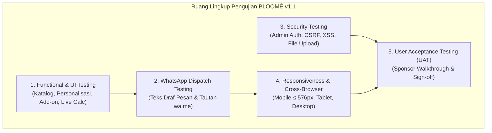

# MASTER SOFTWARE TESTING PLAN & QUALITY ASSURANCE STRATEGY (v1.1)
# BLOOMÉ — Flowers & Stories

## 1. Document Information

- **Nama Dokumen:** Master Software Testing Plan & Quality Assurance Strategy
- **Nama Sistem:** BLOOMÉ — Flowers & Stories
- **Nama Proyek:** Perancangan Sistem Informasi Pemesanan dan Personalisasi Buket Bunga Berbasis Web
- **Lead QA Engineer & Project Manager:** Jayanti Firdasari
- **Backend Developer & Security Tester:** Elsa Futri
- **Frontend Developer & UI/UX Tester:** Riya Monika
- **Project Sponsor & UAT Lead:** Nabila Febriyani
- **Versi Dokumen:** 1.1 (Refined Testing Baseline — Interactive Catalog & WhatsApp Ordering)
- **Tanggal Efektif:** 20 November 2026
- **Status Dokumen:** Approved Baseline

---

## 2. Executive Summary & Testing Objectives

Dokumen **Master Software Testing Plan v1.1** ini menetapkan strategi jaminan mutu perangkat lunak (*Quality Assurance Strategy*), rancangan skenario uji (*test matrix*), klasifikasi cacat (*defect severity*), serta kriteria kelulusan (*exit criteria*) sistem informasi **BLOOMÉ — Flowers & Stories**.

Berdasarkan kesepakatan final proses bisnis:
> **"Website berfungsi sebagai katalog interaktif dan media personalisasi buket bunga, sedangkan proses pemesanan dan transaksi diteruskan secara langsung melalui WhatsApp."**

Tujuan pengujian sistem:
1. **Memvalidasi Alur Personalisasi & Estimasi Harga:** Memastikan seluruh pilihan warna wrapping, pita satin, dan item add-on berfungsi lancar serta kalkulasi estimasi total harga terhitung 100% akurat di browser sebelum dialihkan ke WhatsApp.
2. **Memvalidasi Integrasi Tautan WhatsApp:** Memastikan tombol "Pesan via WhatsApp" berhasil menyusun draf pesan terstruktur rapi dan membuka tautan URL resmi toko (`https://wa.me/...`) tanpa eror.
3. **Memvalidasi Kemandirian Pengelolaan Admin:** Memastikan pemilik toko dapat melakukan login aman dan mengelola produk, foto, kategori, variasi warna, item add-on, dan nomor kontak WhatsApp tanpa kendala.
4. **Memvalidasi Keamanan & Keandalan:** Memastikan rute admin terproteksi dari akses ilegal, formulir terlindungi CSRF, input teks bebas dari celah XSS, dan berkas unggahan gambar divalidasi ketat.
5. **Memvalidasi Pengalaman Pengguna Mobile & UAT:** Memastikan tampilan web responsif optimal pada smartphone dan memperoleh persetujuan resmi (*UAT Sign-off*) dari sponsor Nabila Febriyani.

---

## 3. Ruang Lingkup Pengujian (Testing Scope)

### 3.1 Item yang Diuji (In-Scope)
- **Katalog & Filter Kategori:** Penelusuran produk buket, penyaringan kategori dinamis, dan penanda lencana ketersediaan stok (*Tersedia / Habis*).
- **Konfigurator Personalisasi & Add-on:** Pemilihan warna wrapping, jenis pita, penambahan kartu ucapan, boneka, lampu LED, topper akrilik, dan kolom catatan instruksi khusus.
- **Kalkulasi Estimasi Harga (Client-Side JS):** Perhitungan dinamis penambahan biaya variasi dan add-on ke harga dasar buket.
- **Generator Draf Pesan WhatsApp:** Penyusunan template teks otomatis terstruktur dan pemicuan tautan URL Scheme `https://wa.me/<nomor>?text=...`.
- **Tombol Konsultasi Buket Custom:** Pengujian tombol CTA menuju percakapan chat WhatsApp toko untuk pesanan desain bebas.
- **Panel Dashboard Admin:** Login/logout aman admin tunggal, ringkasan data etalase, CRUD kategori, CRUD produk dan ketersediaan stok, galeri multi-foto, CRUD variasi personalisasi, CRUD add-on, dan pembaruan nomor WhatsApp bisnis.
- **Keamanan Siber:** Proteksi middleware rute admin, validasi token CSRF pada formulir, sanitasi input XSS, dan validasi format serta ukuran berkas foto di sisi server.
- **Responsivitas & Kompatibilitas:** Uji tampilan mobile smartphone (360px–414px), tablet (768px), desktop (1280px+), dan cross-browser (Chrome, Edge, Firefox, Safari).

### 3.2 Item yang Tidak Diuji (Out-of-Scope dari Sistem Web)
- Pengujian modul transaksi checkout web dan penyimpanan transaksi ke database web (proses transaksi dilakukan di WhatsApp).
- Pengujian payment gateway otomatis (pembayaran dilakukan manual via transfer bank/e-wallet melalui komunikasi WhatsApp).
- Pengujian formulir upload bukti transfer pembayaran di website (bukti bayar dikirim via chat WhatsApp).
- Pengujian siklus transisi 8 status pesanan (ST-01 s/d ST-08) di website (dieliminasi dari web).
- Pengujian registrasi dan login akun pelanggan.

---

## 4. Tingkatan & Metode Pengujian (Testing Levels)

| Tingkat Pengujian | Metode & Pendekatan | Fokus Pengujian Utama | Penanggung Jawab |
|---|---|---|---|
| **Level 1: Client Interactivity Testing** | Manual & Browser DevTools | Interaksi swatch warna personalisasi, checkbox add-on, dan kalkulasi dinamis total estimasi harga di browser. | Riya Monika |
| **Level 2: WhatsApp URL Verification** | Manual End-to-End | Verifikasi format teks pesan ter-encode URL pada berbagai variasi pesanan dan kelancaran membuka WhatsApp. | Jayanti Firdasari |
| **Level 3: Feature & HTTP Testing** | Laravel Feature Test | Request-response HTTP controller admin, validasi Form Request, otentikasi admin, dan operasi CRUD Eloquent MySQL. | Elsa Futri |
| **Level 4: Security Penetration Test** | Manual Pentesting | Percobaan bypass akses rute admin tanpa login, ketiadaan token CSRF, payload XSS, dan unggah berkas terlarang (.php/.exe). | Elsa Futri |
| **Level 5: UI/UX & Responsive Audit** | Multi-Device Emulation | Uji konsistensi palet warna, tipografi, breakpoint smartphone, tata letak sticky summary card, dan cross-browser. | Riya Monika |
| **Level 6: User Acceptance Testing (UAT)** | Skenario Nyata Terpandu | Pengujian menyeluruh oleh Sponsor Nabila Febriyani dari sudut pandang pembeli buket dan pengelola admin. | Jayanti & Nabila |

---

## 5. Matriks Kasus Uji Utama (Master Test Scenarios Matrix)

### 5.1 Kasus Uji Pelanggan Publik (Customer Web & WhatsApp)
| Test ID | Skenario Pengujian | Langkah Pengujian | Hasil yang Diharapkan | Prioritas |
|---|---|---|---|:---:|
| **TC-CUST-01** | Akses Beranda & Katalog Tanpa Login | Buka URL `/` dan `/catalog` pada mode penyamaran (*incognito*). | Halaman tampil sempurna dengan foto buket, harga dasar, dan navigasi tanpa hambatan login. | P0 |
| **TC-CUST-02** | Filter Kategori Katalog | Klik tombol filter kategori "Buket Uang" pada etalase katalog. | Hanya produk dengan kategori buket uang yang tampil pada grid. | P0 |
| **TC-CUST-03** | Indikator Produk Stok Habis | Buka halaman produk yang ditandai `is_available = 0`. | Tampil badge "Habis / Slot Penuh" dan tombol "Pesan via WhatsApp" nonaktif (*disabled*). | P0 |
| **TC-CUST-04** | Pemilihan Opsi Personalisasi | Di halaman detail produk, klik swatch warna wrapping "Blush Pink" dan pita "Champagne". | Swatch warna menampilkan cincin penanda aktif dan nama variasi tercantum pada ringkasan. | P0 |
| **TC-CUST-05** | Pemilihan Add-on & Live Price Update | Centang add-on "Kartu Ucapan Cetak (+Rp 10.000)" dan "Boneka Wisuda (+Rp 35.000)". | Estimasi total harga otomatis bertambah Rp 45.000 secara *real-time* di kartu ringkasan. | P0 |
| **TC-CUST-06** | Input Catatan Ucapan Khusus | Ketik teks ucapan pada kolom textarea: *"Happy Graduation, Sarah!"*. | Teks ucapan tersimpan pada state klien dan siap disematkan ke pesan WhatsApp. | P1 |
| **TC-CUST-07** | Eksekusi Tombol "Pesan via WhatsApp" | Klik tombol CTA "Pesan via WhatsApp" setelah mengonfigurasi buket. | Browser membuka URL `https://wa.me/...` dengan teks terisi lengkap memuat produk, warna, add-on, catatan, dan estimasi total. | P0 |
| **TC-CUST-08** | CTA Konsultasi Buket Custom | Buka halaman Custom Bouquet dan klik "Konsultasi Desain Custom via WhatsApp". | WhatsApp terbuka dengan template pesan pembuka konsultasi desain buket custom. | P0 |

---

### 5.2 Kasus Uji Panel Admin (Admin Management)
| Test ID | Skenario Pengujian | Langkah Pengujian | Hasil yang Diharapkan | Prioritas |
|---|---|---|---|:---:|
| **TC-ADM-01** | Login Kredensial Sah | Masukkan email dan password admin Nabila yang benar pada `/admin/login`. | Berhasil masuk dan dialihkan ke `/admin/dashboard`. | P0 |
| **TC-ADM-02** | Login Password Salah | Masukkan password salah pada formulir login. | Akses ditolak, muncul notifikasi error kredensial. | P0 |
| **TC-ADM-03** | Tambah Produk Buket Baru | Input data buket baru, harga dasar, kategori, deskripsi, dan upload foto utama. | Data tersimpan di MySQL dan buket langsung tampil di katalog publik. | P0 |
| **TC-ADM-04** | Toggle Ketersediaan Stok Buket | Klik tombol ubah status stok pada salah satu produk dari *Tersedia* menjadi *Habis*. | Status langsung terupdate dan katalog publik menampilkan badge "Habis". | P0 |
| **TC-ADM-05** | Upload Galeri Multi-Foto | Masuk ke menu galeri produk, pilih 3 file foto buket tambahan, klik upload. | Ketiga foto tersimpan di storage lokal dan tampil pada slider halaman detail produk. | P1 |
| **TC-ADM-06** | Tambah Variasi Personalisasi | Buat opsi variasi baru (misal: "Warna Pita Satin") dan tambahkan nilai ("Burgundy", "Sage Green"). | Opsi variasi langsung muncul sebagai pilihan di halaman detail buket terkait. | P0 |
| **TC-ADM-07** | Tambah Item Add-on & Harga | Buat item add-on baru "Lampu LED Fairy Lights" dengan harga Rp 20.000. | Add-on muncul di antarmuka pemilih dan penambahan biayanya terintegrasi dengan kalkulator harga. | P0 |
| **TC-ADM-08** | Ubah Nomor WhatsApp Toko | Buka menu Pengaturan Bisnis, ganti nomor WhatsApp toko dengan nomor baru, simpan. | Tautan tombol "Pesan via WhatsApp" di seluruh katalog langsung mengarah ke nomor baru. | P0 |

---

### 5.3 Kasus Uji Keamanan Siber (Security Penetration Tests)
| Test ID | Vektor Pengujian | Prosedur Uji | Hasil yang Diharapkan |
|---|---|---|---|
| **TC-SEC-01** | Bypass Rute Admin Tanpa Sesi | Akses langsung URL `/admin/dashboard` atau `/admin/products` tanpa login. | Permintaan diblokir middleware `auth:admin`, dialihkan ke `/admin/login`. |
| **TC-SEC-02** | Proteksi CSRF Formulir Admin | Kirim request POST ke endpoint admin tanpa menyertakan token `@csrf`. | Server melempar respon HTTP 419 (*Page Expired / Token Mismatch*). |
| **TC-SEC-03** | Sanitasi Cross-Site Scripting (XSS) | Masukkan tag `` pada input nama produk atau deskripsi. | Tag di-escape aman oleh Blade `{{ }}` menjadi karakter HTML entitas biasa. |
| **TC-SEC-04** | Upload Berkas Ekstensi Terlarang | Coba unggah file `exploit.php` atau `virus.exe` pada form upload foto produk. | Sistem menolak berkas dengan pesan validasi *"Format berkas wajib JPG, PNG, atau WebP"*. |
| **TC-SEC-05** | Upload Berkas Melebihi Batas Ukuran | Unggah berkas gambar berukuran 10 MB (melebihi batas kuota). | Berkas ditolak server dengan pesan error batasan ukuran berkas. |

---

## 6. Klasifikasi Tingkat Keparahan Cacat (*Defect Severity Matrix*)

| Tingkat Keparahan | Definisi & Dampak | Batas Penanganan | Toleransi Rilis |
|---|---|---|:---:|
| **P0 — Blocker / Critical** | Kerusakan fatal: Tautan WhatsApp gagal terbuka, kalkulasi harga salah, rute admin bocor tanpa login, gagal simpan produk. | Maksimal 12 jam | **0 Toleransi (Wajib 100% Selesai)** |
| **P1 — Major** | Kerusakan fungsi penting: Filter kategori tidak merespon, swatch warna tidak berubah saat diklik, galeri foto gagal memuat. | Maksimal 24 jam | Wajib diperbaiki sebelum sesi UAT |
| **P2 — Minor** | Kendala minor: Keterangan deskripsi terpotong di mobile, animasi transisi tombol sedikit tersendat. | 2-3 hari kerja | Dapat diperbaiki pada sprint stabilisasi |
| **P3 — Cosmetic** | Ketidaksesuaian tampilan visual non-fungsional: Margin/padding selisih beberapa piksel, perbaikan penulisan kata (*typo*). | Fleksibel | Tidak menghalangi rilis v1.1 |

---

## 7. Protokol User Acceptance Testing (UAT) Bersama Sponsor

Sesi UAT dijadwalkan pada **27 – 28 November 2026** di Samarinda bersama pemilik usaha Nabila Febriyani dengan panduan langkah:

1. **Pengujian Sudut Pandang Pelanggan (via Smartphone):**
   - Sponsor membuka website BLOOMÉ di browser ponsel.
   - Sponsor menjelajahi katalog dan memfilter kategori buket bunga.
   - Sponsor memilih buket mawar, memilih warna kertas wrapping dan warna pita satin.
   - Sponsor mencentang add-on kartu ucapan dan menuliskan pesan ucapan khusus.
   - Sponsor memeriksa ringkasan pesanan dan menekan tombol **"Pesan via WhatsApp"**.
   - Sponsor memverifikasi bahwa aplikasi WhatsApp di ponselnya otomatis terbuka dan draf pesan memuat rincian buket secara rapi dan akurat.
2. **Pengujian Sudut Pandang Pengelola (via Laptop):**
   - Sponsor membuka halaman login admin dan masuk menggunakan kredensial miliknya.
   - Sponsor mencoba menambahkan satu produk buket baru dan mengunggah fotonya.
   - Sponsor mencoba mengubah ketersediaan produk buket dari *Tersedia* menjadi *Habis*.
   - Sponsor mencoba mengubah nomor WhatsApp toko di menu pengaturan dan memastikan nomor tujuan pemesanan di web langsung terbarui.
3. **Penandatanganan Berita Acara UAT:**
   - Setelah seluruh skenario berhasil dilalui tanpa kendala, sponsor menandatangani Berita Acara Penerimaan Sistem.

---

## 8. Parameter Menunggu Konfirmasi Pengujian (`[Perlu Konfirmasi Owner]`)

Hal-hal yang membutuhkan data resmi dari pemilik toko sebelum pengujian akhir:
1. Nomor WhatsApp resmi toko untuk pengujian tautan pemesanan live.
2. Batas ukuran maksimal berkas unggahan foto produk admin (2 MB atau 5 MB).
3. Daftar produk riil dan struktur harga definitif untuk pengujian seeder data katalog.

---

## 9. Kesimpulan & Pengesahan

Master Software Testing Plan v1.1 ini telah disesuaikan secara konsisten untuk menguji arsitektur katalog interaktif, konfigurator personalisasi, estimasi harga dinamis, dan pemesanan WhatsApp, memastikan mutu sistem siap diluncurkan sebelum tenggat waktu 30 November 2026.

**Disahkan Oleh:**  
**Jayanti Firdasari** (Lead QA Engineer & Project Manager)  
**Elsa Futri** (Backend Developer & Security Lead)  
**Riya Monika** (Frontend Developer & UI/UX Lead)  
**Nabila Febriyani** (Project Sponsor / Owner)  
Tanggal: 20 November 2026
