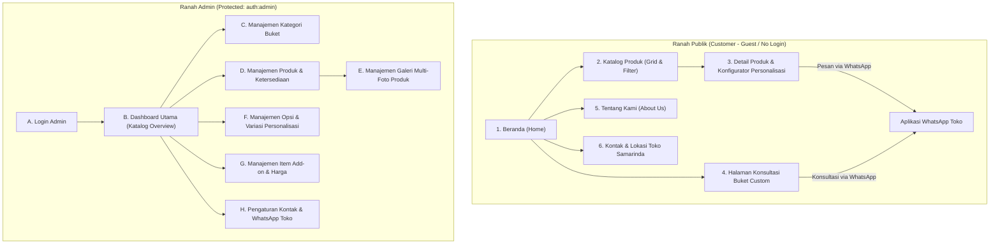
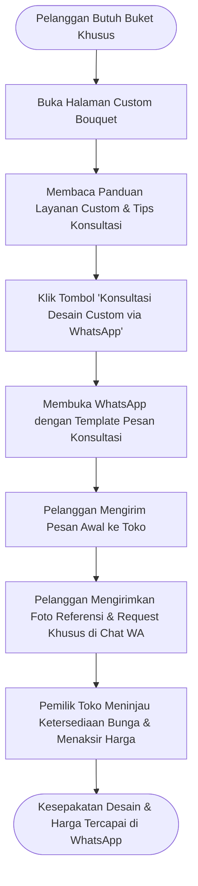
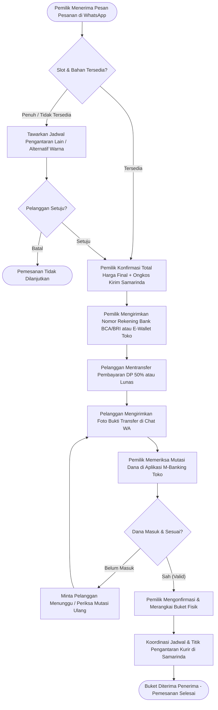
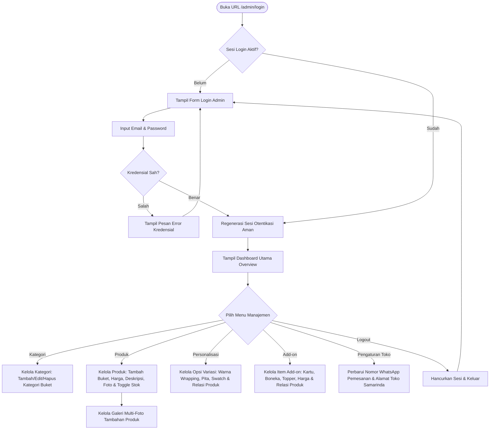

# USER FLOW & NAVIGATION ARCHITECTURE SPECIFICATION (v1.1)
# BLOOMÉ — Flowers & Stories

## 1. Document Information

- **Nama Dokumen:** User Flow & Navigation Architecture Specification
- **Nama Produk:** BLOOMÉ — Flowers & Stories
- **Nama Proyek:** Perancangan Sistem Informasi Pemesanan dan Personalisasi Buket Bunga Berbasis Web
- **Lead UI/UX Designer & Frontend Developer:** Riya Monika
- **Lead System Analyst & Project Manager:** Jayanti Firdasari
- **Backend Developer & Database Administrator:** Elsa Futri
- **Project Sponsor / Owner:** Nabila Febriyani
- **Lokasi Usaha:** Jalan Cipto Mangunkusumo, Simpang Tiga, Loa Janan Ilir, Samarinda
- **Versi Dokumen:** 1.1 (Refined Flow Baseline — Interactive Catalog & Personalization with WhatsApp Ordering)
- **Tanggal Efektif:** 20 November 2026
- **Status Dokumen:** Approved Baseline

---

## 2. Overview & Navigation Objectives

Dokumen **User Flow & Navigation Architecture v1.1** ini mendefinisikan struktur informasi, alur navigasi pengguna (*user interaction journeys*), logika percabangan, serta penanganan kondisi khusus (*edge cases*) pada sistem informasi **BLOOMÉ — Flowers & Stories**.

Berdasarkan kesepakatan terbaru proses bisnis, alur pemesanan difokuskan pada:
1. **Seamless Catalog Browsing:** Pengunjung dapat mengeksplorasi etalase digital buket secara leluasa sebagai pengguna tamu (*guest*) tanpa kewajiban registrasi akun.
2. **Interactive Personalization & Real-Time Estimation:** Pengunjung dapat mengonfigurasikan pilihan warna kertas wrapping, pita satin, memilih item add-on (kartu ucapan, boneka, topper, lampu LED), menuliskan catatan khusus, dan memantau estimasi total biaya secara interaktif di halaman detail produk.
3. **Automated WhatsApp Order Dispatch:** Seluruh rincian buket dan personalisasi dikompilasi secara otomatis ke dalam format teks terstruktur yang langsung mengarahkan pelanggan ke obrolan WhatsApp resmi toko (`https://wa.me/...`).
4. **Off-Web Transaction & Delivery Coordination:** Seluruh kesepakatan jadwal pengerjaan, konfirmasi harga final, pembayaran DP 50%, verifikasi bukti transfer, dan jadwal pengantaran di Samarinda berlangsung melalui WhatsApp.
5. **Admin Content Autonomy:** Pemilik usaha dapat secara mandiri mengelola etalase buket, variasi warna, item add-on, ketersediaan stok, dan kontak WhatsApp toko melalui panel dashboard admin yang aman.

---

## 3. Sitemap & Information Architecture

Struktur hierarki halaman sistem dibagi menjadi Ranah Publik dan Ranah Admin:



---

## 4. User Flow 1: Eksplorasi Katalog, Personalisasi Buket, dan Pemesanan WhatsApp

Alur utama interaksi pelanggan dalam memilih produk buket, memodifikasi preferensi personalisasi, dan mengalihkan pesanan ke WhatsApp:

```mermaid
flowchart TD
    Start([Pelanggan Mengakses Website]) --> Home[Buka Beranda BLOOMÉ]
    Home --> BrowseCat[Buka Menu Katalog Produk]
    BrowseCat --> FilterCat{Gunakan Filter Kategori?}
    FilterCat -- Ya --> FilteredView[Tampilkan Buket Kategori Terpilih]
    FilterCat -- Tidak --> AllView[Tampilkan Semua Koleksi Buket]
    FilteredView --> SelectProduct[Pilih Kartu Produk Buket]
    AllView --> SelectProduct
    SelectProduct --> ViewDetail[Buka Halaman Detail Produk]
    
    ViewDetail --> CheckAvail{Status Ketersediaan?}
    CheckAvail -- Habis / Slot Penuh --> DisabledOrder[Badge 'Stok Habis' & Tombol Pesan Dinonaktifkan]
    CheckAvail -- Tersedia --> ConfigOptions[Pilih Variasi Personalisasi: Warna Wrapping, Warna Pita]
    
    ConfigOptions --> SelectAddOns[Pilih Item Add-on: Kartu Ucapan, Boneka Wisuda, Lampu LED, Topper]
    SelectAddOns --> FillNotes[Tulis Catatan Khusus / Pesan Kartu Ucapan]
    FillNotes --> LiveCalc[Sistem Menghitung Ulang Estimasi Total Biaya di Browser]
    LiveCalc --> ReviewSummary[Pelanggan Memeriksa Kartu Ringkasan Pilihan & Estimasi Total]
    
    ReviewSummary --> ClickWA[Klik Tombol 'Pesan via WhatsApp']
    ClickWA --> CompileMsg[Sistem Menyusun Draf Pesan & Melakukan URL Encoding]
    CompileMsg --> RedirectWA[Browser Membuka URL: https://wa.me/{no_wa}?text={encoded_text}]
    RedirectWA --> OpenApp[Aplikasi WhatsApp Terbuka di Perangkat Pelanggan]
    OpenApp --> SendManual[Pelanggan Menekan Tombol Kirim Pesan Manual]
    SendManual --> ChatDone([Rincian Pesanan Masuk ke Chat WhatsApp Pemilik Toko])
```

### Rincian Interaksi Alur Katalog & Personalisasi:
1. **Layar Antarmuka:** `resources/views/catalog/show.blade.php`.
2. **Dinamika JavaScript:** Setiap kali pelanggan memilih nilai opsi personalisasi (radio button / swatch warna) atau mencentang add-on (checkbox), script `personalization.js` menjumlahkan harga dasar produk dengan biaya tambahan dan memperbarui label estimasi harga secara instan tanpa reload halaman.
3. **Penyusunan Teks Pesan WhatsApp:** Tombol memicu fungsi perakit URL yang mengambil teks produk, rincian variasi warna yang dipilih, rincian add-on, catatan ucapan, dan nominal estimasi harga menjadi teks rapi.
4. **Batas Proses Web:** Web tidak mencatat baris transaksi pesanan di database. Pelanggan tetap memegang kendali penuh untuk menekan tombol kirim di WhatsApp.

---

## 5. User Flow 2: Konsultasi Pemesanan Buket Custom via WhatsApp

Alur konsultasi buket khusus (*custom bouquet*) yang dirangkai sesuai bujet dan foto referensi unik pelanggan di luar etalase katalog:



---

## 6. User Flow 3: Alur Transaksi, Pembayaran, dan Pengantaran (Off-Web Process)

Alur kelanjutan transaksi setelah pesan pemesanan diterima oleh pemilik toko di WhatsApp:



---

## 7. User Flow 4: Pengelolaan Konten & Katalog oleh Administrator

Rutinitas pemilik toko dalam mengelola etalase digital melalui dashboard web:



---

## 8. Penanganan Kasus Batas (*Edge Cases & Exception Flows*)

| Skenario Kasus Batas | Jalur Alternatif & Penanganan Sistem |
|---|---|
| **Aplikasi WhatsApp Tidak Terpasang pada Perangkat** | Tautan menggunakan skema `https://wa.me/...` yang secara otomatis dialihkan ke WhatsApp Web jika diakses via browser desktop, atau meminta konfirmasi instalasi aplikasi pada perangkat mobile. Sistem juga menampilkan tombol salin teks pesan (*copy to clipboard*) sebagai cadangan darurat. |
| **Produk Buket Berstatus Habis (*Out of Stock*)** | Di halaman katalog dan detail produk, kartu ditandai dengan badge "Habis / Slot Penuh". Tombol "Pesan via WhatsApp" dinonaktifkan (*disabled*) dan digantikan dengan tombol alternatif "Tanyakan Ketersediaan Bahan via WhatsApp". |
| **Pelanggan Tidak Memilih Variasi Wajib (*Required Option*)** | Validasi sisi klien pada form personalisasi menampilkan penanda peringatan merah pada opsi wajib (misal: Warna Kertas Wrapping) sebelum tautan WhatsApp dapat dibuat. |
| **Nomor WhatsApp Toko Belum Dikonfigurasi Admin** | Sistem menyediakan nilai fallback default nomor toko dari file `.env` sistem agar tombol pemesanan tidak pernah rusak (*broken link*). |
| **Unggahan Foto Produk Melebihi Batas Ukuran** | Form Request di dashboard admin memvalidasi ukuran berkas maksimal **[Perlu Konfirmasi Owner]** (standar: 5 MB) dan format gambar (JPG/PNG/WebP), serta menampilkan pesan error spesifik jika tidak memenuhi syarat. |
| **Sesi Login Admin Kedaluwarsa** | Middleware `auth:admin` mengarahkan admin kembali ke formulir login dengan pesan: *"Sesi telah berakhir, silakan masuk kembali."* |

---

## 9. Kesimpulan & Pengesahan

Spesifikasi alur pengguna (*User Flow*) v1.1 ini telah diselaraskan 100% dengan konsep katalog interaktif dan pemesanan WhatsApp, mengeliminasi seluruh alur checkout web dan transisi status internal yang tidak relevan.

**Disahkan Oleh:**  
**Riya Monika** (UI/UX Designer & Frontend Developer)  
**Jayanti Firdasari** (Project Manager & System Analyst)  
Tanggal: 20 November 2026
